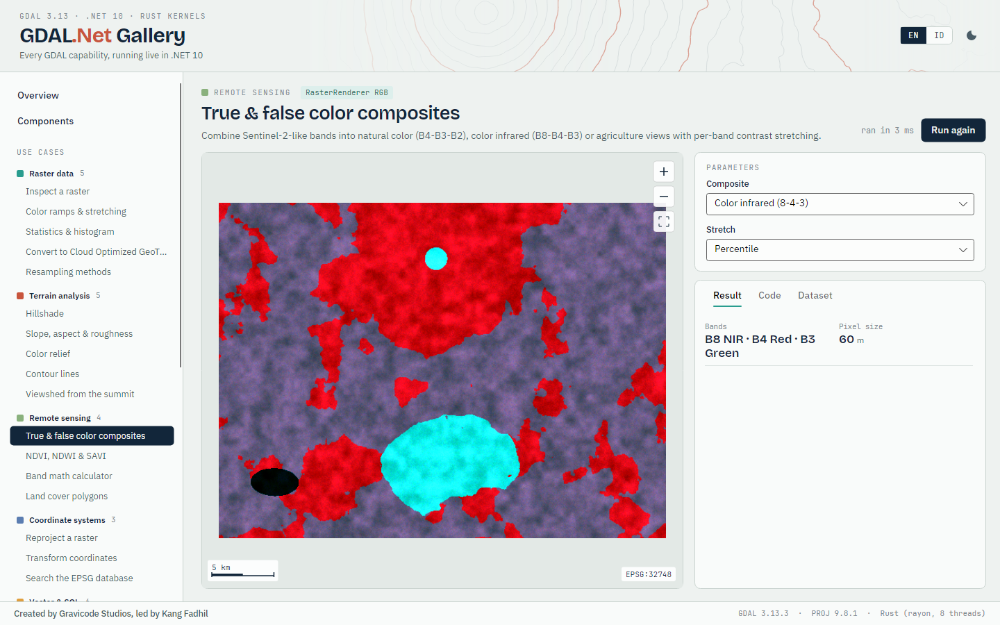

# Avalonia controls

`Gravicode.GDAL.Net.Avalonia` provides desktop controls for Windows, macOS and Linux. Each control is drawn natively, and rasters are rendered on a background thread.



## Install and set up

```bash
dotnet add package Gravicode.GDAL.Net.Avalonia
```

```xml
<!-- App.axaml -->
<Application.Styles>
  <FluentTheme />
  <StyleInclude Source="avares://GDAL.Net.Avalonia/Themes/GdalNetTheme.axaml" />
</Application.Styles>
```

The theme follows light and dark mode and includes the DataGrid Fluent theme. You can override its colours with these resources:
- `GdalNet.MapBackground`
- `GdalNet.Ink`
- `GdalNet.InkMuted`
- `GdalNet.Panel`
- `GdalNet.Rule`
- `GdalNet.Accent`

> Avalonia also has a `RenderOptions` type. Qualify GDAL's as `GDAL.Net.Rendering.RenderOptions`, or add an alias: `using GdalRenderOptions = GDAL.Net.Rendering.RenderOptions;`.

## Controls

| Control | Purpose | Key members |
|---|---|---|
| `GdalMapView` | Raster + vector map, smooth pan/zoom | `Rasters` (`MapRasterLayer`), `Vectors` (`StyledVector`), `Extent`, `CrsLabel`, `MapBackground`, `Accent`, `ShowControls`, `ShowScaleBar`, `ShowCoordinates`, `HighlightSelection`, `IsRendering`; events `FeatureClicked`, `ViewChanged`, `PointerCoordinateChanged`; methods `ZoomToFit()`, `ZoomBy()`, `ZoomTo(Envelope)` |
| `GdalAttributeGrid` | DataGrid over features or tables | `Data` (`VectorData`) **or** `Columns` + `Rows`, `MaxRows`, `FeatureSelected`, `Grid` |
| `GdalHistogramChart` | Custom-drawn histogram | `Histogram`, `Ramp`, `RampMin`, `RampMax`, `Title`, `LogScale` |
| `GdalColorLegend` | Ramp legend | `Ramp`, `Minimum`, `Maximum`, `Unit`, `Title`, `Orientation`, `Ticks` |
| `GdalDatasetInfoPanel` | Dataset inspector | `Dataset`, `ShowMetadata` |
| `GdalSrsExplorer` | EPSG search, WKT2/WKT1/PROJJSON/PROJ/ESRI, lon/lat transform | query, selected CRS, mono font |

### GdalMapView

```xml
<Window xmlns:gdal="using:GDAL.Net.Avalonia" ...>
  <gdal:GdalMapView x:Name="Map" CrsLabel="EPSG:32748" />
</Window>
```

```csharp
using GDAL.Net;
using GDAL.Net.Avalonia;
using GDAL.Net.Rendering;
using GdalRenderOptions = GDAL.Net.Rendering.RenderOptions;

var dem = Gdal.OpenRaster("dem.tif");
Map.Rasters = [new MapRasterLayer(dem, new GdalRenderOptions { Ramp = ColorRamp.Terrain, Hillshade = true }, "DEM")];

using var contours = RasterAlgorithms.GenerateContours(dem.GetBand(1), interval: 100);
Map.Vectors = [new StyledVector(VectorData.Load(contours.GetLayer(0)), VectorStyle.Lines(new Rgba(200, 85, 61)), "Contours")];

Map.FeatureClicked += (_, e) => Title = $"{e.Feature["elev"]} m";
```

Interaction:
- **Mouse:** the wheel zooms at the cursor, dragging pans and a double-click fits the view.
- **Keyboard:** `+`, `-`, arrow keys and `Home` (fit).

Rendering is debounced and cancellable. During a gesture the previous frame is transformed, so panning stays smooth.

### Thread safety: `GdalUiSync.Lock`

GDAL datasets are not thread-safe, and the map reads them on a background thread. Any of your own code that touches or disposes a dataset currently shown in a map must take the shared lock:

```csharp
lock (GdalUiSync.Lock)
{
    Map.Rasters = null;
    dem.Dispose();
}
```

## Limitations

- Only north-up rasters are displayed. Warp rotated rasters first.
- All maps share one render lock, so several maps render one after another.
- The DataGrid shows string cells, so numeric columns sort as text.

## Next

- [Blazor components](blazor.md)
- [Gallery](gallery.md)
- [Rendering](rendering.md)
