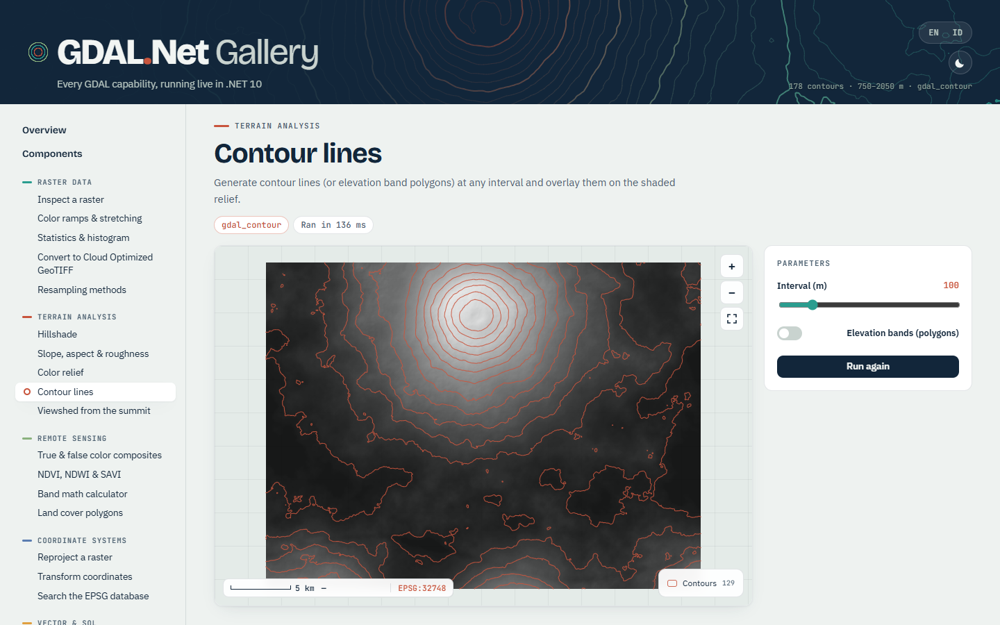

# Blazor components

`Gravicode.GDAL.Net.Blazor` provides Razor components that render GDAL data in Blazor Web Apps.

GDAL is native code, so the components run with **Interactive Server** rendering. Rasters are rendered on the server through `RasterRenderer` and sent as PNG images. Vectors are drawn as SVG in the browser.



## Install and set up

```bash
dotnet add package Gravicode.GDAL.Net.Blazor
```

```razor
@* _Imports.razor *@
@using GDAL.Net
@using GDAL.Net.Rendering
@using GDAL.Net.Blazor
```

```csharp
// Program.cs
builder.Services.AddRazorComponents().AddInteractiveServerComponents()
    .AddHubOptions(o => o.MaximumReceiveMessageSize = 1024 * 1024);   // PNG frames of large maps
app.MapRazorComponents<App>().AddInteractiveServerRenderMode();
```

Static assets are served from `_content/Gravicode.GDAL.Net.Blazor/` (the map's JS module), and Blazor loads them automatically.

The components are themed with CSS variables (`--gdal-*`), which you can override in your own stylesheet.

## Components

| Component | Purpose | Key parameters |
|---|---|---|
| `GdalMap` | Pan/zoom map for rasters and vectors | `Rasters` (`MapRaster(Dataset, RenderOptions, Title)`), `Vectors` (`StyledVector`), `Extent`, `ViewKey`, `CrsLabel`, `Geographic`, `Overscan`, `ShowControls`, `OnFeatureClick`, `OnClick`, `OnRendered`, `Class`, `Style` |
| `GdalAttributeTable` | Sortable, paged table | `Data` (`VectorData`) **or** `Columns` + `Rows`, `PageSize`, `Caption`, `EmptyText` |
| `GdalHistogram` | SVG histogram | `Histogram`, `Ramp`, `Title`, `Unit`, `Log`, `Width`, `Height` |
| `GdalColorLegend` | Ramp gradient with labels | `Ramp`, `Min`, `Max`, `Unit`, `Title`, `ShowMidpoint` |
| `GdalDatasetInfo` | Driver, size, bands, CRS, geotransform, metadata | `Dataset`, `ShowMetadata` |
| `GdalSrsExplorer` | EPSG search, WKT2/PROJJSON/PROJ/ESRI, point transform | `InitialCrs`, `Authority`, `MaxResults`, `Lon`, `Lat`, `OnSelected` |
| `GdalProgressBar` | Progress of long operations | `Value` (0..1), `Indeterminate`, `Label` |

### GdalMap

```razor
@page "/terrain"
@rendermode InteractiveServer
@implements IDisposable

<GdalMap Rasters="rasters" Vectors="vectors" CrsLabel="EPSG:32748" Style="height:600px"
         OnFeatureClick="OnClick" />

<p>@status</p>

@code {
    Dataset? dem;
    IReadOnlyList<MapRaster> rasters = [];
    List<StyledVector> vectors = [];
    string status = "";

    protected override void OnInitialized()
    {
        dem = Gdal.OpenRaster("dem.tif");
        rasters = [new MapRaster(dem, new RenderOptions { Ramp = ColorRamp.Terrain, Hillshade = true }, "DEM")];
        using var contours = RasterAlgorithms.GenerateContours(dem.GetBand(1), interval: 100);
        vectors = [new StyledVector(VectorData.Load(contours.GetLayer(0)), VectorStyle.Lines(new Rgba(200, 85, 61)), "Contours")];
    }

    void OnClick(MapFeatureClick click) => status = $"Contour {click.Feature["elev"]} m at {click.X:0}, {click.Y:0}";

    public void Dispose() => dem?.Dispose();
}
```

How the map behaves:
- **Interaction.** Wheel and drag move instantly on the client. When the gesture settles, the server renders the visible extent (plus `Overscan`) at the viewport's pixel size. Overviews make this fast at every zoom level.
- **View reset.** Changing `ViewKey` resets the view to `Extent` (or to the extent of all layers).
- **Styling vectors.** `VectorStyle` can vary fill and point radius per feature (`FillSelector`, `RadiusSelector`) and set a `LabelField`. Labels that would overlap are hidden.
- **Thread safety.** A dataset passed to the map must not be used concurrently by other code.

### Attribute table, histogram and legend

```razor
<GdalAttributeTable Data="cities" PageSize="15" Caption="Cities" />
<GdalHistogram Histogram="@band.GetHistogram(64)" Ramp="ColorRamp.Terrain" Unit="m" />
<GdalColorLegend Ramp="ColorRamp.Ndvi" Min="-1" Max="1" Title="NDVI" />
```

### CRS explorer

```razor
<GdalSrsExplorer InitialCrs="EPSG:32748" Lon="107.6191" Lat="-6.9175" OnSelected="crs => chosen = crs" />
```

## Limitations

- WebAssembly is not supported, because the native GDAL library cannot run in the browser.
- Large viewports cost bandwidth, since every re-render sends a PNG frame over SignalR.
- Tens of thousands of vector features are slow as a single SVG. Simplify them (`VectorData.Load(layer, simplifyTolerance: …)`) or filter them first.

## Next

- [Avalonia controls](avalonia.md)
- [Gallery](gallery.md)
- [Rendering](rendering.md)
