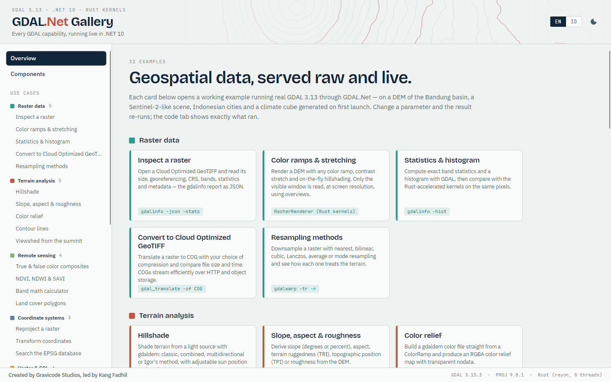
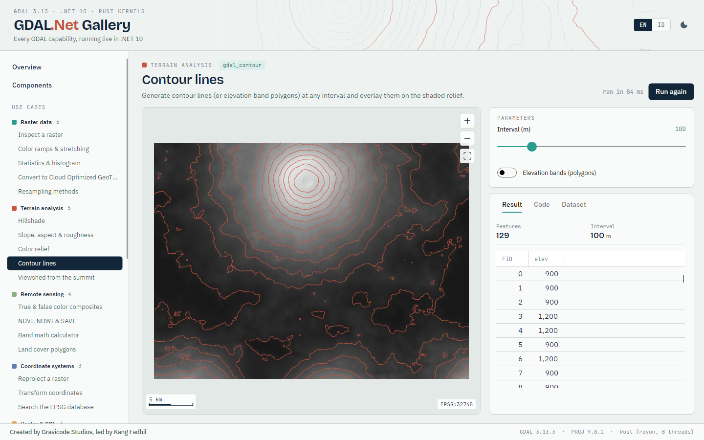
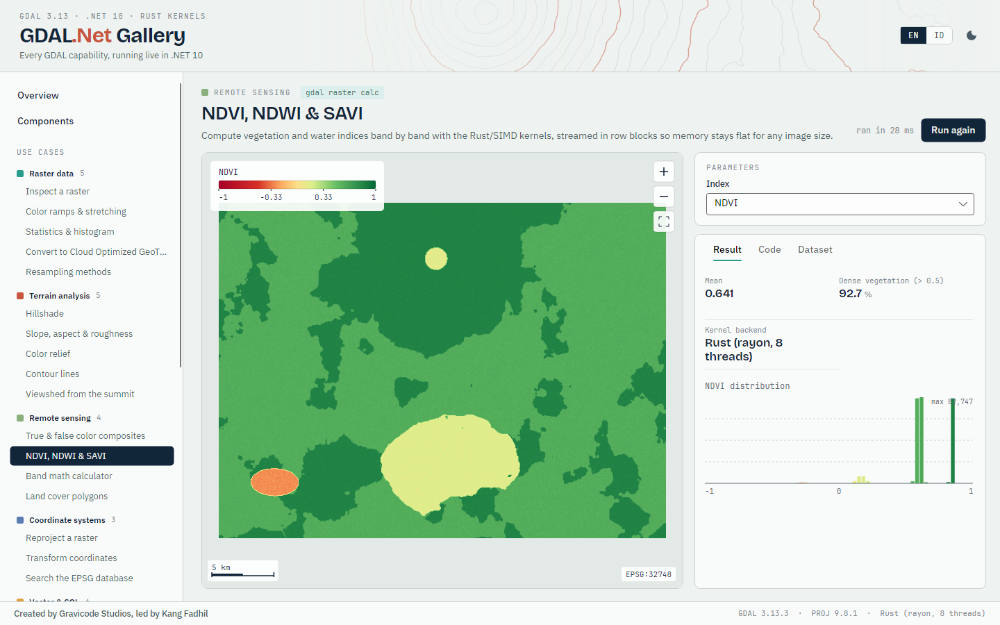
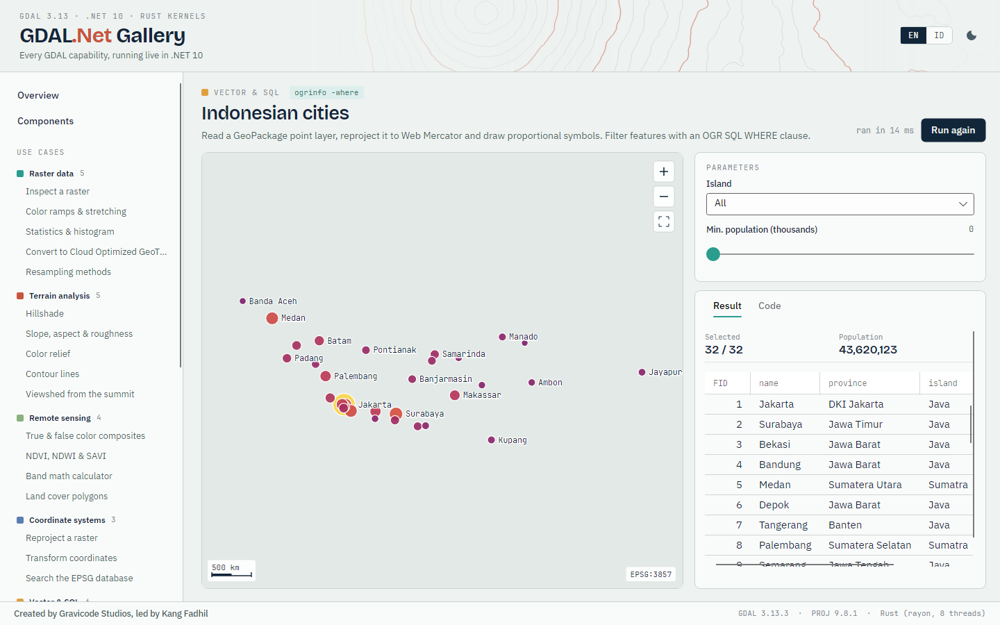
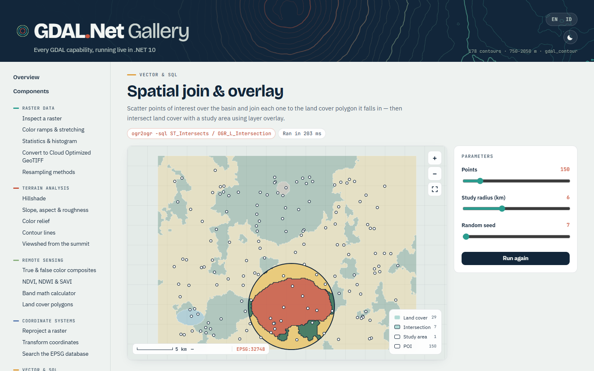
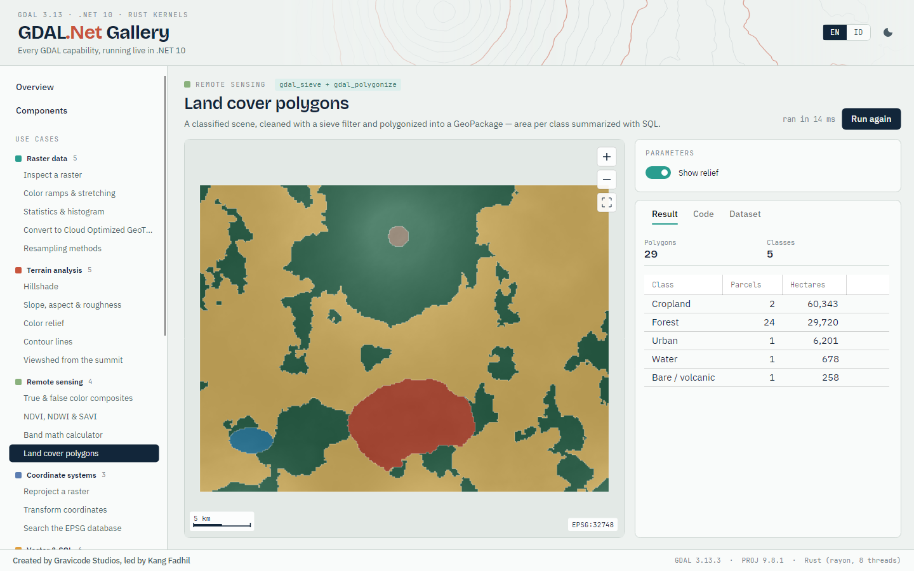
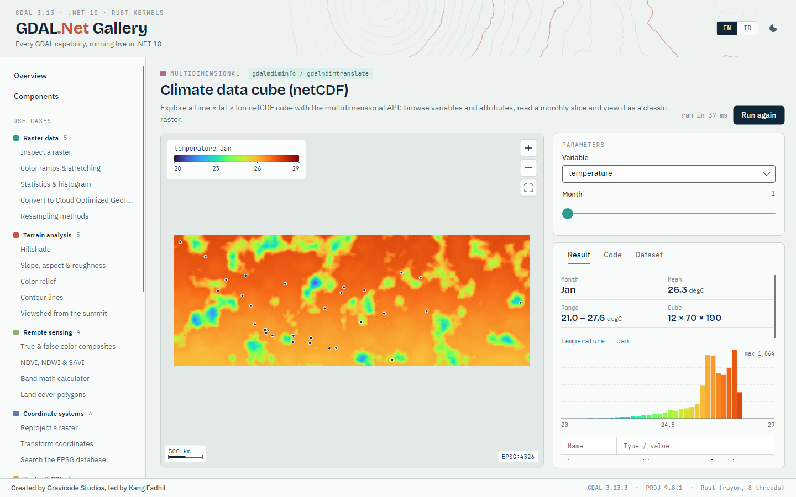
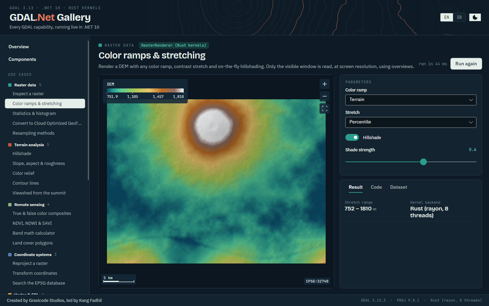

# GDAL.Net Gallery

Two gallery apps, one for the web (Blazor) and one for the desktop (Avalonia), run **the same 32 interactive use cases** from `samples/GDAL.Net.Gallery.Shared`. Every sample runs real GDAL.Net code.

The sample data is generated by GDAL.Net itself on first launch, so nothing is downloaded:
- a DEM of a volcanic basin modelled on Bandung (UTM 48S, 30 m, COG)
- a 4-band Sentinel-2-like scene of the same area
- 32 Indonesian cities (GeoPackage)
- land cover polygons (sieved and polygonized from the classified scene)
- 2×2 DEM tiles
- a monthly temperature and rainfall cube over Indonesia (netCDF)

```bash
dotnet run --project samples/GDAL.Net.Gallery.Blazor      # http://localhost:5280
dotnet run --project samples/GDAL.Net.Gallery.Avalonia
dotnet run --project samples/GDAL.Net.Gallery.Avalonia -- --screenshot docs/images   # regenerate screenshots
```

Each sample page has:
- the map
- a parameter panel (change a value and the sample re-runs)
- a **Result** tab: metrics, legend, histogram, table and text output
- a **Code** tab: the C# that ran, with a copy button

Both apps switch between English and Bahasa Indonesia and have dark mode. Every sample is also covered by the test suite, with default parameters and with every choice option.

| Blazor | Avalonia |
|---|---|
|  |  |
|  |  |
|  |  |
|  |  |
|  |  |
|  |  |
|  |  |
|  |  |
|  |  |

## Samples

### Raster data

| Sample | What it shows | GDAL equivalent |
|---|---|---|
| **Inspect a raster** (`raster-info`) | Open a Cloud Optimized GeoTIFF and read its size, georeferencing, CRS, bands, statistics and metadata — the gdalinfo report as JSON. | `gdalinfo -json -stats` |
| **Color ramps & stretching** (`raster-styling`) | Render a DEM with any color ramp, contrast stretch and on-the-fly hillshading. Only the visible window is read, at screen resolution, using overviews. | `RasterRenderer (Rust kernels)` |
| **Statistics & histogram** (`histogram`) | Compute exact band statistics and a histogram with GDAL, then compare with the Rust-accelerated kernels on the same pixels. | `gdalinfo -hist` |
| **Convert to Cloud Optimized GeoTIFF** (`cog`) | Translate a raster to COG with your choice of compression and compare file size and time. COGs stream efficiently over HTTP and object storage. | `gdal_translate -of COG` |
| **Resampling methods** (`resampling`) | Downsample a raster with nearest, bilinear, cubic, Lanczos, average or mode resampling and see how each one treats the terrain. | `gdalwarp -tr -r` |

### Terrain analysis

| Sample | What it shows | GDAL equivalent |
|---|---|---|
| **Hillshade** (`hillshade`) | Shade terrain from a light source with gdaldem: classic, combined, multidirectional or Igor's method, with adjustable sun position and vertical exaggeration. | `gdaldem hillshade` |
| **Slope, aspect & roughness** (`slope-aspect`) | Derive slope (degrees or percent), aspect, terrain ruggedness (TRI), topographic position (TPI) or roughness from the DEM. | `gdaldem slope / aspect / TRI / TPI / roughness` |
| **Color relief** (`color-relief`) | Build a gdaldem color file straight from a ColorRamp and produce an RGBA color relief map with transparent nodata. | `gdaldem color-relief` |
| **Contour lines** (`contours`) | Generate contour lines (or elevation band polygons) at any interval and overlay them on the shaded relief. | `gdal_contour` |
| **Viewshed from the summit** (`viewshed`) | Which parts of the basin can an observer on the volcano rim see? Viewshed accounts for terrain occlusion and earth curvature. | `gdal_viewshed` |

### Remote sensing

| Sample | What it shows | GDAL equivalent |
|---|---|---|
| **True & false color composites** (`composites`) | Combine Sentinel-2-like bands into natural color (B4-B3-B2), color infrared (B8-B4-B3) or agriculture views with per-band contrast stretching. | `RasterRenderer RGB` |
| **NDVI, NDWI & SAVI** (`ndvi`) | Compute vegetation and water indices band by band with the Rust/SIMD kernels, streamed in row blocks so memory stays flat for any image size. | `gdal raster calc` |
| **Band math calculator** (`band-math`) | Type any expression over named bands (B1…B4, BLUE, GREEN, RED, NIR) with operators, comparisons, conditionals and functions. Evaluated with vectorized TensorPrimitives. | `gdal_calc / gdal raster calc` |
| **Land cover polygons** (`land-cover`) | A classified scene, cleaned with a sieve filter and polygonized into a GeoPackage — area per class summarized with SQL. | `gdal_sieve + gdal_polygonize` |

### Coordinate systems

| Sample | What it shows | GDAL equivalent |
|---|---|---|
| **Reproject a raster** (`reproject-raster`) | Warp the DEM from UTM 48S to geographic WGS 84, Web Mercator or the Indonesian DGN95 datum with any resampling method. | `gdalwarp -t_srs` |
| **Transform coordinates** (`transform-coordinates`) | Convert a longitude/latitude to several CRSs at once (UTM, Web Mercator, DGN95, TM-3) with PROJ, and inspect the CRS as WKT2, PROJJSON or ESRI WKT. | `gdalsrsinfo / cs2cs` |
| **Search the EPSG database** (`crs-search`) | Full-text search over thousands of CRSs in the PROJ database, or list every projected CRS valid at a location. | `projinfo --searchpaths` |

### Vector & SQL

| Sample | What it shows | GDAL equivalent |
|---|---|---|
| **Indonesian cities** (`cities`) | Read a GeoPackage point layer, reproject it to Web Mercator and draw proportional symbols. Filter features with an OGR SQL WHERE clause. | `ogrinfo -where` |
| **SQL engine** (`sql`) | Query vector data with OGR SQL or the SQLite/SpatiaLite dialect: aggregation, ordering, spatial functions and joins — on any format. | `ogrinfo -sql -dialect SQLITE` |
| **Buffer, hull & dissolve** (`geoprocessing`) | GEOS geoprocessing on real distances: buffer Java's big cities in a metric CRS, dissolve overlapping buffers, and wrap everything in a convex hull. | `OGR_G_Buffer / UnaryUnion / ConvexHull` |
| **Spatial join & overlay** (`spatial-join`) | Scatter points of interest over the basin and join each one to the land cover polygon it falls in — then intersect land cover with a study area using layer overlay. | `ogr2ogr -sql ST_Intersects / OGR_L_Intersection` |
| **Convert vector formats** (`convert-vector`) | ogr2ogr in-process: export to GeoJSON, GeoPackage, FlatGeobuf, Shapefile, KML, GML or CSV, reprojecting and filtering on the way. | `ogr2ogr` |
| **Rasterize & grid** (`rasterize`) | Burn land cover polygons into a raster by attribute, or interpolate scattered elevation samples into a surface with gdal_grid (inverse distance, nearest, moving average). | `gdal_rasterize / gdal_grid` |

### Mosaics & clipping

| Sample | What it shows | GDAL equivalent |
|---|---|---|
| **Virtual mosaic (VRT)** (`vrt-mosaic`) | Stitch four DEM tiles into one seamless virtual raster without copying a single pixel, or stack bands from separate files. | `gdalbuildvrt` |
| **Clip by polygon** (`clip`) | Cut the DEM with a cutline — a circle around the city or the urban land cover polygons — and crop the output to the cut extent. | `gdalwarp -cutline -crop_to_cutline` |
| **Georeference with GCPs** (`georeference`) | Take an image without coordinates (like a scanned map), attach ground control points and rectify it with a polynomial or thin plate spline transform. | `gdal_translate -gcp + gdalwarp -tps` |

### Cloud & virtual files

| Sample | What it shows | GDAL equivalent |
|---|---|---|
| **In-memory files & ZIP archives** (`vsi-memory-zip`) | Write datasets into /vsimem/ and straight into a ZIP archive, list the archive and read layers back out of it — no temporary files on disk. | `/vsimem/ + /vsizip/` |
| **Stream a remote COG over HTTP** (`vsicurl`) | Open a Cloud Optimized GeoTIFF directly from a URL with /vsicurl/. Only the header and the blocks/overviews needed for the view are downloaded. The same API works for /vsis3/, /vsiaz/ and /vsigs/. | `/vsicurl/ /vsis3/ /vsiaz/ /vsigs/` |

### Multidimensional

| Sample | What it shows | GDAL equivalent |
|---|---|---|
| **Climate data cube (netCDF)** (`climate-cube`) | Explore a time × lat × lon netCDF cube with the multidimensional API: browse variables and attributes, read a monthly slice and view it as a classic raster. | `gdalmdiminfo / gdalmdimtranslate` |

### Utilities

| Sample | What it shows | GDAL equivalent |
|---|---|---|
| **Run the gdal command line** (`gdal-cli`) | Every algorithm of the unified "gdal" CLI (GDAL 3.11+) runs in-process: raster info, reproject, calc, tile, vector filter, pipelines… | `gdal (unified CLI)` |
| **Formats & drivers** (`drivers`) | List every raster, vector and multidimensional driver compiled into the native GDAL build, with their capabilities and file extensions. | `gdalinfo --formats / ogrinfo --formats` |
| **Web map tiles (XYZ)** (`tiles`) | Cut a raster into Web Mercator XYZ tiles ready for Leaflet, OpenLayers or MapLibre — or serve them on demand from an endpoint. | `gdal2tiles / gdal raster tile` |

## Next

- [Blazor components](blazor.md)
- [Avalonia controls](avalonia.md)
- [Documentation index](index.md)
