# GDAL.Net Gallery

Ada dua aplikasi galeri, web (Blazor) dan desktop (Avalonia). Keduanya menjalankan **32 use case interaktif yang sama** dari `samples/GDAL.Net.Gallery.Shared`, dan setiap sampel menjalankan kode GDAL.Net sungguhan.

Data sampel dibuat oleh GDAL.Net sendiri saat aplikasi pertama kali dijalankan, jadi tidak ada yang perlu diunduh:
- DEM cekungan vulkanik bermodel Bandung (UTM 48S, 30 m, COG)
- citra 4-band mirip Sentinel-2 untuk area yang sama
- 32 kota Indonesia (GeoPackage)
- poligon tutupan lahan (hasil sieve dan polygonize dari citra terklasifikasi)
- tile DEM 2×2
- kubus suhu dan curah hujan bulanan di Indonesia (netCDF)

```bash
dotnet run --project samples/GDAL.Net.Gallery.Blazor      # http://localhost:5280
dotnet run --project samples/GDAL.Net.Gallery.Avalonia
dotnet run --project samples/GDAL.Net.Gallery.Avalonia -- --screenshot docs/images   # buat ulang screenshot
```

Setiap halaman sampel berisi:
- peta
- panel parameter; mengubah nilai akan menjalankan ulang sampel
- tab **Hasil**: metrik, legenda, histogram, tabel, dan output teks
- tab **Kode**: kode C# yang dijalankan, dengan tombol salin

Kedua aplikasi mendukung Bahasa Indonesia/Inggris dan mode gelap. Setiap sampel juga diuji otomatis, baik dengan parameter default maupun dengan setiap opsi pilihan.

| Blazor | Avalonia |
|---|---|
| 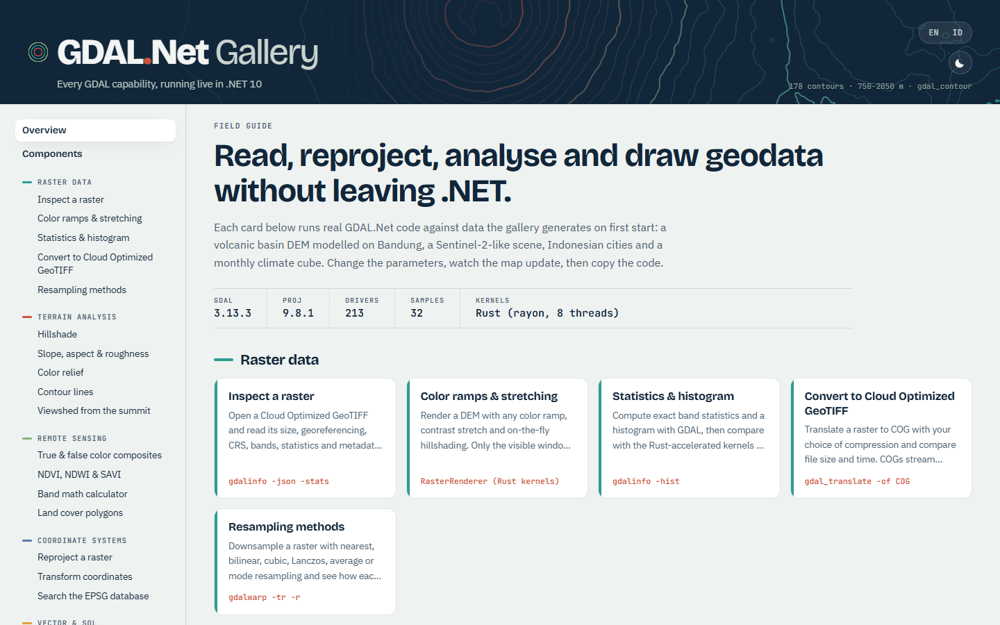 | 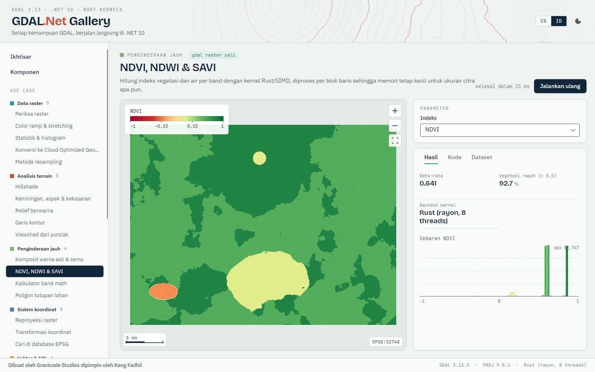 |
| 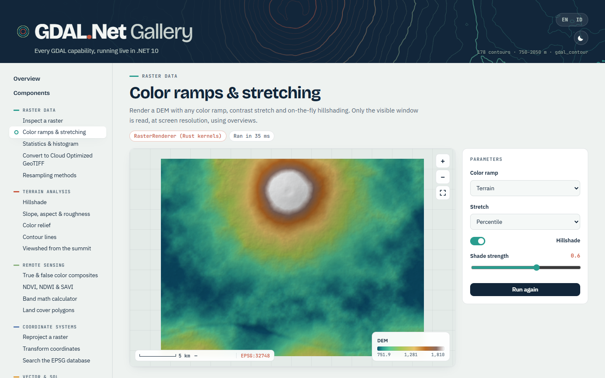 | 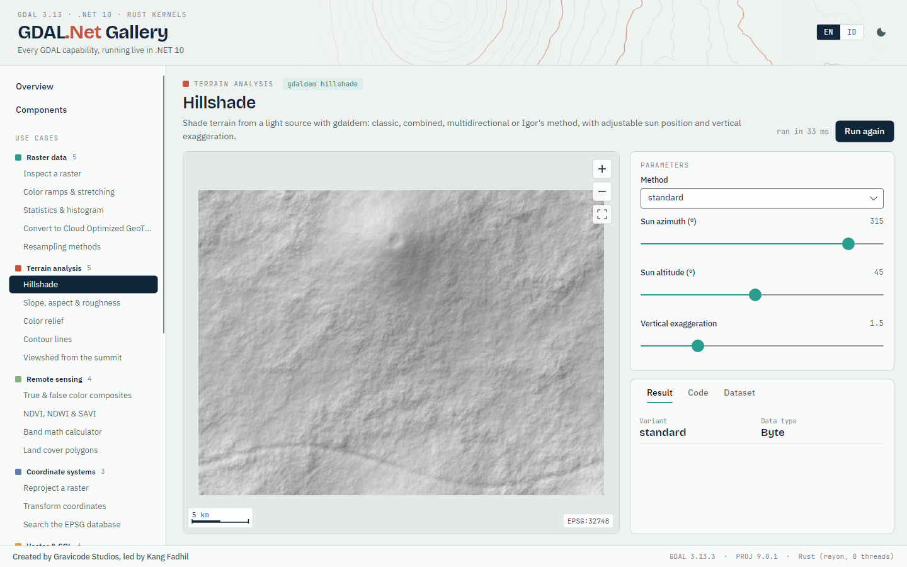 |
|  | 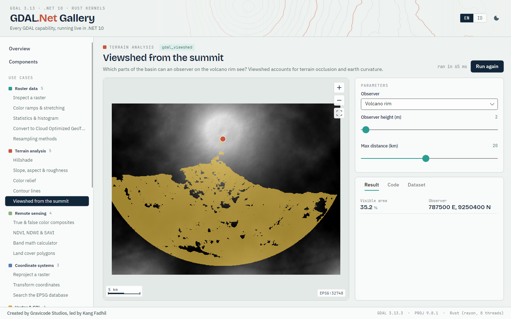 |
| 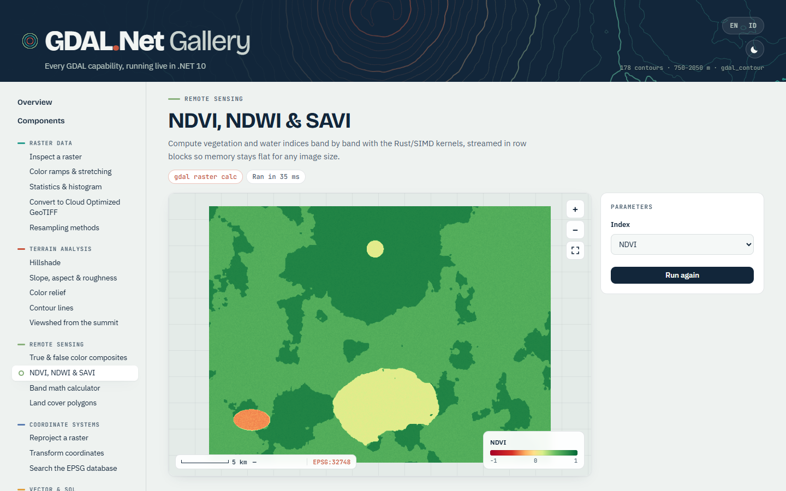 |  |
| 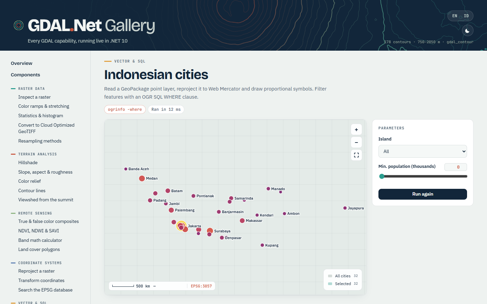 | 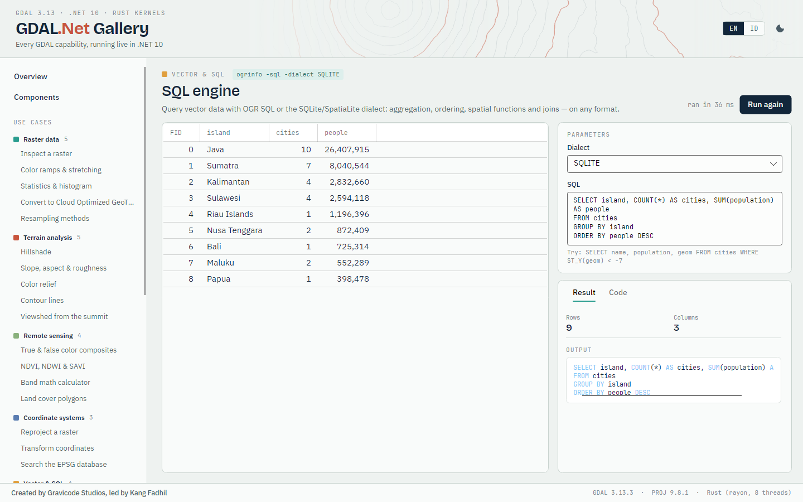 |
| 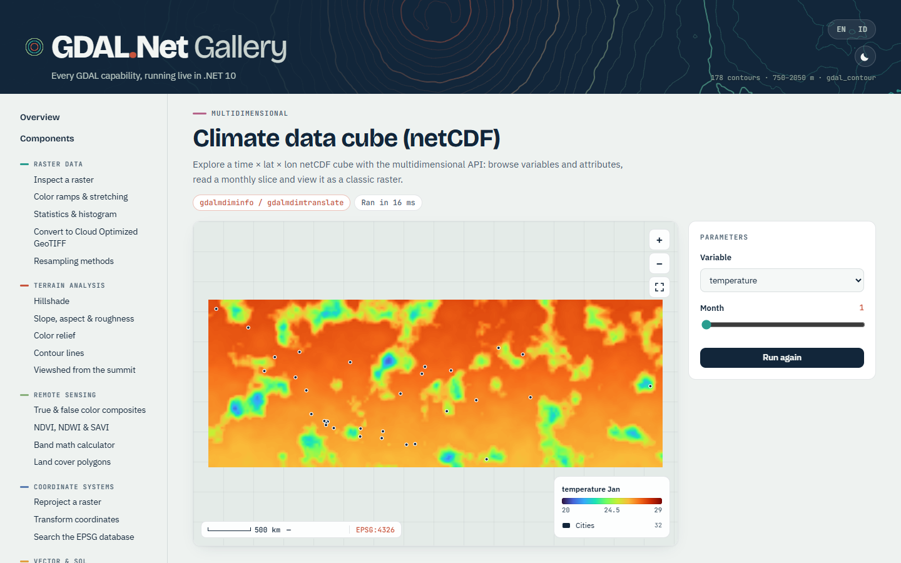 | 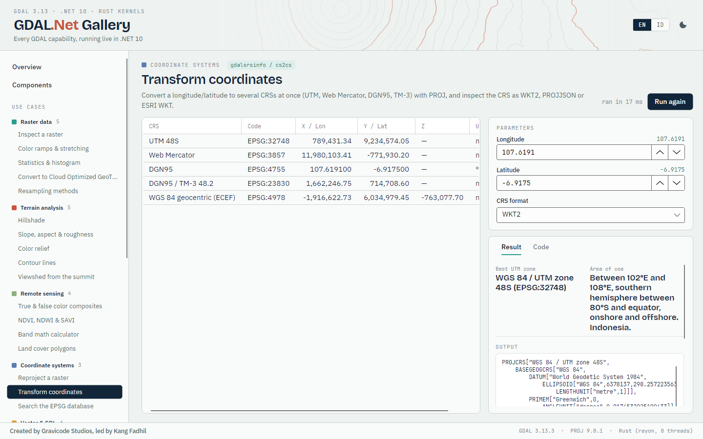 |
| 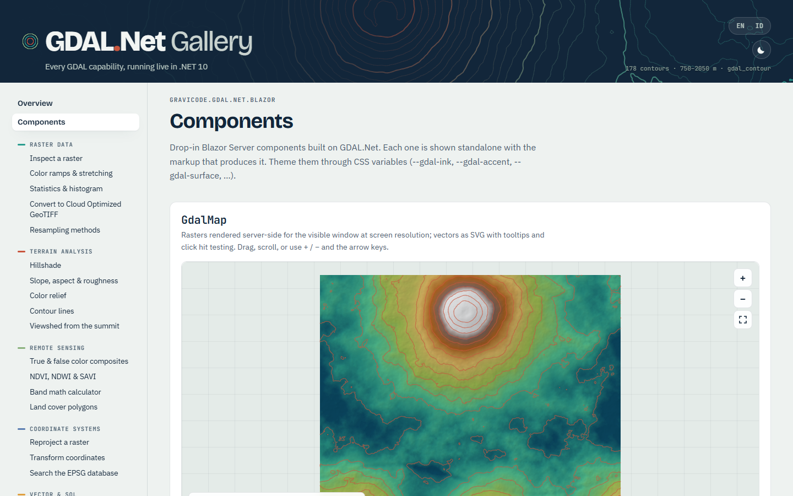 | 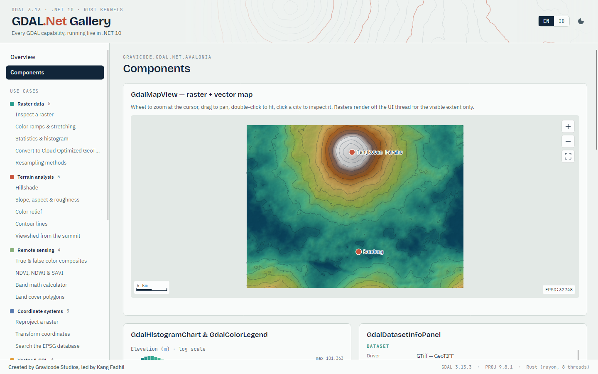 |
| 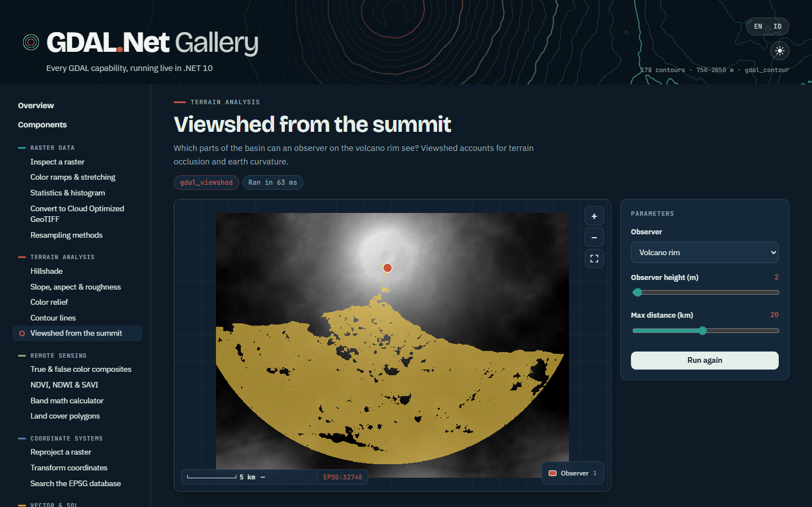 | 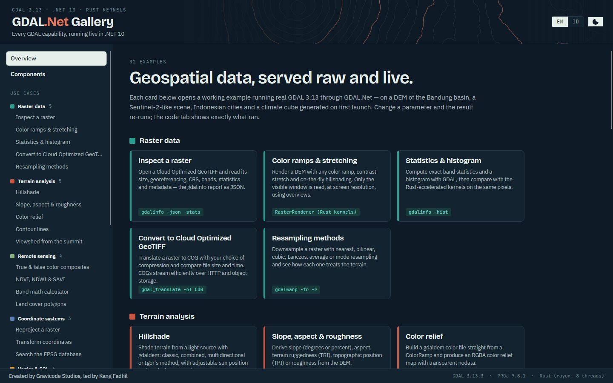 |

## Daftar sampel

### Data raster

| Sampel | Yang ditunjukkan | Padanan GDAL |
|---|---|---|
| **Periksa raster** (`raster-info`) | Buka Cloud Optimized GeoTIFF lalu baca ukuran, georeferensi, CRS, band, statistik, dan metadatanya — laporan gdalinfo dalam JSON. | `gdalinfo -json -stats` |
| **Color ramp & stretching** (`raster-styling`) | Render DEM dengan color ramp, contrast stretch, dan hillshade langsung. Hanya jendela yang terlihat yang dibaca, pada resolusi layar, memakai overview. | `RasterRenderer (Rust kernels)` |
| **Statistik & histogram** (`histogram`) | Hitung statistik band dan histogram secara eksak dengan GDAL, lalu bandingkan dengan kernel Rust pada piksel yang sama. | `gdalinfo -hist` |
| **Konversi ke Cloud Optimized GeoTIFF** (`cog`) | Ubah raster menjadi COG dengan kompresi pilihan, lalu bandingkan ukuran file dan waktunya. COG efisien di-stream lewat HTTP dan object storage. | `gdal_translate -of COG` |
| **Metode resampling** (`resampling`) | Perkecil raster dengan resampling nearest, bilinear, cubic, Lanczos, average, atau mode, lalu lihat pengaruhnya pada terrain. | `gdalwarp -tr -r` |

### Analisis terrain

| Sampel | Yang ditunjukkan | Padanan GDAL |
|---|---|---|
| **Hillshade** (`hillshade`) | Beri bayangan terrain dari sumber cahaya dengan gdaldem: klasik, combined, multidirectional, atau metode Igor, dengan posisi matahari dan eksagerasi vertikal yang dapat diatur. | `gdaldem hillshade` |
| **Kemiringan, aspek & kekasaran** (`slope-aspect`) | Turunkan kemiringan (derajat atau persen), aspek, terrain ruggedness (TRI), topographic position (TPI), atau kekasaran dari DEM. | `gdaldem slope / aspect / TRI / TPI / roughness` |
| **Relief berwarna** (`color-relief`) | Buat file warna gdaldem langsung dari ColorRamp dan hasilkan peta relief RGBA dengan nodata transparan. | `gdaldem color-relief` |
| **Garis kontur** (`contours`) | Hasilkan garis kontur (atau poligon kelas elevasi) dengan interval apa pun dan tampilkan di atas relief berbayang. | `gdal_contour` |
| **Viewshed dari puncak** (`viewshed`) | Bagian cekungan mana yang terlihat oleh pengamat di bibir kawah? Viewshed memperhitungkan halangan terrain dan kelengkungan bumi. | `gdal_viewshed` |

### Penginderaan jauh

| Sampel | Yang ditunjukkan | Padanan GDAL |
|---|---|---|
| **Komposit warna asli & semu** (`composites`) | Gabungkan band mirip Sentinel-2 menjadi warna alami (B4-B3-B2), inframerah (B8-B4-B3), atau tampilan pertanian dengan contrast stretch per band. | `RasterRenderer RGB` |
| **NDVI, NDWI & SAVI** (`ndvi`) | Hitung indeks vegetasi dan air per band dengan kernel Rust/SIMD, diproses per blok baris sehingga memori tetap kecil untuk ukuran citra apa pun. | `gdal raster calc` |
| **Kalkulator band math** (`band-math`) | Ketik ekspresi apa pun atas band bernama (B1…B4, BLUE, GREEN, RED, NIR) dengan operator, perbandingan, kondisi, dan fungsi. Dievaluasi dengan TensorPrimitives tervektorisasi. | `gdal_calc / gdal raster calc` |
| **Poligon tutupan lahan** (`land-cover`) | Citra terklasifikasi, dibersihkan dengan sieve filter lalu dipoligonkan ke GeoPackage — luas per kelas diringkas dengan SQL. | `gdal_sieve + gdal_polygonize` |

### Sistem koordinat

| Sampel | Yang ditunjukkan | Padanan GDAL |
|---|---|---|
| **Reproyeksi raster** (`reproject-raster`) | Warp DEM dari UTM 48S ke geografis WGS 84, Web Mercator, atau datum Indonesia DGN95 dengan metode resampling apa pun. | `gdalwarp -t_srs` |
| **Transformasi koordinat** (`transform-coordinates`) | Konversi bujur/lintang ke beberapa CRS sekaligus (UTM, Web Mercator, DGN95, TM-3) dengan PROJ, dan lihat CRS sebagai WKT2, PROJJSON, atau ESRI WKT. | `gdalsrsinfo / cs2cs` |
| **Cari di database EPSG** (`crs-search`) | Pencarian teks penuh pada ribuan CRS di database PROJ, atau daftar semua CRS terproyeksi yang berlaku di suatu lokasi. | `projinfo --searchpaths` |

### Vektor & SQL

| Sampel | Yang ditunjukkan | Padanan GDAL |
|---|---|---|
| **Kota-kota Indonesia** (`cities`) | Baca layer titik GeoPackage, reproyeksikan ke Web Mercator, lalu gambar simbol proporsional. Saring fitur dengan klausa WHERE OGR SQL. | `ogrinfo -where` |
| **Mesin SQL** (`sql`) | Kueri data vektor dengan OGR SQL atau dialek SQLite/SpatiaLite: agregasi, pengurutan, fungsi spasial, dan join — di format apa pun. | `ogrinfo -sql -dialect SQLITE` |
| **Buffer, hull & dissolve** (`geoprocessing`) | Geoprocessing GEOS dengan jarak nyata: buffer kota besar di Jawa dalam CRS metrik, gabungkan (dissolve) buffer yang tumpang tindih, lalu bungkus dengan convex hull. | `OGR_G_Buffer / UnaryUnion / ConvexHull` |
| **Spatial join & overlay** (`spatial-join`) | Sebar titik minat di cekungan dan gabungkan masing-masing ke poligon tutupan lahan tempatnya berada — lalu potong tutupan lahan dengan area studi memakai overlay layer. | `ogr2ogr -sql ST_Intersects / OGR_L_Intersection` |
| **Konversi format vektor** (`convert-vector`) | ogr2ogr di dalam proses: ekspor ke GeoJSON, GeoPackage, FlatGeobuf, Shapefile, KML, GML, atau CSV sambil reproyeksi dan penyaringan. | `ogr2ogr` |
| **Rasterisasi & grid** (`rasterize`) | Bakar poligon tutupan lahan menjadi raster berdasarkan atribut, atau interpolasikan sampel elevasi tersebar menjadi permukaan dengan gdal_grid (inverse distance, nearest, moving average). | `gdal_rasterize / gdal_grid` |

### Mosaik & pemotongan

| Sampel | Yang ditunjukkan | Padanan GDAL |
|---|---|---|
| **Mosaik virtual (VRT)** (`vrt-mosaic`) | Gabungkan empat tile DEM menjadi satu raster virtual tanpa menyalin satu piksel pun, atau tumpuk band dari file terpisah. | `gdalbuildvrt` |
| **Potong dengan poligon** (`clip`) | Potong DEM dengan cutline — lingkaran di sekitar kota atau poligon permukiman — lalu pangkas keluaran ke batas potongan. | `gdalwarp -cutline -crop_to_cutline` |
| **Georeferensi dengan GCP** (`georeference`) | Ambil citra tanpa koordinat (seperti peta hasil scan), pasang titik kontrol tanah (GCP), lalu rektifikasi dengan transformasi polinomial atau thin plate spline. | `gdal_translate -gcp + gdalwarp -tps` |

### Cloud & file virtual

| Sampel | Yang ditunjukkan | Padanan GDAL |
|---|---|---|
| **File di memori & arsip ZIP** (`vsi-memory-zip`) | Tulis dataset ke /vsimem/ dan langsung ke arsip ZIP, lihat isi arsip, lalu baca kembali layernya — tanpa file sementara di disk. | `/vsimem/ + /vsizip/` |
| **Stream COG jarak jauh via HTTP** (`vsicurl`) | Buka Cloud Optimized GeoTIFF langsung dari URL dengan /vsicurl/. Hanya header dan blok/overview yang dibutuhkan yang diunduh. API yang sama berlaku untuk /vsis3/, /vsiaz/, dan /vsigs/. | `/vsicurl/ /vsis3/ /vsiaz/ /vsigs/` |

### Multidimensi

| Sampel | Yang ditunjukkan | Padanan GDAL |
|---|---|---|
| **Kubus data iklim (netCDF)** (`climate-cube`) | Jelajahi kubus netCDF waktu × lintang × bujur dengan API multidimensi: telusuri variabel dan atribut, baca irisan bulanan, dan tampilkan sebagai raster klasik. | `gdalmdiminfo / gdalmdimtranslate` |

### Utilitas

| Sampel | Yang ditunjukkan | Padanan GDAL |
|---|---|---|
| **Jalankan command line gdal** (`gdal-cli`) | Semua algoritma CLI "gdal" terpadu (GDAL 3.11+) berjalan di dalam proses: raster info, reproject, calc, tile, vector filter, pipeline… | `gdal (unified CLI)` |
| **Format & driver** (`drivers`) | Daftar semua driver raster, vektor, dan multidimensi pada build GDAL native, lengkap dengan kemampuan dan ekstensi file. | `gdalinfo --formats / ogrinfo --formats` |
| **Tile peta web (XYZ)** (`tiles`) | Potong raster menjadi tile XYZ Web Mercator siap untuk Leaflet, OpenLayers, atau MapLibre — atau sajikan sesuai permintaan dari endpoint. | `gdal2tiles / gdal raster tile` |

## Berikutnya

- [Komponen Blazor](blazor.md)
- [Kontrol Avalonia](avalonia.md)
- [Indeks dokumentasi](index.md)

Dibuat oleh Gravicode Studios dipimpin oleh Kang Fadhil.
