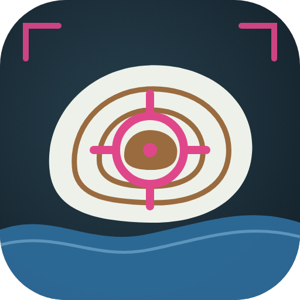
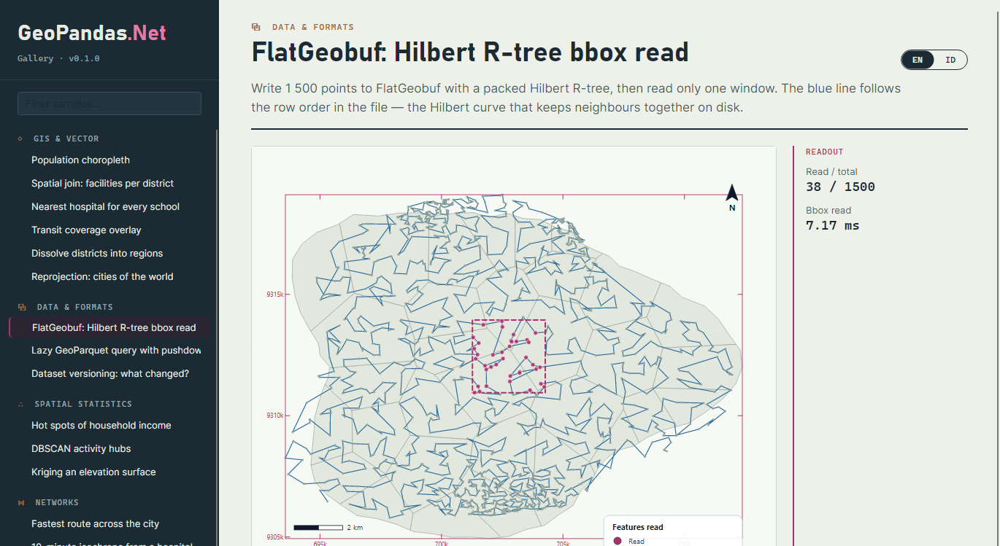
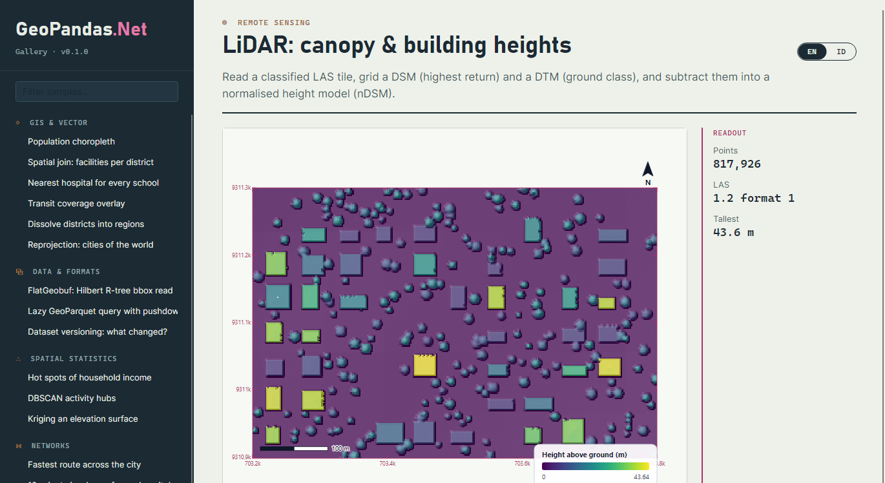

<p align="center"></p>

<h1 align="center">GeoPandas.Net</h1>
<p align="center"><b>Platform analitik geospasial generasi berikutnya untuk .NET 10</b><br>
GeoDataFrame · engine CRS · indeks spasial · GeoParquet / FlatGeobuf / GeoPackage / Shapefile / NetCDF / LAS · PostGIS · kueri lazy · statistik spasial · routing · raster · GeoLLM</p>
<p align="center"><a href="README.md">🇬🇧 Read in English</a> · <a href="docs/id/index.md">Dokumentasi</a> · <a href="PLAN.md">Roadmap</a> · <a href="Progress.md">Progres</a></p>

> **Dibuat oleh Gravicode Studios dipimpin oleh Kang Fadhil.**

GeoPandas.Net adalah reimplementasi dan perluasan konsep [GeoPandas](https://geopandas.org) Python untuk ekosistem .NET. Seperti GeoPandas yang dibangun di atas Shapely/GEOS, GeoPandas.Net memakai **NetTopologySuite** (port JTS/GEOS untuk .NET) untuk predikat dan overlay geometri yang robust. Seluruh lapisan di atasnya diimplementasikan sendiri: `GeoDataFrame` berbasis column-store, engine CRS/proyeksi tanpa ketergantungan PROJ, indeks STR-tree/KD-tree/quadtree/octree, format file, statistik spasial, analisis jaringan, analitik raster/terrain, konversi CAD, asisten LLM, serta kernel Rust + SIMD.


## Fitur utama

| Bidang | Kemampuan |
|---|---|
| **GeoDataFrame** | Column-store immutable dengan kolom bertipe dan bitmap null; `Filter`, `SortBy`, `GroupBy().Agg`, `Merge`, `Concat`, `Describe`, `ValueCounts` |
| **Operasi geometri** | `Area`, `GeomLength`, `Buffer`, `Simplify`, `Centroid`, `ConvexHull`, `MakeValid`, transformasi affine, predikat tervektorisasi, otomatis paralel untuk data besar |
| **Spatial join** | `SJoin` (intersects / within / contains / touches / crosses / overlaps / covers…), `SJoinNearest` (branch-and-bound eksak), `Overlay`, `Dissolve`, `Clip`, `Explode`, `Cx` |
| **Engine CRS** | **Dataset EPSG lengkap** (5 800+ CRS beserta wilayah penggunaannya), 20 metode proyeksi (TM, LCC, Albers, LAEA, stereografik kutub & miring, Hotine/RSO, Cassini, Equal Earth, Robinson, Mollweide…) yang cocok dengan PROJ hingga nanometer, PROJ.4 / WKT1 / ESRI / WKT2 / PROJJSON, datum shift Helmert dan **NTv2**, **geoid** (GTX, ISG, GeoTIFF) |
| **Survei & GNSS** | Poligon (Bowditch/Transit), COGO, perataan jaring dan sipat datar kuadrat terkecil dengan elips kesalahan, uji χ² dan data snooping, RINEX 2/3 serta penentuan posisi absolut GPS |
| **Indeks spasial** | STR-tree, KD-tree, quadtree dinamis, octree (3-D / point cloud), GeoHash; indeks sel **H3** dan **S2** (persis sama dengan h3-py dan s2sphere) |
| **IO** | GeoJSON, ESRI Shapefile (Z), GeoPackage, **FlatGeobuf** (Hilbert R-tree), **GeoParquet 1.1**, **Arrow IPC/Feather** (GeoArrow, PROJJSON), CSV, DXF dalam satu registri `GeoIO`; diuji dua arah terhadap GDAL / geopandas / pyarrow |
| **Data ilmiah** | **NetCDF** CDF-1/2/5 + NetCDF-4/HDF5 dengan konvensi CF, jendela hyperslab dan grid kurvilinier; point cloud **LAS 1.0–1.4 / LAZ (format 0–10) / COPC** dengan Octree, DSM/DTM/nDSM; pembaca produk **Landsat C2, Sentinel-2 SAFE, STAC, MODIS/VIIRS** |
| **Basis data** | `ReadSql` / `ReadTable` / `ToSql` (setara `read_postgis`/`to_postgis`) untuk **PostGIS, SQL Server, DuckDB Spatial, Oracle Spatial, MySQL** lewat ADO.NET, plus **BigQuery GIS** |
| **Lazy & versi** | `LazyGeoDataFrame`: pushdown bbox/kolom/atribut/limit ke file dan SQL, batch streaming, `Explain()`; `DatasetRepository`: snapshot berbasis konten, commit, tag, diff per kunci |
| **Analitik** | Bobot queen/rook/KNN/distance band, Moran's I, Geary's C, LISA, hot spot Getis-Ord Gi*, DBSCAN, K-Means, IDW, ordinary dan **kriging universal**, **OLS dengan diagnostik LM, model lag/error spasial ML, GWR** (sesuai PySAL spreg/mgwr) |
| **Jaringan** | Graf dari garis (biaya, satu arah), Dijkstra, A*, Dijkstra dua arah, **Contraction Hierarchies**, area layanan / isokron, penelusuran jaringan utilitas; **hidraulika air** (`.inp` EPANET, solver gradien global sesuai EPANET 2.2), aturan topologi, segmen isolasi katup |
| **Sipil & BIM** | Alinyemen horizontal (klotoid) dan vertikal, koridor yang di-daylight ke DEM, galian-timbunan dan mass haul, pad datar, pemecahan persil; **IFC2x3/IFC4 → GeoDataFrame** dalam koordinat peta, footprint LOD1, GIS → IFC4 tergeoreferensi |
| **Raster** | Pembaca GeoTIFF / BigTIFF / COG, penulis GeoTIFF, slope, aspect, hillshade, viewshed, pengisian sink, arah aliran D8, akumulasi, DAS, NDVI/NDWI/NDBI/SAVI, deteksi perubahan Otsu, statistik zonal, rasterize, kontur |
| **CAD** | Pembaca DXF (termasuk bulge LWPOLYLINE, ARC, ELLIPSE, SPLINE, TEXT, MTEXT, INSERT) dan penulis R12, baca/tulis **DWG** (R14–2018) dan **MicroStation DGN v7**, georeferensi dua titik CAD → GIS |
| **AI spasial** | `GeoAssistant` (GeoLLM): pertanyaan bahasa alami → rencana kueri ter-whitelist yang dijalankan secara deterministik. Mendukung OpenAI, Azure OpenAI, DeepSeek atau endpoint yang kompatibel dengan OpenAI |
| **Skala besar** | `PartitionedGeoDataFrame` (partisi k-d tree, grid, H3 atau atribut; map/reduce paralel; spatial join sadar-partisi yang identik dengan `SJoin`) dan dataset GeoParquet terpartisi dengan pemangkasan partisi berdasarkan bounding box |
| **3D & kembaran digital** | glTF/GLB dan **OGC 3D Tiles 1.1** (bangunan ekstrusi, terrain; lolos validator, tergeoreferensi ECEF), integrasi Cesium.Net, peta interaktif `Explore()` (MapLibre, komponen Blazor), live layer IoT dengan event geofence dan ambang |
| **Cloud, ML & GPU** | Klien Azure Maps, AWS Location (SigV4) dan Azure Digital Twins yang menghasilkan GeoDataFrame; segmentasi ONNX dan klasifikasi tutupan lahan ML.NET; kernel raster ILGPU (CUDA / OpenCL / CPU) |
| **Peta** | `gdf.Plot()` menghasilkan `MapScene` (koroplet, kategorikal, simbol proporsional, label, legenda, skala, panah utara, bingkai lembar peta) → SVG, Blazor, Avalonia |
| **Performa** | Kernel native Rust (Rayon) dengan fallback SIMD `Vector<T>`, graf CSR, `Span<T>`/`ArrayPool<T>`, paket inti kompatibel AOT |

## Mulai cepat

```bash
dotnet add package GeoPandas.Net
```

```csharp
using GeoPandas.Net;
using GeoPandas.Net.Data;
using GeoPandas.Net.Geometry;

var kecamatan = Gpd.ReadFile("kecamatan.gpkg");
var sekolah   = Gpd.ReadFile("sekolah.geojson").ToCrs(kecamatan.Crs!);

var jumlah = sekolah.SJoin(kecamatan, SpatialPredicate.Within)
                    .GroupBy("name_right")
                    .Agg(("name_left", AggFunc.Count, "jumlah_sekolah"));

var utm = kecamatan.ToCrs(kecamatan.EstimateUtmCrs());   // mis. EPSG:32748 untuk Jakarta
Console.WriteLine(utm.Area().Sum() / 1e6 + " km²");
utm.ToFile("kecamatan_utm.shp");
```

Panduan lengkap: [Memulai](docs/id/getting-started.md) · [GeoDataFrame & IO](docs/id/vector.md) · [Format, basis data, lazy & versi](docs/id/data.md) · [Analisis](docs/id/analysis.md) · [CAD & AI](docs/id/integrations.md) · [Teknik & BIM](docs/id/engineering.md) · [Skala besar, 3D, kembaran digital & cloud](docs/id/scale-3d-twins.md) · [Tools](docs/id/tools.md).

## Galeri (web Blazor + desktop Avalonia)

36 contoh interaktif (GIS, data & format, statistik spasial, jaringan, raster, teknik sipil, penginderaan jauh, survei & geodesi, CAD & BIM, kembaran digital & 3D, AI), dwibahasa EN/ID.

```bash
dotnet run --project gallery/GeoPandas.Net.Gallery.Blazor     # http://localhost:5280
dotnet run --project gallery/GeoPandas.Net.Gallery.Avalonia
```

| | |
|---|---|
|  |  |

| | |
|---|---|
|  |  |
|  |  |
|  |  |

## CLI `gpd`

```bash
dotnet tool install -g GeoPandas.Net.Cli
gpd sample districts kecamatan.gpkg
gpd convert kecamatan.gpkg kecamatan.geojson --to-crs EPSG:4326
gpd convert kecamatan.gpkg kecamatan.parquet                 # GeoParquet / .fgb / .feather
gpd scan jalan.parquet --bbox 700000,9308000,704000,9312000 --where "highway=primary" --explain
gpd las ndsm tile.laz tinggi.tif --cell 1
gpd repo commit persil.repo persil.gpkg --m "sinkronisasi mingguan"
gpd ask kecamatan.gpkg "Tampilkan 5 distrik terpadat di wilayah Selatan beserta luasnya"
```

## Build dari source

```bash
cargo build --release --manifest-path native/geopandas_native/Cargo.toml   # opsional
dotnet build GeoPandas.Net.slnx
dotnet test tests/GeoPandas.Net.Tests
```

## Lisensi & kredit

MIT. Engine geometri: NetTopologySuite (BSD-3). **Dibuat oleh Gravicode Studios dipimpin oleh Kang Fadhil.**
