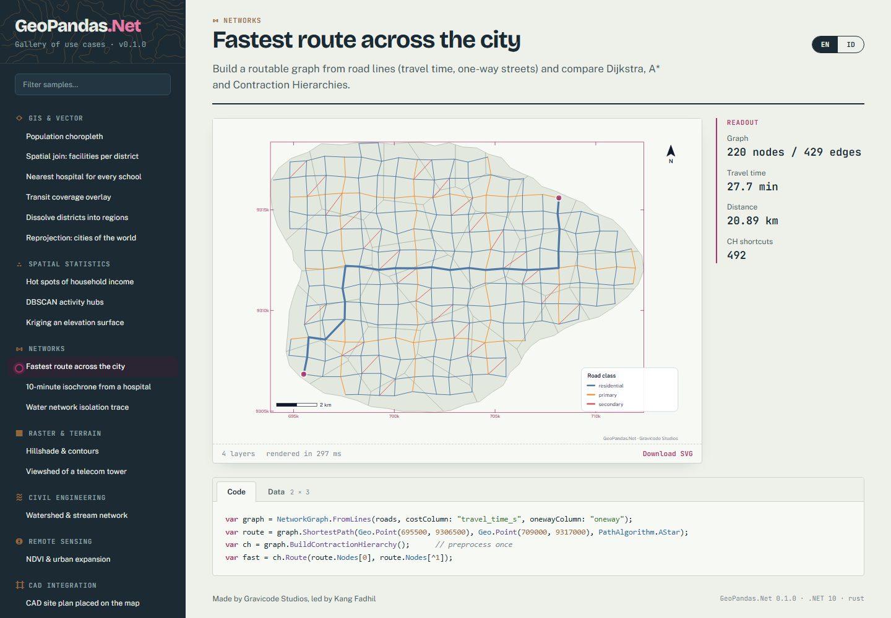
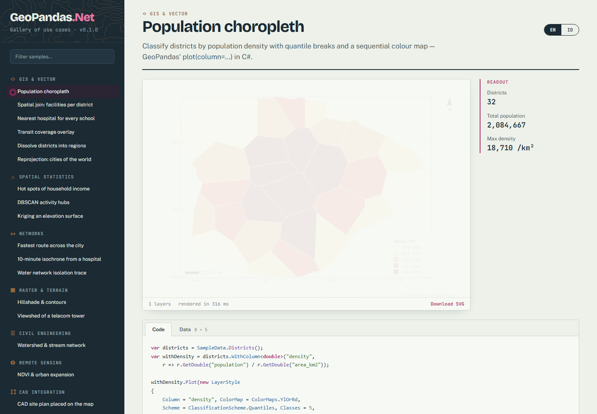
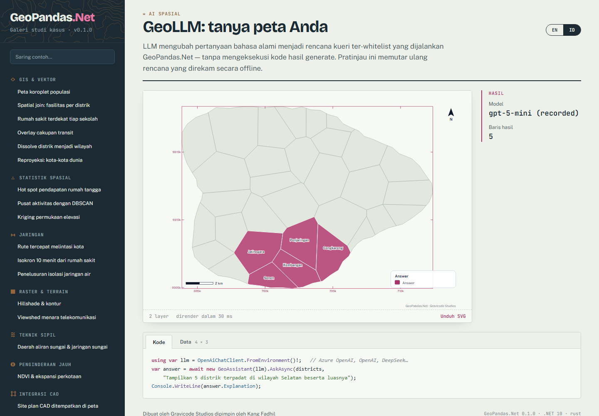
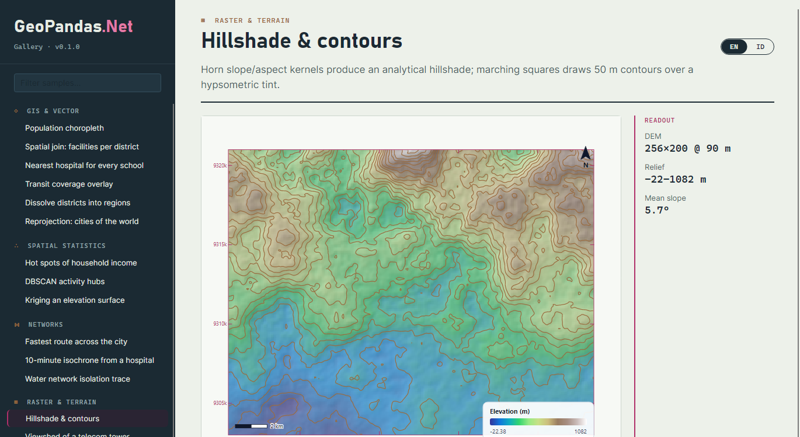

<p align="center"></p>

<h1 align="center">GeoPandas.Net</h1>
<p align="center"><b>Platform analitik geospasial generasi berikutnya untuk .NET 10</b><br>
GeoDataFrame · engine CRS · indeks spasial · GeoJSON / Shapefile / GeoPackage / DXF · statistik spasial · routing · raster · GeoLLM</p>
<p align="center"><a href="README.md">🇬🇧 Read in English</a> · <a href="docs/id/index.md">Dokumentasi</a> · <a href="PLAN.md">Roadmap</a> · <a href="Progress.md">Progres</a></p>

> **Dibuat oleh Gravicode Studios dipimpin oleh Kang Fadhil.**

GeoPandas.Net adalah reimplementasi dan perluasan konsep [GeoPandas](https://geopandas.org) Python untuk ekosistem .NET. Seperti GeoPandas yang dibangun di atas Shapely/GEOS, GeoPandas.Net memakai **NetTopologySuite** (port JTS/GEOS untuk .NET) untuk predikat dan overlay geometri yang robust. Seluruh lapisan di atasnya diimplementasikan sendiri: `GeoDataFrame` berbasis column-store, engine CRS/proyeksi tanpa ketergantungan PROJ, indeks STR-tree/KD-tree/quadtree/octree, format file, statistik spasial, analisis jaringan, analitik raster/terrain, konversi CAD, asisten LLM, serta kernel Rust + SIMD.



## Fitur utama

| Bidang | Kemampuan |
|---|---|
| **GeoDataFrame** | Column-store immutable dengan kolom bertipe dan bitmap null; `Filter`, `SortBy`, `GroupBy().Agg`, `Merge`, `Concat`, `Describe`, `ValueCounts` |
| **Operasi geometri** | `Area`, `GeomLength`, `Buffer`, `Simplify`, `Centroid`, `ConvexHull`, `MakeValid`, transformasi affine, predikat tervektorisasi, otomatis paralel untuk data besar |
| **Spatial join** | `SJoin` (intersects / within / contains / touches / crosses / overlaps / covers…), `SJoinNearest` (branch-and-bound eksak), `Overlay`, `Dissolve`, `Clip`, `Explode`, `Cx` |
| **Engine CRS** | Registri EPSG (WGS 84, Web/World Mercator, 120 zona UTM, NAD83 UTM, **DGN95 / TM-3 Indonesia**, Lambert-93, Albers, British National Grid…), parsing PROJ.4, WKT1, ESRI .prj dan WKT2, datum shift Helmert 7 parameter |
| **Indeks spasial** | STR-tree, KD-tree, quadtree dinamis, octree (3-D / point cloud), GeoHash |
| **IO** | GeoJSON, ESRI Shapefile (Z), GeoPackage, CSV (WKT / lon-lat), DXF; semuanya diimplementasikan sendiri, dengan registri driver `GeoIO` |
| **Analitik** | Bobot queen/rook/KNN/distance band, Moran's I, Geary's C, LISA, hot spot Getis-Ord Gi*, DBSCAN, K-Means, IDW, ordinary kriging |
| **Jaringan** | Graf dari garis (biaya, satu arah), Dijkstra, A*, Dijkstra dua arah, **Contraction Hierarchies**, area layanan / isokron, penelusuran jaringan utilitas |
| **Raster** | Pembaca GeoTIFF / BigTIFF / COG, penulis GeoTIFF, slope, aspect, hillshade, viewshed, pengisian sink, arah aliran D8, akumulasi, DAS, NDVI/NDWI/NDBI/SAVI, deteksi perubahan Otsu, statistik zonal, rasterize, kontur |
| **CAD** | Pembaca DXF (termasuk bulge LWPOLYLINE, ARC, ELLIPSE, SPLINE, TEXT, MTEXT, INSERT) dan penulis R12, georeferensi dua titik CAD → GIS |
| **AI spasial** | `GeoAssistant` (GeoLLM): pertanyaan bahasa alami → rencana kueri ter-whitelist yang dijalankan secara deterministik. Mendukung OpenAI, Azure OpenAI, DeepSeek atau endpoint yang kompatibel dengan OpenAI |
| **Peta** | `gdf.Plot()` menghasilkan `MapScene` (koroplet, kategorikal, simbol proporsional, label, legenda, skala, panah utara, bingkai lembar peta) → SVG, Blazor, Avalonia |
| **Performa** | Kernel native Rust (Rayon) dengan fallback SIMD `Vector<T>`, graf CSR, `Span<T>`/`ArrayPool<T>`, paket inti kompatibel AOT |

## Mulai cepat

```bash
dotnet add package GeoPandas.Net
```

```csharp
using GeoPandas.Net;
using GeoPandas.Net.Data;
using GeoPandas.Net.Geometry;

var kecamatan = Gpd.ReadFile("kecamatan.gpkg");
var sekolah   = Gpd.ReadFile("sekolah.geojson").ToCrs(kecamatan.Crs!);

var jumlah = sekolah.SJoin(kecamatan, SpatialPredicate.Within)
                    .GroupBy("name_right")
                    .Agg(("name_left", AggFunc.Count, "jumlah_sekolah"));

var utm = kecamatan.ToCrs(kecamatan.EstimateUtmCrs());   // mis. EPSG:32748 untuk Jakarta
Console.WriteLine(utm.Area().Sum() / 1e6 + " km²");
utm.ToFile("kecamatan_utm.shp");
```

Panduan lengkap: [Memulai](docs/id/getting-started.md) · [GeoDataFrame & IO](docs/id/vector.md) · [Analisis](docs/id/analysis.md) · [CAD & AI](docs/id/integrations.md) · [Tools](docs/id/tools.md).

## Galeri (web Blazor + desktop Avalonia)

18 contoh interaktif (GIS, statistik spasial, jaringan, raster, teknik sipil, penginderaan jauh, CAD, AI), dwibahasa EN/ID.

```bash
dotnet run --project gallery/GeoPandas.Net.Gallery.Blazor     # http://localhost:5280
dotnet run --project gallery/GeoPandas.Net.Gallery.Avalonia
```

| | |
|---|---|
|  |  |



## CLI `gpd`

```bash
dotnet tool install -g GeoPandas.Net.Cli
gpd sample districts kecamatan.gpkg
gpd convert kecamatan.gpkg kecamatan.geojson --to-crs EPSG:4326
gpd ask kecamatan.gpkg "Tampilkan 5 distrik terpadat di wilayah Selatan beserta luasnya"
```

## Build dari source

```bash
cargo build --release --manifest-path native/geopandas_native/Cargo.toml   # opsional
dotnet build GeoPandas.Net.slnx
dotnet test tests/GeoPandas.Net.Tests
```

## Lisensi & kredit

MIT. Engine geometri: NetTopologySuite (BSD-3). **Dibuat oleh Gravicode Studios dipimpin oleh Kang Fadhil.**
