<p align="center"></p>

<h1 align="center">GeoPandas.Net</h1>
<p align="center"><b>Next-generation geospatial analytics for .NET 10</b><br>
GeoDataFrame · CRS engine · spatial index · GeoParquet / FlatGeobuf / GeoPackage / Shapefile / NetCDF / LAS · PostGIS · lazy queries · spatial statistics · routing · rasters · GeoLLM</p>
<p align="center"><a href="README.id.md">🇮🇩 Baca dalam Bahasa Indonesia</a> · <a href="docs/en/index.md">Documentation</a> · <a href="PLAN.md">Roadmap</a> · <a href="Progress.md">Progress</a></p>

> **Dibuat oleh Gravicode Studios dipimpin oleh Kang Fadhil** — Made by Gravicode Studios, led by Kang Fadhil.

GeoPandas.Net re-implements and extends the ideas of Python's [GeoPandas](https://geopandas.org) for the .NET ecosystem. Like GeoPandas sits on Shapely/GEOS, GeoPandas.Net uses **NetTopologySuite** (the .NET port of JTS/GEOS) for robust geometry predicates and overlays. Everything above that is implemented here: a column-store `GeoDataFrame`, a CRS/projection engine with no PROJ dependency, STR-tree/KD-tree/quadtree/octree indexes, file formats, spatial statistics, network analysis, raster/terrain analytics, CAD conversion, an LLM assistant, and Rust + SIMD kernels.


## Highlights

| Area | What you get |
|---|---|
| **GeoDataFrame** | Immutable column store with typed columns and null bitmaps; `Filter`, `SortBy`, `GroupBy().Agg`, `Merge`, `Concat`, `Describe`, `ValueCounts`; geometry-aware `Head`/`Select`/`WithColumn` |
| **Geometry ops** | `Area`, `GeomLength`, `Buffer`, `Simplify`, `Centroid`, `ConvexHull`, `MakeValid`, affine ops, vectorised predicates, all parallel for large inputs |
| **Spatial joins** | `SJoin` (intersects / within / contains / touches / crosses / overlaps / covers…), `SJoinNearest` (exact branch-and-bound), `Overlay` (intersection, union, difference, symmetric difference, identity), `Dissolve`, `Clip`, `Explode`, `Cx` |
| **CRS engine** | The **full EPSG dataset** (5 800+ CRSs with areas of use), 20 projection methods (TM, LCC, Albers, LAEA, polar & oblique stereographic, Hotine/RSO, Cassini, Equal Earth, Robinson, Mollweide…) matching PROJ to the nanometre, PROJ.4 / WKT1 / ESRI / WKT2 / PROJJSON, Helmert and **NTv2** datum shifts, **geoids** (GTX, ISG, GeoTIFF), `EstimateUtmCrs` |
| **Surveying & GNSS** | Traverses (Bowditch/Transit), COGO, least-squares network and leveling adjustment with error ellipses, χ² test and data snooping, RINEX 2/3 and GPS single point positioning |
| **Spatial index** | STR-tree (bulk-loaded, flat arrays, k-NN), KD-tree, dynamic quadtree, octree (3-D / point clouds), GeoHash; **H3** and **S2** cell indexes (exact against h3-py and s2sphere) |
| **IO** | GeoJSON, ESRI Shapefile (.shp/.shx/.dbf/.prj/.cpg, Z), GeoPackage, **FlatGeobuf** (Hilbert R-tree), **GeoParquet 1.1** and **Arrow IPC/Feather** (GeoArrow, PROJJSON), CSV, DXF behind one `GeoIO` driver registry; all checked against GDAL / geopandas / pyarrow in both directions |
| **Scientific data** | **NetCDF** CDF-1/2/5 + NetCDF-4/HDF5 with CF conventions, hyperslab windows and curvilinear grids; **LAS 1.0–1.4 / LAZ (formats 0–10) / COPC** point clouds with Octree, DSM/DTM/nDSM; **Landsat C2, Sentinel-2 SAFE, STAC, MODIS/VIIRS** product readers |
| **Databases** | `ReadSql` / `ReadTable` / `ToSql` (GeoPandas `read_postgis`/`to_postgis`) for **PostGIS, SQL Server, DuckDB Spatial, Oracle Spatial, MySQL** over plain ADO.NET, plus **BigQuery GIS** |
| **Lazy & versioned** | `LazyGeoDataFrame`: bbox/column/attribute/limit pushdown into files and SQL, streaming batches, `Explain()`; `DatasetRepository`: content-addressed snapshots, commits, tags, keyed diffs |
| **Analytics** | Queen/rook/KNN/distance-band weights, Moran's I, Geary's C, LISA, Getis-Ord Gi* hot spots, DBSCAN, K-Means, IDW, ordinary and **universal kriging**, **OLS with LM diagnostics, ML spatial lag/error models, GWR** (matching PySAL spreg/mgwr) |
| **Network** | Graphs from lines (costs, one-way), Dijkstra, A*, bidirectional Dijkstra, **Contraction Hierarchies**, service areas / isochrones, connected components, utility-network tracing; **water hydraulics** (EPANET `.inp`, global gradient solver matching EPANET 2.2), topology rules, isolation-valve segments |
| **Civil & BIM** | Horizontal (clothoid) and vertical alignments, corridors daylighted to a DEM, cut/fill and mass haul, level pads, parcel subdivision; **IFC2x3/IFC4 → GeoDataFrame** in map coordinates, LOD1 footprints, GIS → georeferenced IFC4 |
| **Raster** | GeoTIFF / BigTIFF / COG reader (strips, tiles, Deflate, LZW, PackBits, predictor), GeoTIFF writer, slope, aspect, hillshade, ruggedness, viewshed, sink filling, D8 flow, accumulation, watersheds, NDVI/NDWI/NDBI/SAVI, Otsu change detection, zonal stats, rasterize, contours |
| **CAD** | DXF reader (LINE, LWPOLYLINE with bulges, POLYLINE, CIRCLE, ARC, ELLIPSE, SPLINE, TEXT, MTEXT, INSERT, 3DFACE) and R12 writer, **DWG** read/write (R14–2018), **MicroStation DGN v7** read/write, two-point CAD → GIS georeferencing |
| **Spatial AI** | `GeoAssistant` (GeoLLM): natural language → whitelisted query plan, executed deterministically. Works with OpenAI, Azure OpenAI, DeepSeek or any OpenAI-compatible endpoint |
| **Scale** | `PartitionedGeoDataFrame` (k-d tree, grid, H3 or attribute partitions; parallel map/reduce; partition-aware spatial join identical to `SJoin`) and partitioned GeoParquet datasets with bounding-box partition pruning |
| **3D & twins** | glTF/GLB and **OGC 3D Tiles 1.1** (extruded buildings, terrain; validator-clean, ECEF-georeferenced), Cesium.Net integration, interactive `Explore()` maps (MapLibre, Blazor component), live IoT layers with geofence and threshold events |
| **Cloud, ML & GPU** | Azure Maps, AWS Location (SigV4) and Azure Digital Twins clients returning GeoDataFrames; ONNX segmentation and ML.NET land-cover classification; ILGPU raster kernels (CUDA / OpenCL / CPU) |
| **Maps** | `gdf.Plot()` returns a renderer-agnostic `MapScene` (choropleth, categorical, proportional symbols, labels, legends, scale bar, north arrow, map-sheet frame) that can be drawn as SVG, in Blazor, or natively in Avalonia |
| **Performance** | Rust native kernels (Rayon) with a `Vector<T>` SIMD managed fallback, CSR graphs, `Span<T>`/`ArrayPool<T>`, AOT-compatible core packages |

## Quick start

```bash
dotnet add package GeoPandas.Net
```

```csharp
using GeoPandas.Net;
using GeoPandas.Net.Data;
using GeoPandas.Net.Geometry;
using GeoPandas.Net.Plotting;

var districts = Gpd.ReadFile("districts.gpkg");          // GeoJSON, .shp, .gpkg, .csv, .dxf
var schools   = Gpd.ReadFile("schools.geojson").ToCrs(districts.Crs!);

// Spatial join + group by
var perDistrict = schools.SJoin(districts, SpatialPredicate.Within)
                         .GroupBy("name_right")
                         .Agg(("name_left", AggFunc.Count, "schools"));

// Reproject to metres, measure, buffer
var utm  = districts.ToCrs(districts.EstimateUtmCrs());
var area = utm.Area();                                     // m²
var walk = schools.ToCrs(utm.Crs!).Buffer(500).Dissolve(); // 500 m walking catchment

// Map → SVG
utm.WithColumn(area.Rename("area_m2"))
   .Plot(new LayerStyle { Column = "area_m2", ColorMap = ColorMaps.Viridis }, "District area")
   .SaveSvg("area.svg");

utm.ToFile("districts_utm.shp");
```

More examples: [Getting started](docs/en/getting-started.md) · [GeoDataFrame & IO](docs/en/vector.md) · [Formats, databases, lazy & versioning](docs/en/data.md) · [Analysis](docs/en/analysis.md) · [CAD & AI](docs/en/integrations.md) · [Engineering & BIM](docs/en/engineering.md) · [Scale, 3D, twins & cloud](docs/en/scale-3d-twins.md).

## Packages

| Package | Contents |
|---|---|
| `GeoPandas.Net` | Meta-package with everything below, plus the `Gpd` facade |
| `GeoPandas.Net.Geometry` | Geometry factory, CRS engine, spatial indexes, geodesy, native kernels |
| `GeoPandas.Net.Core` | `DataFrame`, `GeoSeries`, `GeoDataFrame`, spatial joins/overlay, `MapScene` plotting |
| `GeoPandas.Net.Data` | GeoJSON, Shapefile, GeoPackage, FlatGeobuf, CSV, `GeoIO` registry and `GeoIO.Scan`, dataset versioning |
| `GeoPandas.Net.Arrow` | GeoParquet 1.1 reader/writer, Arrow IPC / Feather, `DataFrame` ⇄ `RecordBatch` |
| `GeoPandas.Net.PointCloud` | LAS/LAZ/COPC, `PointCloud` (Octree, classes, DSM/DTM, GeoDataFrame interop) |
| `GeoPandas.Net.Survey` | Traverses, COGO, least-squares adjustment, RINEX, GNSS single point positioning |
| `GeoPandas.Net.RemoteSensing` | Landsat C2, Sentinel-2 SAFE (JPEG 2000), STAC items, MODIS/VIIRS grids and HDF-EOS5 |
| `GeoPandas.Net.Sql` | PostGIS / SQL Server / DuckDB / Oracle / MySQL dialects, `ReadSql`, `ToSql`, SQL scan source |
| `GeoPandas.Net.Sql.BigQuery` | BigQuery GIS read / load (separate, brings Google.Cloud.BigQuery.V2) |
| `GeoPandas.Net.Analytics` | Spatial weights, autocorrelation, hot spots, clustering, interpolation, spatial regression, GWR |
| `GeoPandas.Net.Network` | Routing, Contraction Hierarchies, isochrones, utility tracing, water hydraulics, topology rules, valve isolation |
| `GeoPandas.Net.Civil` | Alignments, corridors, earthwork, mass haul, parcel subdivision |
| `GeoPandas.Net.BIM` | STEP/IFC reader and writer, IFC ⇄ GIS, LOD1 building footprints |
| `GeoPandas.Net.Raster` | GeoTIFF/COG IO, NetCDF (classic + NetCDF-4), terrain, hydrology, spectral indices, zonal statistics |
| `GeoPandas.Net.CAD` | DXF, DWG and DGN v7 read/write, CAD ⇄ GIS georeferencing |
| `GeoPandas.Net.AI` | GeoLLM assistant, OpenAI / Azure OpenAI client |
| `GeoPandas.Net.Scene` | Local ENU frames, meshes (terrain, extrusions, points, lines), glTF/GLB with feature metadata, 3D Tiles 1.1 |
| `GeoPandas.Net.Twin` | Live layers for IoT streams, geofence/threshold/stale events, zone statistics, digital twins |
| `GeoPandas.Net.Cloud` | Azure Maps, AWS Location Service, Azure Digital Twins (no SDK dependencies) |
| `GeoPandas.Net.Cesium` | Cesium.Net helpers: GeoDataFrames, point clouds and tilesets in a CesiumJS viewer (separate package) |
| `GeoPandas.Net.Blazor` | `ExploreView` (interactive MapLibre map) and `MapSceneView` components (separate package) |
| `GeoPandas.Net.ML` | ONNX Runtime segmentation, ML.NET land-cover classification, accuracy assessment (separate package) |
| `GeoPandas.Net.Gpu` | ILGPU raster kernels: slope, aspect, hillshade, normalized difference, convolution, IDW (separate package) |
| `GeoPandas.Net.Datasets` | Reproducible sample data (city, roads, POIs, DEM, imagery, CAD plan, LiDAR tile, climate grid, world cities) |
| `GeoPandas.Net.Cli` | `gpd` command-line tool (`dotnet tool install -g GeoPandas.Net.Cli`) |
| `GeoPandas.Net.Templates` | `dotnet new gpd-console`, `gpd-blazor`, `gpd-avalonia` |

## Gallery (Blazor web + Avalonia desktop)

36 live samples across GIS, data & formats, spatial statistics, networks, raster, civil engineering, remote sensing, surveying & geodesy, CAD & BIM, digital twins & 3D and AI. The web and desktop galleries render from the same scene display list, so their maps are identical. The UI is bilingual (EN/ID).

```bash
dotnet run --project gallery/GeoPandas.Net.Gallery.Blazor     # http://localhost:5280
dotnet run --project gallery/GeoPandas.Net.Gallery.Avalonia
```

| | |
|---|---|
| 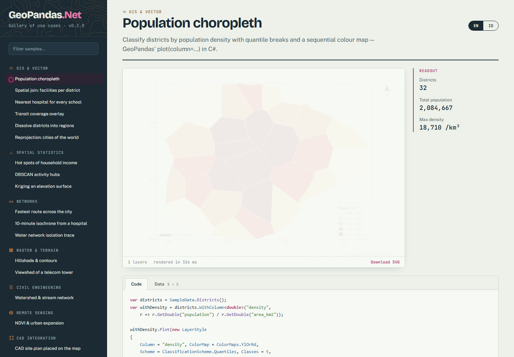 | 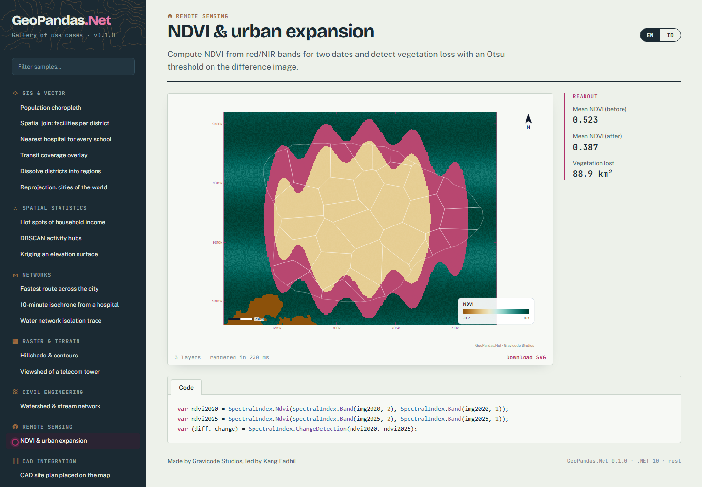 |
| 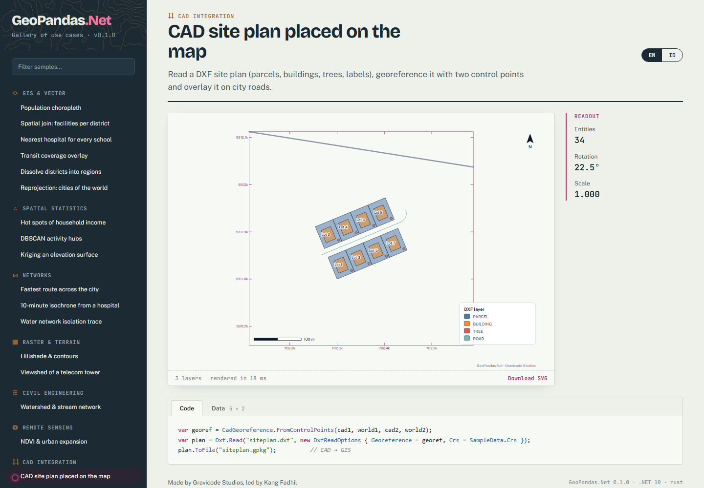 |  |
| 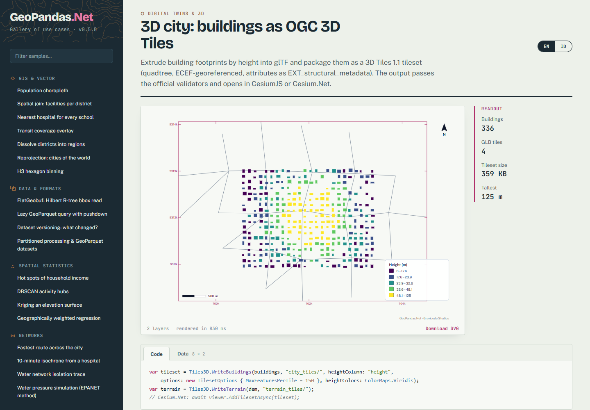 | 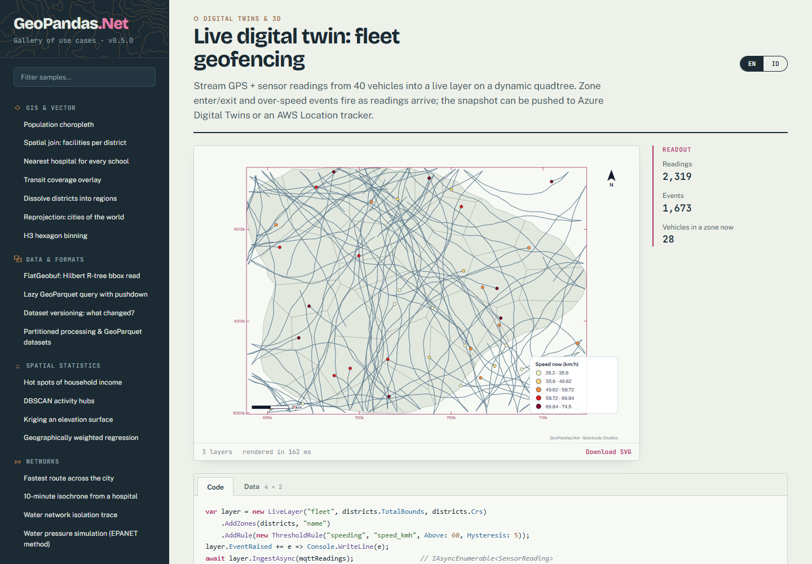 |
| 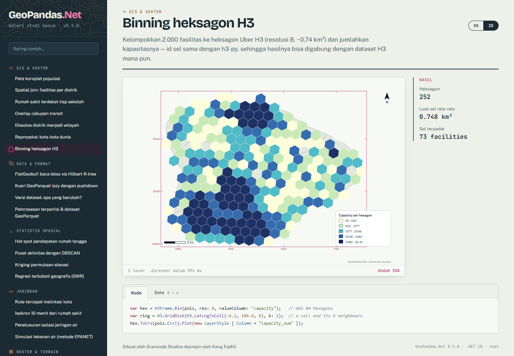 | 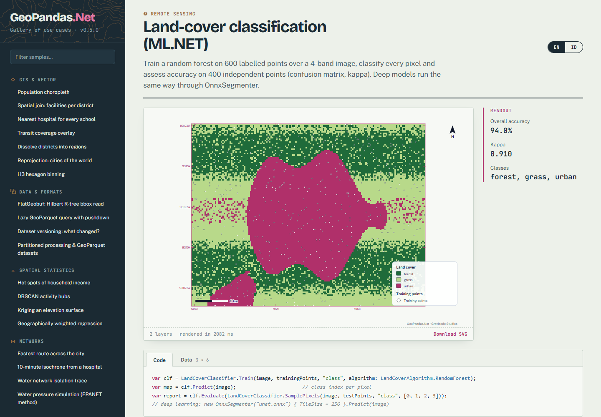 |

`gdf.Explore()` — interactive MapLibre map with hover tooltips and legend:

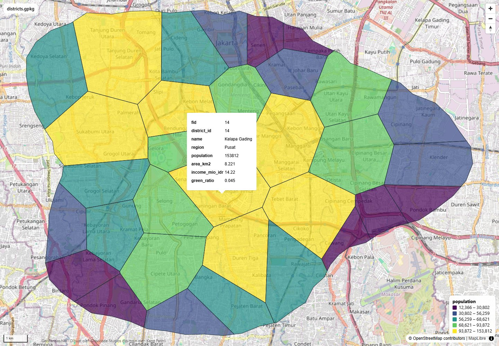

Avalonia desktop, including the Phase 2 data & format samples:

| | |
|---|---|
|  | 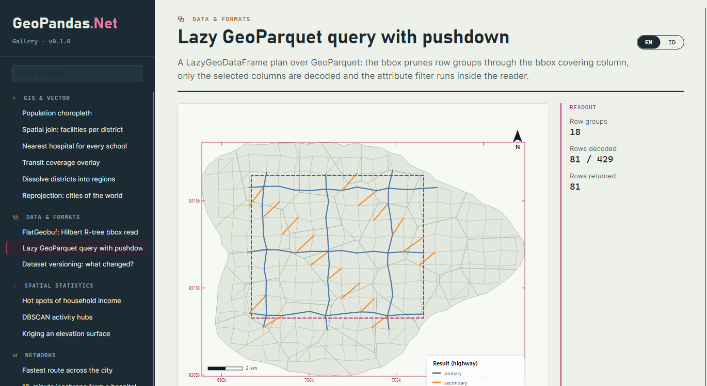 |
|  | 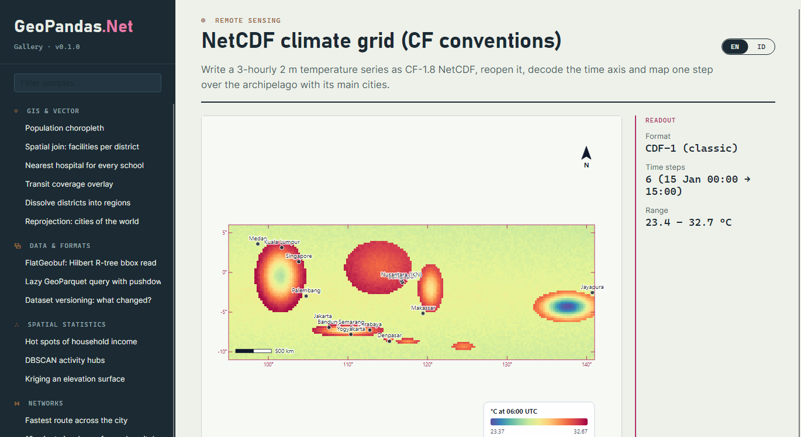 |
| 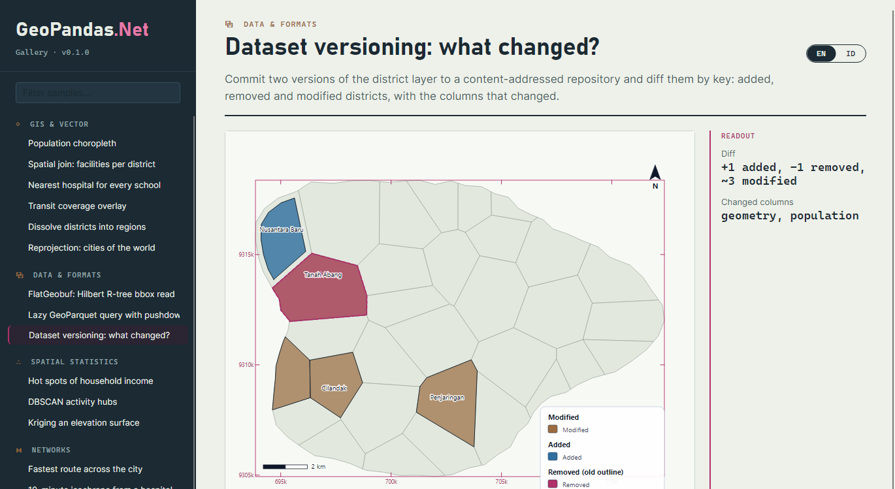 |  |

## CLI

```bash
dotnet tool install -g GeoPandas.Net.Cli
gpd sample districts districts.gpkg
gpd info districts.gpkg
gpd convert districts.gpkg districts.geojson --to-crs EPSG:4326
gpd sjoin pois.geojson districts.gpkg joined.gpkg --predicate within
gpd plot districts.gpkg map.svg --column population --cmap YlOrRd
gpd route roads.shp --from 700000,9310000 --to 705000,9315000 --out route.geojson
gpd raster hillshade dem.tif hillshade.tif
gpd convert districts.gpkg districts.parquet                       # GeoParquet / .fgb / .feather
gpd scan roads.parquet --bbox 700000,9308000,704000,9312000 --where "highway=primary" --explain
gpd las ndsm tile.laz heights.tif --cell 1
gpd netcdf raster era5.nc t2m t2m.tif --index 0
gpd repo commit parcels.repo parcels.gpkg --m "weekly sync"
gpd ask districts.gpkg "5 distrik terpadat di wilayah Selatan?"
```

See [docs/en/tools.md](docs/en/tools.md) for every command.

## Building from source

Requirements: .NET SDK 10, plus Rust (cargo) if you want to build the optional native kernels.

```bash
cargo build --release --manifest-path native/geopandas_native/Cargo.toml   # optional, enables the "rust" backend
dotnet build GeoPandas.Net.slnx
dotnet test tests/GeoPandas.Net.Tests
dotnet run -c Release --project benchmarks/GeoPandas.Net.Benchmarks -- --filter "*"
```

Set `GEOPANDAS_NET_DISABLE_NATIVE=1` to force the managed SIMD path.

## License & credits

MIT. Geometry engine: NetTopologySuite (BSD-3). **Dibuat oleh Gravicode Studios dipimpin oleh Kang Fadhil.**
