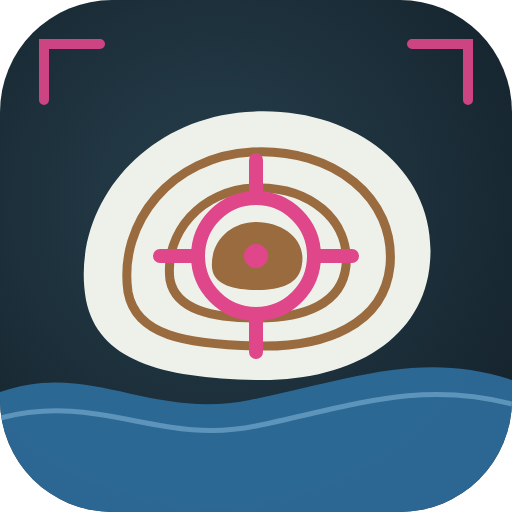
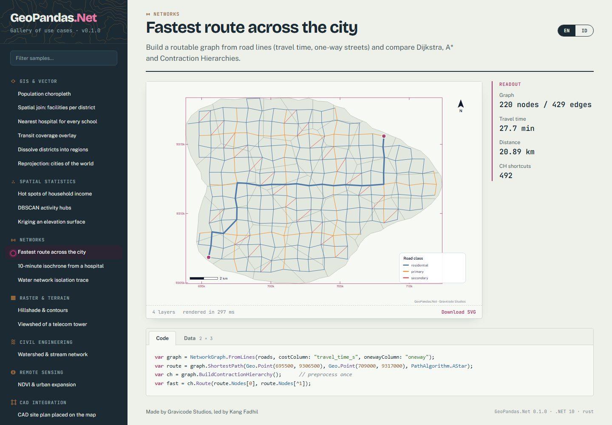
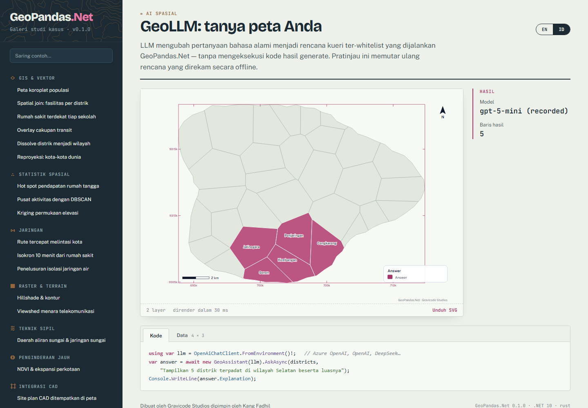
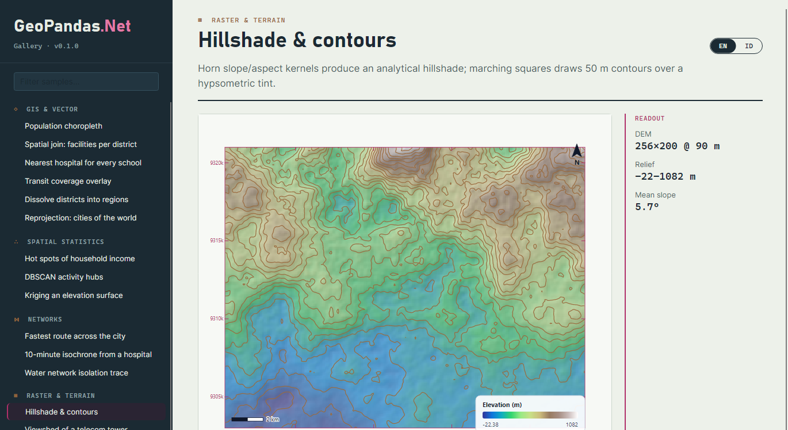

<p align="center"></p>

<h1 align="center">GeoPandas.Net</h1>
<p align="center"><b>Next-generation geospatial analytics for .NET 10</b><br>
GeoDataFrame · CRS engine · spatial index · GeoJSON / Shapefile / GeoPackage / DXF · spatial statistics · routing · rasters · GeoLLM</p>
<p align="center"><a href="README.id.md">🇮🇩 Baca dalam Bahasa Indonesia</a> · <a href="docs/en/index.md">Documentation</a> · <a href="PLAN.md">Roadmap</a> · <a href="Progress.md">Progress</a></p>

> **Dibuat oleh Gravicode Studios dipimpin oleh Kang Fadhil** — Made by Gravicode Studios, led by Kang Fadhil.

GeoPandas.Net re-implements and extends the ideas of Python's [GeoPandas](https://geopandas.org) for the .NET ecosystem. Like GeoPandas sits on Shapely/GEOS, GeoPandas.Net uses **NetTopologySuite** (the .NET port of JTS/GEOS) for robust geometry predicates and overlays. Everything above that is implemented here: a column-store `GeoDataFrame`, a CRS/projection engine with no PROJ dependency, STR-tree/KD-tree/quadtree/octree indexes, file formats, spatial statistics, network analysis, raster/terrain analytics, CAD conversion, an LLM assistant, and Rust + SIMD kernels.



## Highlights

| Area | What you get |
|---|---|
| **GeoDataFrame** | Immutable column store with typed columns and null bitmaps; `Filter`, `SortBy`, `GroupBy().Agg`, `Merge`, `Concat`, `Describe`, `ValueCounts`; geometry-aware `Head`/`Select`/`WithColumn` |
| **Geometry ops** | `Area`, `GeomLength`, `Buffer`, `Simplify`, `Centroid`, `ConvexHull`, `MakeValid`, affine ops, vectorised predicates, all parallel for large inputs |
| **Spatial joins** | `SJoin` (intersects / within / contains / touches / crosses / overlaps / covers…), `SJoinNearest` (exact branch-and-bound), `Overlay` (intersection, union, difference, symmetric difference, identity), `Dissolve`, `Clip`, `Explode`, `Cx` |
| **CRS engine** | EPSG registry (WGS 84, Web/World Mercator, 120 UTM zones, NAD83 UTM, **DGN95 / Indonesia TM-3**, Lambert-93, CONUS Albers, British National Grid…), PROJ.4, OGC WKT1, ESRI .prj and WKT2 parsing, 7-parameter Helmert datum shifts, `EstimateUtmCrs` |
| **Spatial index** | STR-tree (bulk-loaded, flat arrays, k-NN), KD-tree, dynamic quadtree, octree (3-D / point clouds), GeoHash |
| **IO** | GeoJSON, ESRI Shapefile (.shp/.shx/.dbf/.prj/.cpg, Z), GeoPackage, CSV (WKT / lon-lat), DXF; all implemented here, behind a pluggable `GeoIO` driver registry |
| **Analytics** | Queen/rook/KNN/distance-band weights, Moran's I, Geary's C, LISA, Getis-Ord Gi* hot spots, DBSCAN, K-Means, IDW, ordinary kriging with variogram fitting |
| **Network** | Graphs from lines (costs, one-way), Dijkstra, A*, bidirectional Dijkstra, **Contraction Hierarchies**, service areas / isochrones, connected components, utility-network tracing |
| **Raster** | GeoTIFF / BigTIFF / COG reader (strips, tiles, Deflate, LZW, PackBits, predictor), GeoTIFF writer, slope, aspect, hillshade, ruggedness, viewshed, sink filling, D8 flow, accumulation, watersheds, NDVI/NDWI/NDBI/SAVI, Otsu change detection, zonal stats, rasterize, contours |
| **CAD** | DXF reader (LINE, LWPOLYLINE with bulges, POLYLINE, CIRCLE, ARC, ELLIPSE, SPLINE, TEXT, MTEXT, INSERT, 3DFACE) and R12 writer, two-point CAD → GIS georeferencing |
| **Spatial AI** | `GeoAssistant` (GeoLLM): natural language → whitelisted query plan, executed deterministically. Works with OpenAI, Azure OpenAI, DeepSeek or any OpenAI-compatible endpoint |
| **Maps** | `gdf.Plot()` returns a renderer-agnostic `MapScene` (choropleth, categorical, proportional symbols, labels, legends, scale bar, north arrow, map-sheet frame) that can be drawn as SVG, in Blazor, or natively in Avalonia |
| **Performance** | Rust native kernels (Rayon) with a `Vector<T>` SIMD managed fallback, CSR graphs, `Span<T>`/`ArrayPool<T>`, AOT-compatible core packages |

## Quick start

```bash
dotnet add package GeoPandas.Net
```

```csharp
using GeoPandas.Net;
using GeoPandas.Net.Data;
using GeoPandas.Net.Geometry;
using GeoPandas.Net.Plotting;

var districts = Gpd.ReadFile("districts.gpkg");          // GeoJSON, .shp, .gpkg, .csv, .dxf
var schools   = Gpd.ReadFile("schools.geojson").ToCrs(districts.Crs!);

// Spatial join + group by
var perDistrict = schools.SJoin(districts, SpatialPredicate.Within)
                         .GroupBy("name_right")
                         .Agg(("name_left", AggFunc.Count, "schools"));

// Reproject to metres, measure, buffer
var utm  = districts.ToCrs(districts.EstimateUtmCrs());
var area = utm.Area();                                     // m²
var walk = schools.ToCrs(utm.Crs!).Buffer(500).Dissolve(); // 500 m walking catchment

// Map → SVG
utm.WithColumn(area.Rename("area_m2"))
   .Plot(new LayerStyle { Column = "area_m2", ColorMap = ColorMaps.Viridis }, "District area")
   .SaveSvg("area.svg");

utm.ToFile("districts_utm.shp");
```

More examples: [Getting started](docs/en/getting-started.md) · [GeoDataFrame & IO](docs/en/vector.md) · [Analysis](docs/en/analysis.md) · [CAD & AI](docs/en/integrations.md).

## Packages

| Package | Contents |
|---|---|
| `GeoPandas.Net` | Meta-package with everything below, plus the `Gpd` facade |
| `GeoPandas.Net.Geometry` | Geometry factory, CRS engine, spatial indexes, geodesy, native kernels |
| `GeoPandas.Net.Core` | `DataFrame`, `GeoSeries`, `GeoDataFrame`, spatial joins/overlay, `MapScene` plotting |
| `GeoPandas.Net.Data` | GeoJSON, Shapefile, GeoPackage, CSV, `GeoIO` registry |
| `GeoPandas.Net.Analytics` | Spatial weights, autocorrelation, hot spots, clustering, interpolation |
| `GeoPandas.Net.Network` | Routing, Contraction Hierarchies, isochrones, utility tracing |
| `GeoPandas.Net.Raster` | GeoTIFF/COG IO, terrain, hydrology, spectral indices, zonal statistics |
| `GeoPandas.Net.CAD` | DXF read/write, CAD ⇄ GIS georeferencing |
| `GeoPandas.Net.AI` | GeoLLM assistant, OpenAI / Azure OpenAI client |
| `GeoPandas.Net.Datasets` | Reproducible sample data (city, roads, POIs, DEM, imagery, CAD plan, world cities) |
| `GeoPandas.Net.Cli` | `gpd` command-line tool (`dotnet tool install -g GeoPandas.Net.Cli`) |
| `GeoPandas.Net.Templates` | `dotnet new gpd-console`, `gpd-blazor`, `gpd-avalonia` |

## Gallery (Blazor web + Avalonia desktop)

18 live samples across GIS, spatial statistics, networks, raster, civil engineering, remote sensing, CAD and AI. The web and desktop galleries render from the same scene display list, so their maps are identical. The UI is bilingual (EN/ID).

```bash
dotnet run --project gallery/GeoPandas.Net.Gallery.Blazor     # http://localhost:5280
dotnet run --project gallery/GeoPandas.Net.Gallery.Avalonia
```

| | |
|---|---|
|  |  |
|  |  |

Avalonia desktop:



## CLI

```bash
dotnet tool install -g GeoPandas.Net.Cli
gpd sample districts districts.gpkg
gpd info districts.gpkg
gpd convert districts.gpkg districts.geojson --to-crs EPSG:4326
gpd sjoin pois.geojson districts.gpkg joined.gpkg --predicate within
gpd plot districts.gpkg map.svg --column population --cmap YlOrRd
gpd route roads.shp --from 700000,9310000 --to 705000,9315000 --out route.geojson
gpd raster hillshade dem.tif hillshade.tif
gpd ask districts.gpkg "5 distrik terpadat di wilayah Selatan?"
```

See [docs/en/tools.md](docs/en/tools.md) for every command.

## Building from source

Requirements: .NET SDK 10, plus Rust (cargo) if you want to build the optional native kernels.

```bash
cargo build --release --manifest-path native/geopandas_native/Cargo.toml   # optional, enables the "rust" backend
dotnet build GeoPandas.Net.slnx
dotnet test tests/GeoPandas.Net.Tests
dotnet run -c Release --project benchmarks/GeoPandas.Net.Benchmarks -- --filter "*"
```

Set `GEOPANDAS_NET_DISABLE_NATIVE=1` to force the managed SIMD path.

## License & credits

MIT. Geometry engine: NetTopologySuite (BSD-3). **Dibuat oleh Gravicode Studios dipimpin oleh Kang Fadhil.**
