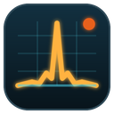
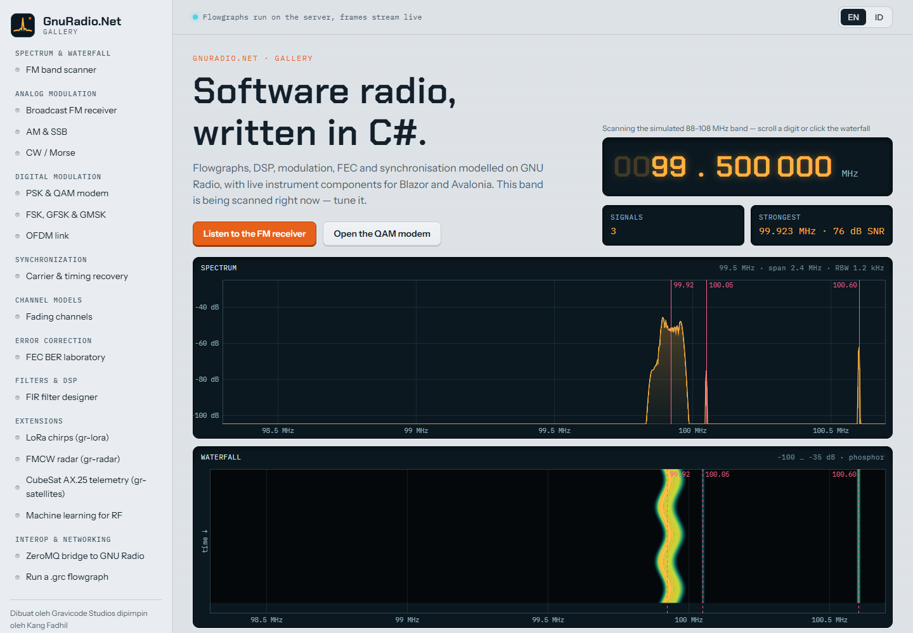
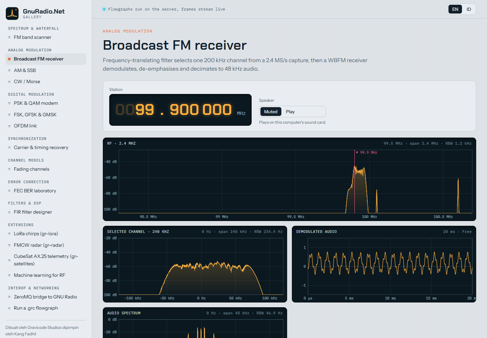
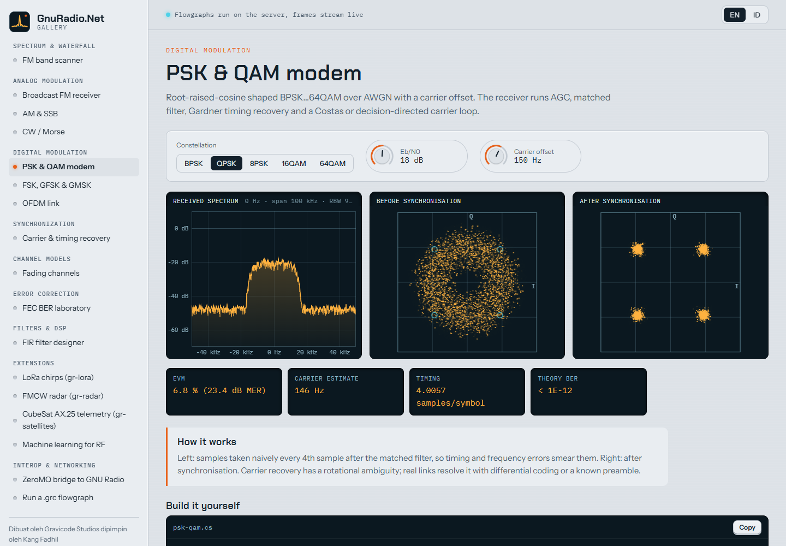
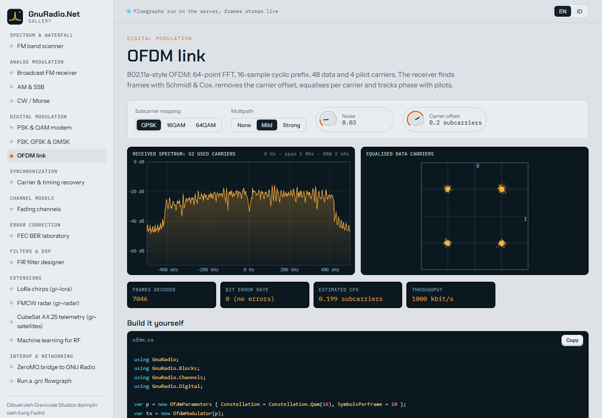
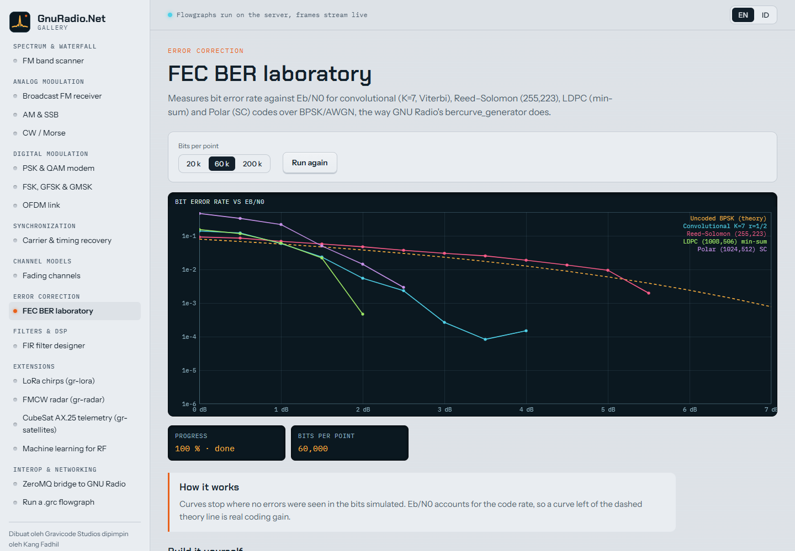
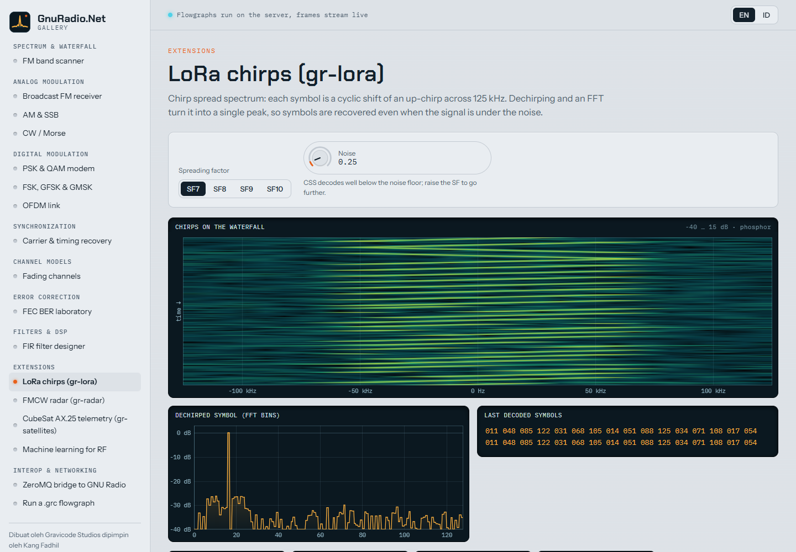
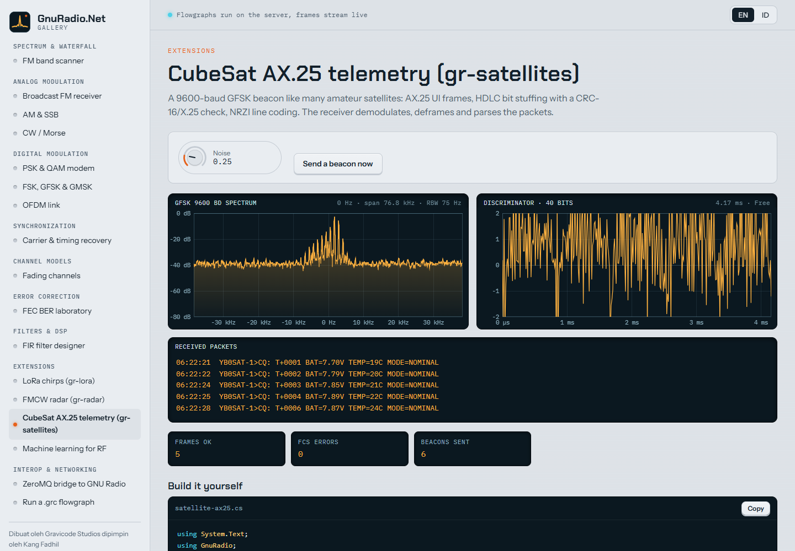
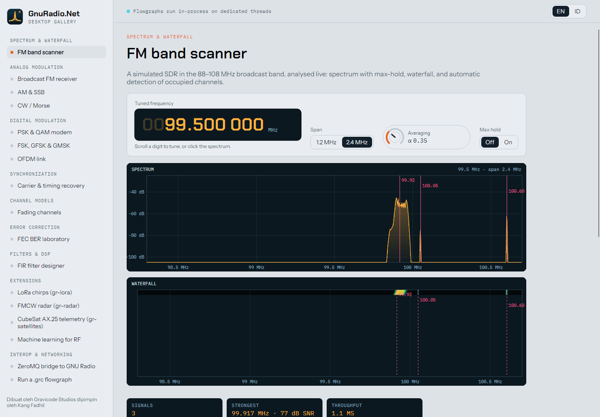
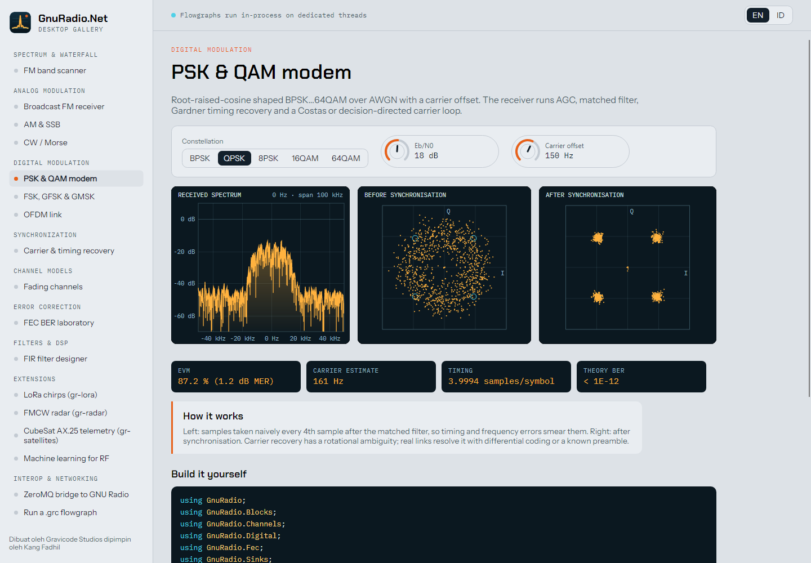

<p align="center"></p>

<h1 align="center">GnuRadio.Net</h1>

<p align="center">
Software Defined Radio and DSP for .NET 10, modelled on <a href="https://github.com/gnuradio/gnuradio">GNU Radio</a> —
flowgraphs, filters, FFT, analog and digital modulation, FEC, synchronisation, channel models, networking, SDR hardware,
and live instrument components for <b>Blazor</b> and <b>Avalonia</b>.
</p>

<p align="center"><b>Dibuat oleh Gravicode Studios dipimpin oleh Kang Fadhil</b></p>

<p align="center"><a href="README.id.md">Baca dalam Bahasa Indonesia</a> · <a href="docs/en/index.md">Documentation</a> · <a href="docs/id/index.md">Dokumentasi</a></p>



## What it is

GnuRadio.Net brings GNU Radio's programming model to C#: you connect **blocks** into a **flowgraph**, and a
thread-per-block scheduler streams samples between them through lock-free ring buffers. Block names, parameters and
behaviour follow GNU Radio (`fir_filter_ccf`, `quadrature_demod_cf`, `costas_loop_cc`, `channel_model`…), so GNU Radio
knowledge and flowgraphs carry over, and the two can work together:

- **Run `.grc` files** from GNU Radio Companion, or convert them to C# (`GnuRadio.Net.Grc`).
- **Exchange samples and PDUs** with GNU Radio over ZeroMQ, byte-compatible with `gr-zeromq` (`GnuRadio.Net.ZeroMQ`).
- **Read and write** GNU Radio's raw sample files (`.cfile`) directly.

It is a native .NET implementation — no Python, no GNU Radio install — so it runs anywhere .NET 10 runs, including
inside web servers and desktop apps. An optional Rust library accelerates FIR filtering and FFTs.

```csharp
using GnuRadio;
using GnuRadio.Analog;
using GnuRadio.Filter;
using GnuRadio.Hardware;
using GnuRadio.Sinks;

var sdr = new SimulatedSdrDevice { CenterFrequency = 99.5e6, SampleRate = 2.4e6 };   // or Sdr.RtlSdr(), Sdr.HackRf()…
var channel = new FreqXlatingFirFilter(10, Firdes.LowPass(1, 2.4e6, 100e3, 50e3), 99.9e6 - 99.5e6, 2.4e6);
var audio = new TimeSink<float>(1024, 48e3);

var fg = new Flowgraph("wbfm");
fg.Connect(new SdrSource(sdr), channel, new WbfmReceive(240e3, 5), audio);
fg.Start();
```

## Packages

| Package | Contents |
|---|---|
| `GnuRadio.Net` | Runtime (flowgraph, scheduler, buffers, tags, messages/PMT, hierarchical blocks), blocks, filters (FIR/IIR/resamplers/firdes), FFT & spectral estimation, analog (AM/FM/SSB/PM/CW, PLL, AGC), digital (PSK/QAM/FSK/GMSK/OFDM, packets, scramblers), FEC (CRC, Reed–Solomon, Viterbi, LDPC, Polar), synchronisation (Costas, Gardner, M&M, correlators), channels (AWGN, fading, Doppler, multipath), TCP/UDP, visual sinks, extensions (LoRa CSS, FMCW radar, AX.25/HDLC, signal detector, modulation classifier), SIMD kernels (VOLK-like) |
| `GnuRadio.Net.Blazor` | `<SpectrumView>`, `<WaterfallView>`, `<ConstellationView>`, `<TimeScope>`, `<VectorView>`, `<LineChart>`, `<Knob>`, `<FrequencyReadout>`, `<LevelMeter>`, `<FlowgraphView>` |
| `GnuRadio.Net.Avalonia` | The same displays and controls for desktop |
| `GnuRadio.Net.Hardware` | SoapySDR bindings (USRP, PlutoSDR, LimeSDR, HackRF, bladeRF, RTL-SDR, Airspy), managed `rtl_tcp` client, simulated SDR |
| `GnuRadio.Net.ZeroMQ` | PUB/SUB and PUSH/PULL stream blocks, PMT message blocks — wire-compatible with `gr-zeromq` |
| `GnuRadio.Net.Grc` | Load and run GNU Radio Companion `.grc` files; generate equivalent C# |

```bash
dotnet add package GnuRadio.Net
dotnet add package GnuRadio.Net.Blazor     # or GnuRadio.Net.Avalonia
```

## Gallery

Seventeen live use cases, each with its controls, instrument displays, readouts and copyable sample code, in both a
Blazor web app and an Avalonia desktop app, in English and Bahasa Indonesia.

```bash
dotnet run --project samples/GnuRadio.Net.Gallery.Web       # http://localhost:5180
dotnet run --project samples/GnuRadio.Net.Gallery.Desktop
```

| | |
|---|---|
|  |  |
|  |  |
|  |  |
|  |  |

Demos: FM band scanner · broadcast FM receiver · AM & SSB · CW/Morse · PSK & QAM modem · FSK/GFSK/GMSK · OFDM link ·
carrier & timing recovery · fading channels · FEC BER laboratory · FIR designer · LoRa chirps · FMCW radar ·
CubeSat AX.25 telemetry · machine learning for RF · ZeroMQ bridge · running a `.grc` file.

## Build, test, benchmark

```bash
dotnet build GnuRadio.Net.slnx
dotnet test tests/GnuRadio.Net.Tests                       # 130+ tests
dotnet run -c Release --project tests/GnuRadio.Net.Benchmarks -- --filter *
pwsh native/build.ps1                                      # optional Rust kernels (needs cargo)
```

## Documentation

English: [index](docs/en/index.md) · [getting started](docs/en/getting-started.md) · [architecture](docs/en/architecture.md) ·
[blocks](docs/en/blocks.md) · [UI components](docs/en/ui-components.md) · [hardware](docs/en/hardware.md) ·
[interop with GNU Radio](docs/en/interop.md) · [performance](docs/en/performance.md) · [gallery](docs/en/gallery.md)

Roadmap: [PLAN.md](PLAN.md) · progress: [Progress.md](Progress.md)

## Relationship to GNU Radio

GnuRadio.Net is an independent .NET implementation inspired by GNU Radio's architecture and block library; it does
not contain or link GNU Radio code. GNU Radio is a project of the GNU Radio Foundation. GnuRadio.Net is MIT licensed.

---

**Dibuat oleh Gravicode Studios dipimpin oleh Kang Fadhil.** © 2026 Gravicode Studios — [MIT License](LICENSE).
