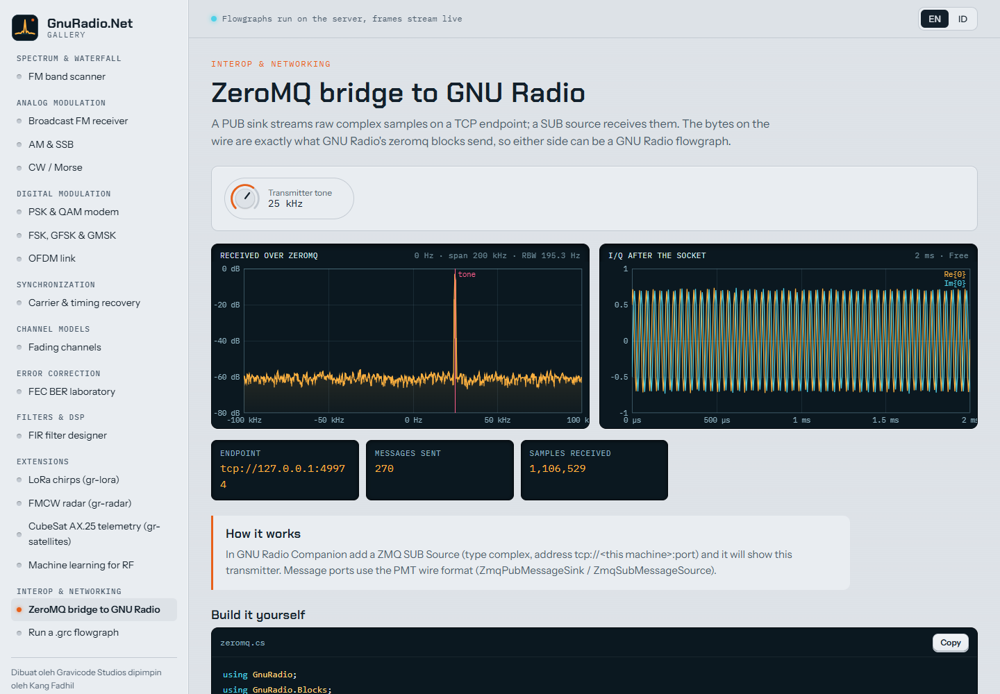
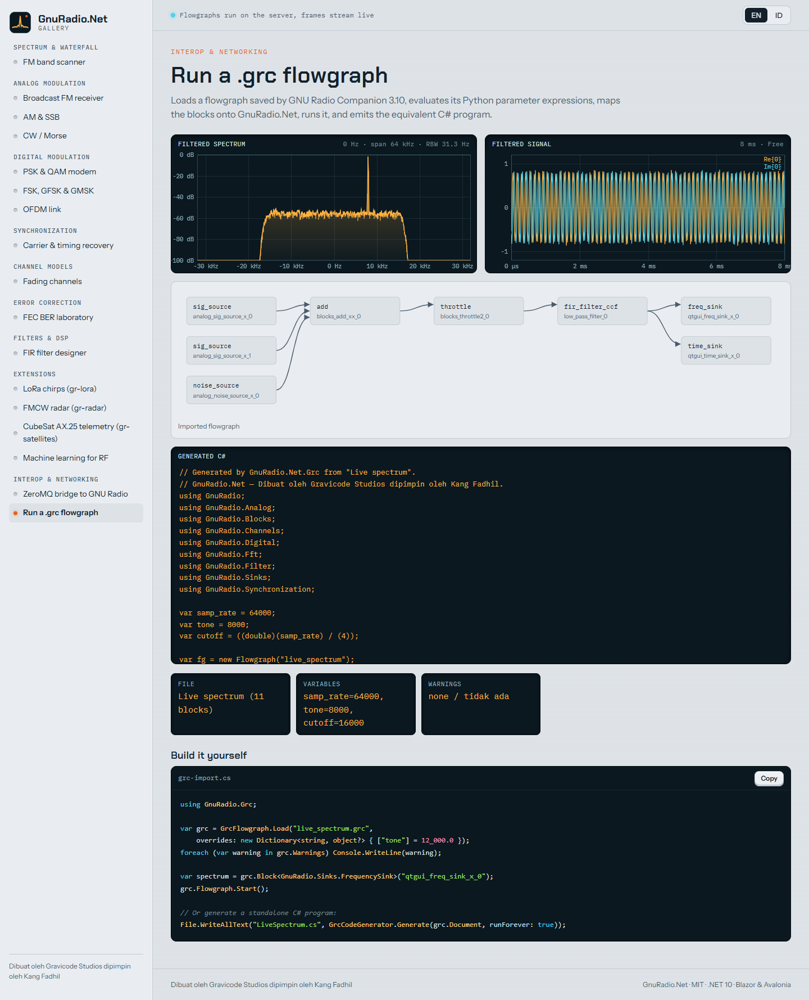

# Interop with GNU Radio

*Dibuat oleh Gravicode Studios dipimpin oleh Kang Fadhil.* · [Bahasa Indonesia](../id/interop.md)

## ZeroMQ

`GnuRadio.Net.ZeroMQ` sends and receives exactly what GNU Radio's `gr-zeromq` blocks do (raw item bytes per message,
`pass_tags=False`), so a GNU Radio flowgraph and a .NET one can be two halves of the same system.

| GnuRadio.Net | GNU Radio |
|---|---|
| `ZmqPubSink<T>` / `ZmqSubSource<T>` | ZMQ PUB Sink / ZMQ SUB Source |
| `ZmqPushSink<T>` / `ZmqPullSource<T>` | ZMQ PUSH Sink / ZMQ PULL Source |
| `ZmqPubMessageSink` / `ZmqSubMessageSource` | ZMQ PUB/SUB Message Sink/Source (PMT wire format) |

```csharp
// .NET transmitter; in GNU Radio Companion add "ZMQ SUB Source", type complex, address tcp://<host>:5555
fg.Connect(source, new Throttle<Complex32>(1e6), new ZmqPubSink<Complex32>("tcp://*:5555"));
```

PUB never blocks (messages are dropped while nobody listens); PUSH applies back-pressure up to `BlockingTimeout`.
Messages are encoded with `PmtSerializer`, compatible with `pmt::serialize` for booleans, symbols, integers, doubles,
complex, pairs, dictionaries, tuples and u8/f32/c32 vectors.



## GNU Radio Companion files

`GnuRadio.Net.Grc` reads `.grc` files (the YAML format of GNU Radio 3.8+), evaluates the Python parameter expressions
(`samp_rate / 4`, `int(x // 2)`, `math.pi`, `1e3 if a else b`, lists, complex literals, `pmt.intern`,
`digital.constellation_qpsk()`…), maps blocks onto GnuRadio.Net and builds a runnable flowgraph. Disabled blocks are
skipped; bypassed blocks are wired through.

```csharp
using GnuRadio.Grc;

var grc = GrcFlowgraph.Load("receiver.grc", overrides: new Dictionary<string, object?> { ["freq"] = 99.9e6 });
foreach (var w in grc.Warnings) Console.WriteLine(w);       // unsupported blocks, failed expressions
var spectrum = grc.Block<GnuRadio.Sinks.FrequencySink>("qtgui_freq_sink_x_0");
grc.Flowgraph.Start();
```

QT GUI sinks become GnuRadio.Net visual sinks, so the same `.grc` can drive a Blazor or Avalonia UI. 86 block ids
are mapped (sources, math, conversions, filters, resamplers, FFT, analog, digital, channels, qtgui, file/wav/audio,
messages); add more with `GrcBlockLibrary.Register(id, new GrcMapping(create, code))`.

### C# code generation

GRC generates Python; `GrcCodeGenerator.Generate(document)` generates an equivalent C# program with variables,
blocks and connections, and TODO comments for blocks without an equivalent.



## Files

`FileSource<Complex32>` reads GNU Radio's `.cfile` captures (interleaved float32) directly; `FileSink<T>` writes them.
`InterleavedShortToComplex`, `InterleavedCharToComplex` and `InterleavedUCharToComplex` read 16-bit, signed 8-bit
(HackRF) and unsigned 8-bit (RTL-SDR) recordings.

## TCP and UDP

`TcpSink`/`TcpSource` and `UdpSink`/`UdpSource` carry raw items, interoperating with GNU Radio's network blocks,
`nc`, and any program that reads raw samples.
