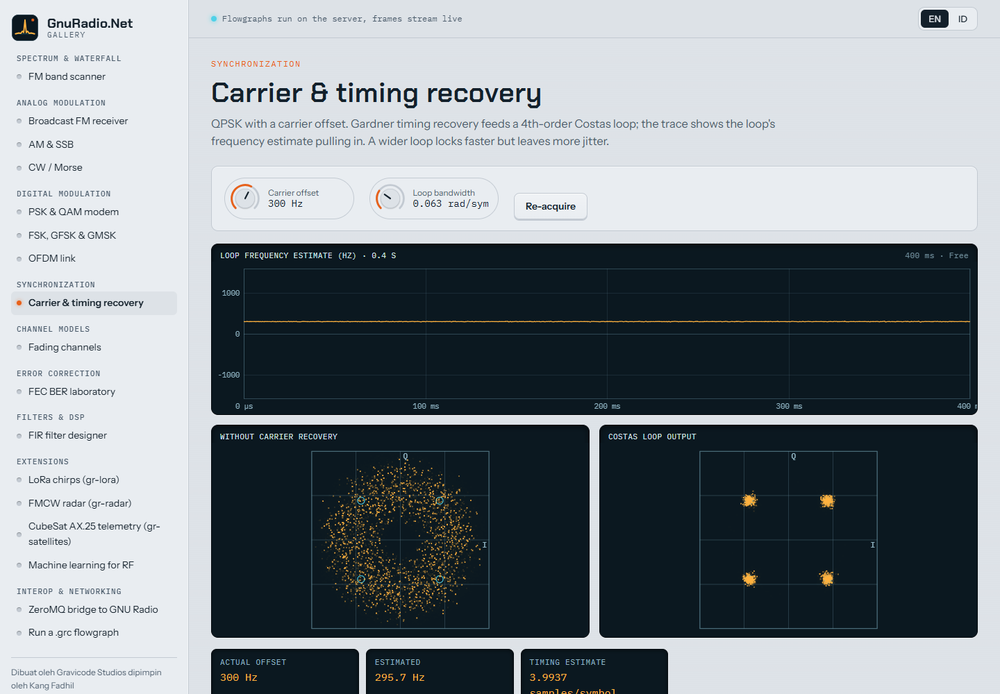
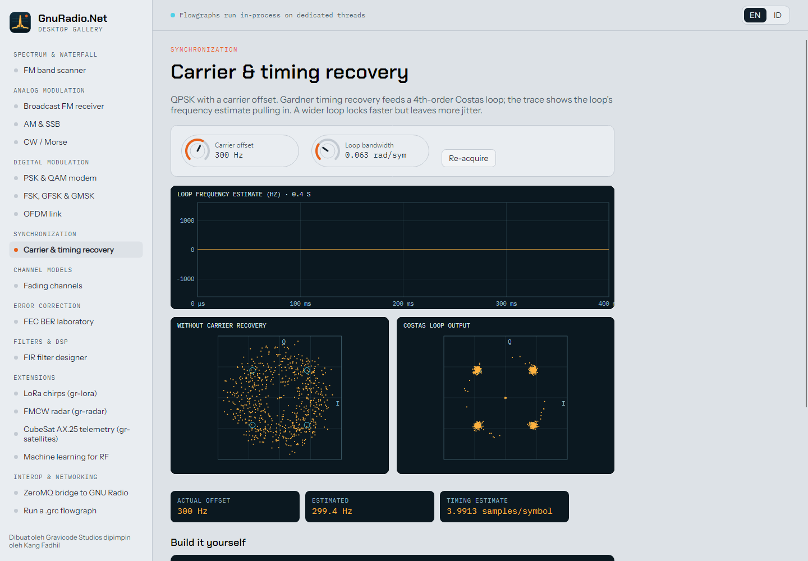
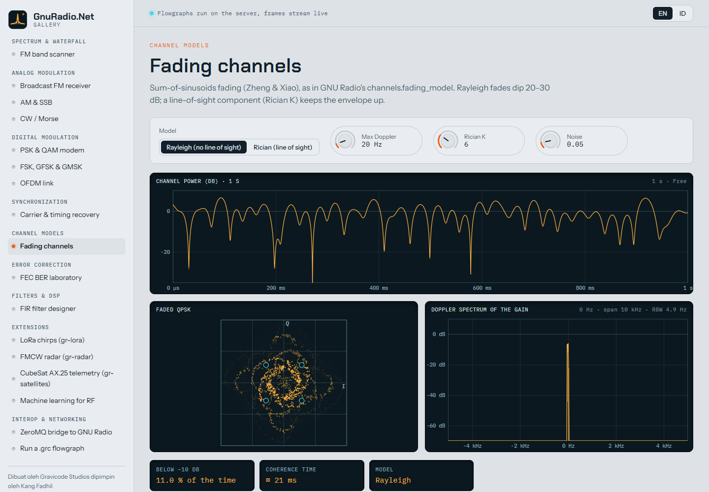
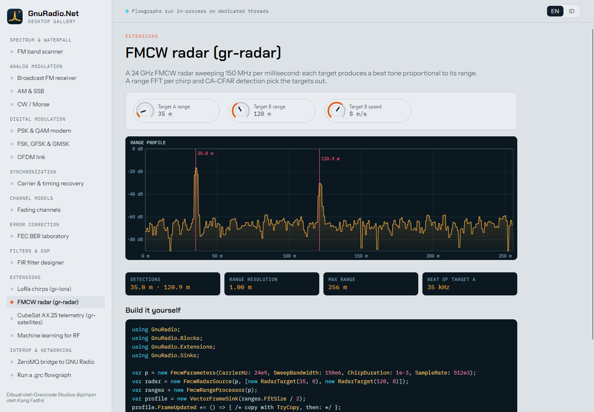

# Galeri GnuRadio.Net

*Dibuat oleh Gravicode Studios dipimpin oleh Kang Fadhil.* · [English](../en/gallery.md)

Dua aplikasi menampilkan 17 demo yang sama dari `samples/GnuRadio.Net.Gallery.Shared`:

```bash
dotnet run --project samples/GnuRadio.Net.Gallery.Web        # Blazor, http://localhost:5180
dotnet run --project samples/GnuRadio.Net.Gallery.Desktop    # Avalonia
```

Keduanya dapat beralih antara bahasa Inggris dan Bahasa Indonesia. Setiap demo memiliki panel depan (pembacaan frekuensi,
knob, pilihan, tombol), layar instrumen, strip pembacaan nilai secara langsung, penjelasan, dan contoh kode C#-nya.

| Kategori | Demo |
|---|---|
| Spektrum & waterfall | Pemindai pita FM (SDR simulasi, deteksi sinyal, klik untuk menyetel) |
| Analog | Penerima siaran FM (dengan keluaran audio Windows) · AM & SSB · CW/Morse dengan dekoding |
| Digital | Modem PSK & QAM · FSK/GFSK/GMSK · Tautan OFDM |
| Sinkronisasi | Pemulihan pembawa & timing (jejak lock-in Costas) |
| Kanal | Fading Rayleigh/Rician dengan Doppler |
| Koreksi galat | Laboratorium BER: konvolusional, Reed–Solomon, LDPC, Polar dibandingkan dengan teori |
| Filter & DSP | Perancang FIR dengan respons langsung |
| Ekstensi | Chirp LoRa · Radar FMCW · Telemetri AX.25 CubeSat · Machine learning untuk RF |
| Interoperabilitas | Jembatan ZeroMQ · Menjalankan berkas `.grc` dengan pembuatan kode C# |

| Web | Desktop |
|---|---|
|  |  |
|  |  |

## Menambahkan demo

Turunkan dari `Demo`, bangun flowgraph di `Build()`, daftarkan panel dengan `AddView`, kontrol dengan `AddParameter`,
pembacaan nilai dengan `AddReadout`, lalu tambahkan factory-nya ke `DemoCatalog`:

```csharp
public sealed class ToneDemo : Demo
{
    private SignalSource<Complex32>? _tone;

    public ToneDemo() => AddParameter(new NumberParameter("f", new("Tone", "Nada"), -20e3, 20e3, 100, 5e3,
        v => { if (_tone is not null) _tone.Frequency = v; }) { Unit = "Hz" });

    public override string Id => "tone";
    public override DemoCategory Category => DemoCategory.Spectrum;
    public override Text Title => new("Tone", "Nada");
    public override Text Summary => new("A single tone.", "Satu nada.");
    public override string Code => "…";

    protected override Flowgraph Build()
    {
        _tone = new SignalSource<Complex32>(48e3, Waveform.Cosine, 5e3);
        var spectrum = new FrequencySink(1024, 48e3);
        var fg = new Flowgraph("tone");
        fg.Connect(_tone, new Throttle<Complex32>(48e3), spectrum);
        AddView(new SpectrumPanel(new("Spectrum", "Spektrum"), spectrum));
        return fg;
    }
}
```

Kedua galeri akan mengambilnya secara otomatis. `GalleryDemoTests` menjalankan setiap demo secara headless di CI.

Tangkapan layar: versi web diambil dengan Edge headless; aplikasi desktop me-render-nya sendiri dengan
`dotnet run --project samples/GnuRadio.Net.Gallery.Desktop -- --screenshots docs/images` (Avalonia headless + Skia).
