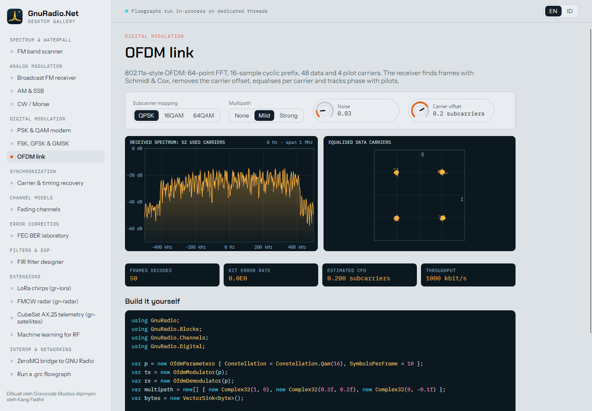

# Komponen UI

*Dibuat oleh Gravicode Studios dipimpin oleh Kang Fadhil.* · [English](../en/ui-components.md)

Kedua pustaka menampilkan tampilan instrumen yang sama: layar gelap dengan jejak berwarna amber dan cyan, grid dengan
tick yang rapi, marker, dan klik-untuk-menyetel (click-to-tune). Keduanya membaca dari sink visual di `GnuRadio.Sinks`,
yang memublikasikan frame dengan penghitung versi — sebuah tampilan hanya menyalin data ketika versinya berubah, sehingga
tampilan yang diam tidak memakan biaya dan proses rendering tidak pernah menghambat pemrosesan sinyal.

| Sink | Blazor | Avalonia |
|---|---|---|
| `FrequencySink` | `<SpectrumView>` | `SpectrumView` |
| `WaterfallSink` | `<WaterfallView>` | `WaterfallView` |
| `ConstellationSink` | `<ConstellationView>` | `ConstellationView` |
| `TimeSink<T>` | `<TimeScope T="…">` | `TimeScope` |
| `VectorFrameSink` atau fungsi data | `<VectorView>` | `VectorView` |
| fungsi deret | `<LineChart>` | `LineChart` |
| `Flowgraph` | `<FlowgraphView>` | `FlowgraphView` |
| kontrol | `<Knob>`, `<FrequencyReadout>`, `<LevelMeter>` | `Knob`, `FrequencyReadout` |

## Blazor

Membutuhkan rendering interaktif (Server atau WebAssembly). Tambahkan stylesheet sekali saja:

```html
<link rel="stylesheet" href="_content/GnuRadio.Net.Blazor/gnuradio.css" />
```

```razor
@using GnuRadio.Blazor.Components

<SpectrumView Sink="_spectrum" MinDb="-100" MaxDb="-20" Title="RF" Height="260px"
              MarkerSource="() => _markers" OnTune="f => _receiver.CenterFrequency = f" />
<WaterfallView Sink="_waterfall" MinDb="-100" MaxDb="-35" Colormap="Colormap.Phosphor" />
<ConstellationView Sink="_constellation" Reference="Constellation.Qam(16).Points" Scale="1.4f" />
<TimeScope T="float" Sink="_audio" Min="-1" Max="1" />
<FrequencyReadout @bind-Value="_frequency" Min="88e6" Max="108e6" Label="Tuned" />
<Knob Label="Noise" @bind-Value="_noise" Min="0" Max="1" Step="0.01" />
```

Data dikirim ke browser sebagai byte float mentah (Blazor mengirim `byte[]` sebagai biner), dan penggambaran dilakukan
dengan canvas 2D di `gnuradio.js`. Warna berupa CSS custom property (`--gr-screen`, `--gr-trace`, `--gr-accent`…):
definisikan ulang pada `:root` untuk mengganti tema; sasis gelap diterapkan otomatis di bawah `prefers-color-scheme: dark`.

Parameter langsung: `MarkerSource`, `DataSource` (VectorView) dan `SeriesSource`/`RevisionSource` (LineChart) adalah
fungsi yang dipanggil (polling) setiap frame, sehingga nilai yang dihitung oleh flowgraph Anda muncul tanpa perlu
me-render ulang halaman.

## Avalonia

```csharp
using GnuRadio.Avalonia;

var spectrum = new SpectrumView { Sink = freqSink, MinDb = -100, MaxDb = -20, Title = "RF", Height = 260 };
spectrum.Tuned += f => xlate.CenterFrequency = f - center;
var waterfall = new WaterfallView { Sink = waterfallSink };
var knob = new Knob { Label = "Noise", Minimum = 0, Maximum = 1, Step = 0.01 };
knob.ValueChangedByUser += v => noise.NoiseVoltage = (float)v;
```

Setiap tampilan melakukan polling ke sink-nya dengan `DispatcherTimer` selama tampilan tersebut berada di layar (`Fps`,
bawaan 30). Waterfall di-render ke dalam `WriteableBitmap` yang bergeser satu baris per spektrum. Warna dan font
disimpan di `GrTheme`.


