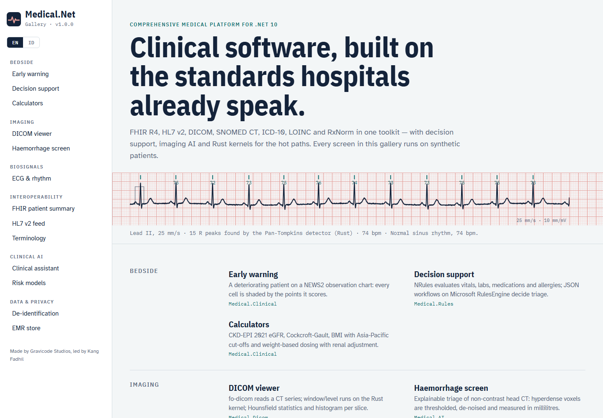

# Medical.Net

**Comprehensive Medical Platform for .NET.** Made by Gravicode Studios, led by Kang Fadhil
(*Dibuat oleh Gravicode Studios dipimpin oleh Kang Fadhil*).



Building blocks for hospital information systems, EMR/EHR, health-data exchange, imaging and clinical AI on .NET 10:

- **Medical.Core**: patient / encounter / observation model, clinical codings, UCUM units, audit trail, DI (`services.AddMedical(...)`)
- **Medical.Fhir**: Firely SDK R4 mapping, transaction and International Patient Summary bundles, validation, FHIRPath, in-memory FHIR store, SATUSEHAT client
- **Medical.Hl7**: NHapi HL7 v2 parse/build (ADT, ORU, ACK), HL7 v2 → FHIR, MLLP server and client
- **Medical.Dicom**: fo-dicom metadata, window/level rendering, HU statistics, PS3.15 de-identification, DICOMweb, C-ECHO / C-STORE SCU + SCP
- **Medical.Terminology**: ICD-10, SNOMED CT, LOINC, RxNorm — bilingual search, subsumption, maps, check digits, release loaders
- **Medical.Clinical**: NEWS2, qSOFA, SOFA, APACHE II, PEWS, MEOWS, Wells, PERC, Child-Pugh, ASCVD / Framingham, WHO growth standards, CKD-EPI 2021, renal / hepatic dosing, lab interpretation
- **Medical.Rules**: NRules decision support (sepsis, early warning, drug interactions, allergies, renal dosing) + JSON workflows on Microsoft RulesEngine; pluggable drug-interaction sources (FDA-label contraindications, CSV, DrugBank XML)
- **Medical.AI**: ML.NET risk models with explanations, Claude / OpenAI-compatible / offline clinical assistant, CT haemorrhage and lung-nodule AI, clinical NLP with ICD-10 suggestions, guideline answers with citations, federated learning, model cards, drift monitoring
- **Medical.HuggingFace**: Hugging Face NER and sentence embeddings in-process via HF.Net
- **Medical.Signals / Privacy / Emr / AspNetCore / Visualization / Native** (Rust kernels) · **Medical.Cli** · **Medical.Templates**

```csharp
var record = SyntheticData.Record(3, deterioration: 0.8);
Console.WriteLine(ClinicalScores.News2(record.LatestVitals!));             // NEWS2 14/20 (High)
foreach (var a in new ClinicalDecisionSupport().Evaluate(record)) Console.WriteLine(a);
Bundle ips = new FhirMapper().ToPatientSummary(record);                    // FHIR R4 IPS document
```

> Medical.Net is a software toolkit, not a certified medical device. Clinical scores, rules and AI outputs support — never replace — the judgement of a qualified clinician.

Documentation (English & Bahasa Indonesia), gallery apps and source: https://github.com/DotNetVibeCoderz/Vibe_Components/tree/main/Medical.Net
