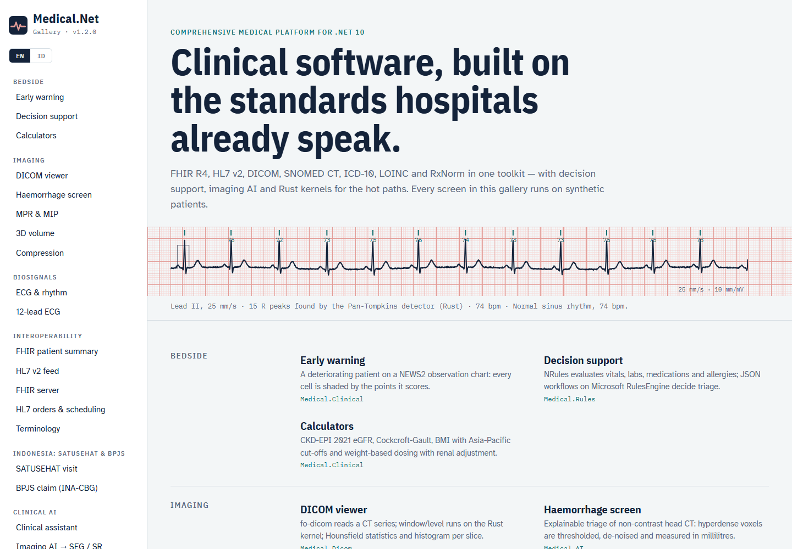

# Medical.Net documentation

Medical.Net — Comprehensive Medical Platform for .NET 10. Made by Gravicode Studios, led by Kang Fadhil. · [Bahasa Indonesia](../id/README.md)

| Guide | Contents |
|---|---|
| [Getting started](getting-started.md) | Install, first patient record, NEWS2, decision support, FHIR export |
| [Architecture](architecture.md) | Package layering, domain model, DI, events, audit, design rules |
| [Modules](modules.md) | Every package with examples: FHIR, HL7, DICOM, terminology, clinical, rules, signals, privacy, EMR, visualization |
| [Interoperability (v1.1)](interoperability.md) | FHIR server (search, `_include`, `_history`, persistence), profile validation, SMART on FHIR, SATUSEHAT workflow + KFA, HL7 orders / scheduling / documents / conformance, BPJS VClaim · PCare · E-Klaim / INA-CBG |
| [Imaging and signals (v1.2)](imaging-signals.md) | JPEG / JPEG-LS / JPEG 2000 codecs, volumes, MPR / MIP (Rust), isosurfaces + 3D (ThreeNet, three.js), DICOM SEG + TID 1500 SR, lung nodules + MONAI bundle, 12-lead ECG (QT/QTc, STEMI criteria), DICOM waveform and SCP-ECG |
| [Clinical AI](ai.md) | Risk models, the clinical assistant (Claude / OpenAI-compatible / offline), imaging AI and the MONAI service |
| [Deployment](deployment.md) | FHIR server, MLLP listener, SATUSEHAT, EMR database and cache, imaging service, security & compliance |
| [Tools](tools.md) | `medical` CLI, `dotnet new` templates, the Gallery apps and screenshots |
| [Native kernels](native.md) | The Rust crate, the managed fallback, building for other platforms |

> Medical.Net is a software toolkit, not a certified medical device. Clinical scores, rules and AI outputs support — never replace — the judgement of a qualified clinician.
