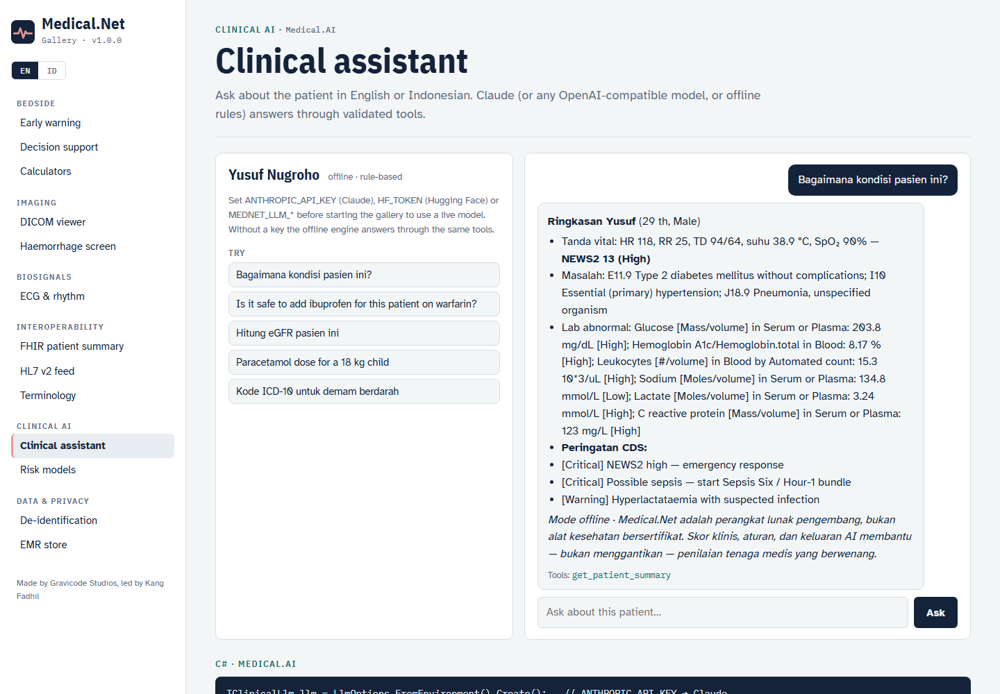

# Clinical AI



## Clinical assistant

`ClinicalAssistant` answers questions about the patient in context (English or Bahasa Indonesia). The model never computes clinical numbers itself: it calls `ClinicalTools` — `get_patient_summary`, `calculate_news2`, `calculate_qsofa`, `calculate_egfr`, `calculate_bmi`, `weight_based_dose`, `check_drug_safety`, `lookup_terminology` — and every call is returned in `AssistantReply.ToolCalls` and written to the audit log.

```csharp
IClinicalLlm llm = LlmOptions.FromEnvironment().Create();
var assistant = new ClinicalAssistant(llm, audit: auditLog) { Patient = record };
AssistantReply r = await assistant.AskAsync("Pasien ini kenapa? Hitung juga eGFR-nya.");
```

| Provider | How to enable | Notes |
|---|---|---|
| **Claude** (default when a key is present) | `ANTHROPIC_API_KEY` (+ `ANTHROPIC_WORKSPACE_ID` for keys not scoped to a workspace) | Official Anthropic C# SDK, model `claude-opus-5-5`, adaptive thinking, high effort, server-side refusal fallback (`fallbacks: "default"`) |
| Hugging Face Inference Providers | `HF_TOKEN` or `MEDNET_LLM_PROVIDER=huggingface` | `https://router.huggingface.co/v1`, default `Qwen/Qwen2.5-72B-Instruct` |
| Azure OpenAI / DeepSeek / Ollama / vLLM | `MEDNET_LLM_PROVIDER=openai`, `MEDNET_LLM_ENDPOINT`, `MEDNET_LLM_API_KEY`, `MEDNET_LLM_MODEL` | OpenAI-compatible chat completions with function calling |
| Offline | no key, or `MEDNET_LLM_PROVIDER=offline` | Deterministic bilingual keyword router over the same tools |

Add your own tool: `assistant.Tools.Add(new ClinicalTool(name, description, jsonSchema, (input, patient) => result))`.

## Risk models (ML.NET)

```csharp
var model = new DeteriorationRiskModel();      // age, NEWS2, qSOFA, lactate, WBC, CRP, eGFR, comorbidities
RiskModelMetrics m = model.Train();             // AUC ≈ 0.96 on a held-out synthetic split
RiskPrediction p = model.Predict(record);       // probability, band, bilingual interpretation
foreach (var d in p.Drivers) Console.WriteLine($"{d.Feature} {d.Contribution:+0.00}");
model.Save("deterioration.zip");

var dm = new DiabetesRiskModel();               // FINDRISC-inspired undiagnosed type 2 diabetes
```

L-BFGS logistic regression over standardised features, so each driver is `weight × z-score` on the log-odds scale. The bundled cohorts are synthetic — retrain and validate on local data before clinical use.

## Imaging AI

`HemorrhageScreener.Analyze(series)` — explainable non-contrast head-CT triage (3×3 smoothing, 50–90 HU, bone/air-edge suppression, connected components, volume in mL). It refuses non-head series. `HemorrhageScreener.Overlay(slice)` returns a PNG with the detected voxels in red.

### MONAI / PyTorch service

`services/medical-ai-service` is a FastAPI app with the same contract:

```bash
cd services/medical-ai-service
pip install -r requirements.txt            # add torch + monai and set MEDNET_MONAI_WEIGHTS for a learned UNet
uvicorn app:app --port 8000
```

```csharp
var report = await new ImagingAiClient(http, "http://localhost:8000").HemorrhageAsync(series);
```

`GET /health`, `POST /v1/ct/hemorrhage` (multipart DICOM). Without `MEDNET_MONAI_WEIGHTS` the service runs the classical pipeline (it matches the C# screener exactly); with weights it runs a MONAI 3D UNet with sliding-window inference. When the service is unreachable the client falls back to the in-process screener.
