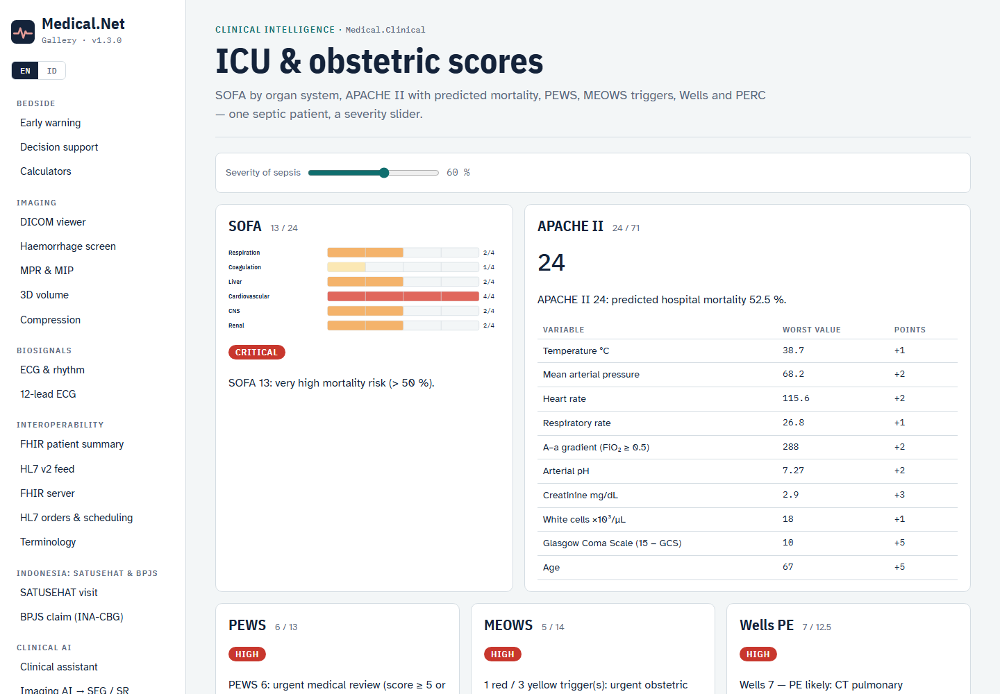
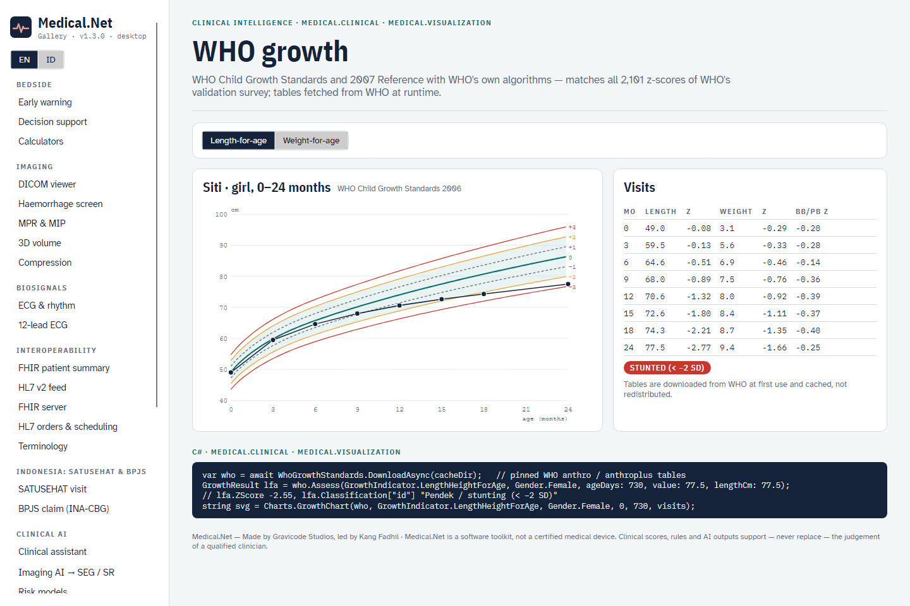
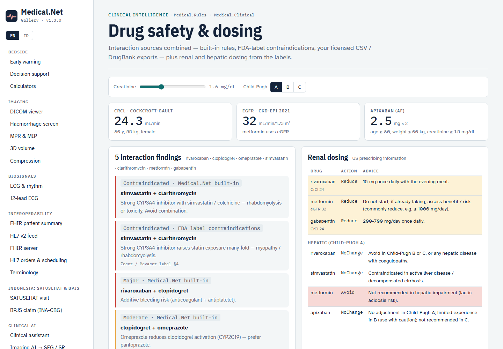
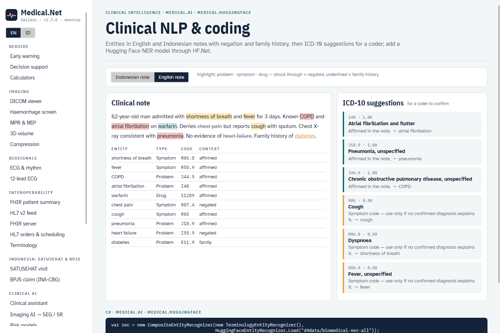
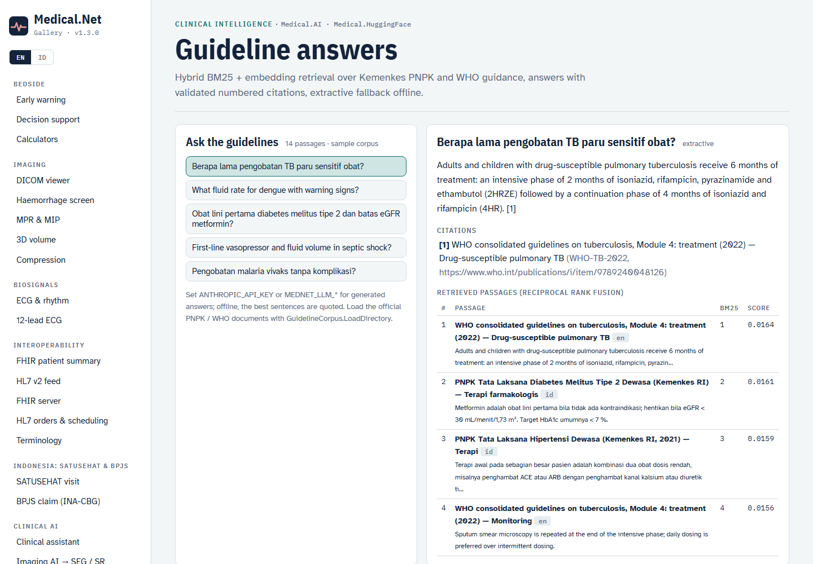
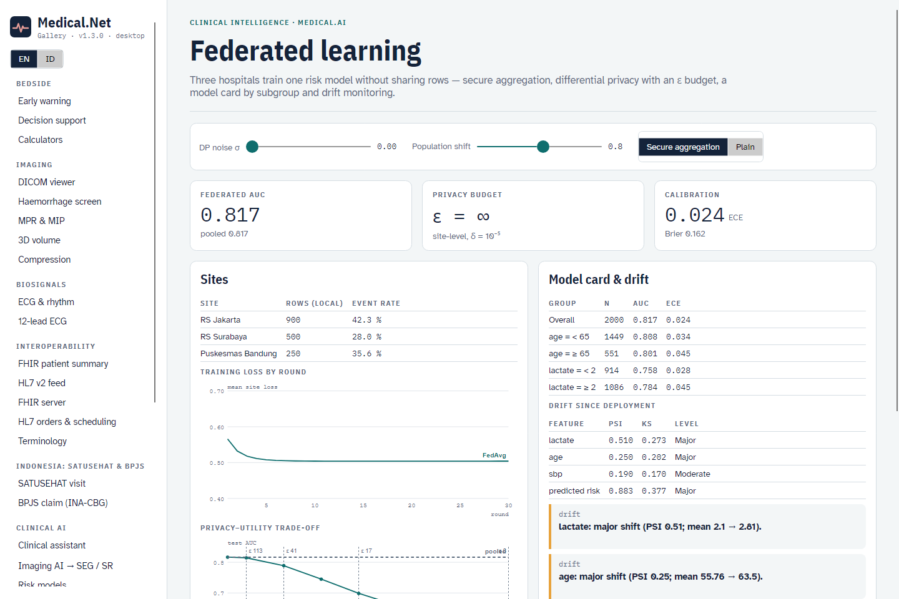
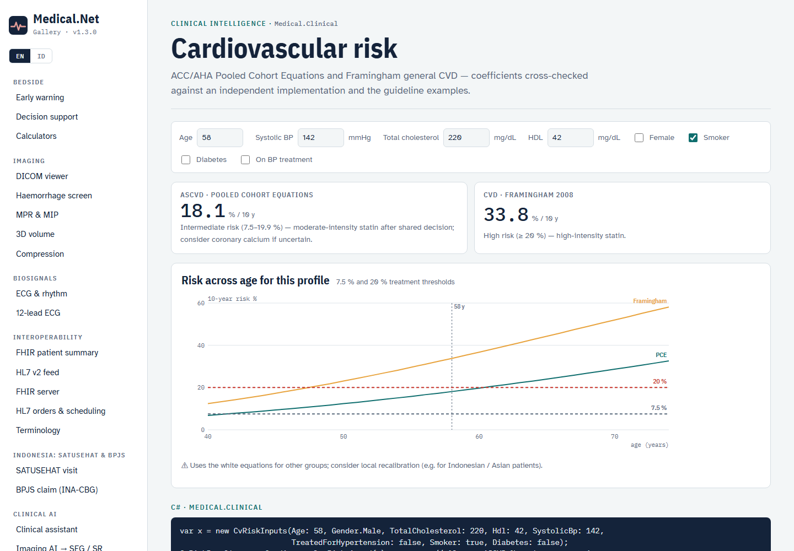
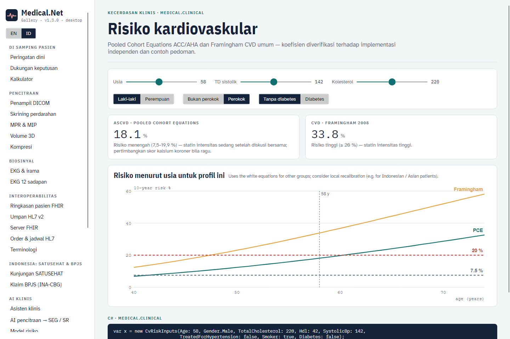

# Clinical intelligence (v1.3)

Medical.Net 1.3 adds critical-care and cardiovascular scores, WHO growth assessment, pluggable drug-interaction sources with
renal / hepatic dosing, clinical NLP with ICD-10 suggestions, guideline answers with citations, and privacy-preserving
model training with model cards and drift monitoring. · [Bahasa Indonesia](../id/clinical-intelligence.md)

> Every output here supports — never replaces — a clinician's judgement. Confirm doses against the current label and
> local formulary, and codes with a certified coder.

## Critical-care, obstetric and VTE scores (`Medical.Clinical`)

```csharp
ScoreResult sofa = ClinicalScores.Sofa(new SofaInputs
{
    PaO2FiO2 = 150, RespiratorySupport = true, Platelets = 80, BilirubinMgDl = 2.5,
    Vasopressors = new Vasopressors(Norepinephrine: 0.05), Gcs = 13, CreatinineMgDl = 2.5,
});                                                    // 13/24 — components 3·2·2·3·1·2; unmeasured organs are listed
ScoreResult apache = ClinicalScores.ApacheII(inputs, diagnosticWeight: 0.113);   // + predicted hospital mortality
ScoreResult pews = ClinicalScores.Pews(new PewsInputs(Behaviour: 1, Cardiovascular: 2, Respiratory: 1));
ScoreResult meows = ClinicalScores.Meows(rr, spo2, temp, sbp, dbp, hr, Avpu.Alert);   // red / yellow triggers
ScoreResult wells = ClinicalScores.WellsPe(...);       // ExactScore 4.5 (half points); Score is in half-point units
ScoreResult perc = ClinicalScores.Perc(...);  ScoreResult dvt = ClinicalScores.WellsDvt(...);
ScoreResult cp = ClinicalScores.ChildPugh(bilirubinMgDl: 2.5, albuminGDl: 3.0, inr: 1.5, ascites: 1, encephalopathy: 0);   // 8 → B
```

| Score | Source | Notes |
|---|---|---|
| SOFA | Vincent 1996; Sepsis-3 | PaO₂/FiO₂ < 200 scores 3–4 only on respiratory support; renal = worse of creatinine and urine output |
| APACHE II | Knaus 1985 | 12 physiology variables + age + chronic health; logit −3.517 + 0.146·score (+0.603 emergency surgery) + diagnostic weight |
| PEWS | Monaghan 2005 (Brighton) | ≥ 5 or any 3 → urgent review |
| MEOWS | Singh 2012 | score = 2 per red + 1 per yellow trigger; 1 red or 2 yellow → urgent |
| Wells PE / DVT, PERC | Wells 2000 / 2003, Kline 2004 | two-tier Wells; PERC only with low gestalt probability |
| Child-Pugh | Pugh 1973 | class A 5–6, B 7–9, C 10–15; drives hepatic dosing |

## Cardiovascular risk

```csharp
var x = new CvRiskInputs(Age: 55, Gender.Male, TotalCholesterol: 213, Hdl: 50, SystolicBp: 140,
                         TreatedForHypertension: false, Smoker: false, Diabetes: false);
CardiovascularRisk.Ascvd(x, PceRace.AfricanAmerican);   // 7.9 % — Pooled Cohort Equations
CardiovascularRisk.Framingham(x);                       // 13.5 % — general CVD (D'Agostino 2008)
```

The coefficients were checked against an independent implementation (the CVrisk R package) and the guideline's own
worked examples: white / African-American women 2.1 % / 3.0 % and African-American men 6.1 %. For white men the
guideline table prints 5.3 % but its equation gives 5.38 %, and the tests use 5.38. Results carry warnings outside
the derivation ranges, and the PCE suggests local recalibration for Indonesian / Asian patients.

## WHO growth standards

```csharp
var who = await WhoGrowthStandards.DownloadAsync(cacheDir);      // fetched once from WHO's GitHub (pinned commits)
GrowthResult r = who.Assess(GrowthIndicator.LengthHeightForAge, Gender.Female, ageDays: 730, value: 77.5, lengthCm: 77.5);
// r.ZScore −2.55, r.Percentile 0.5, r.Classification["id"] "Pendek / stunting (< −2 SD)", r.Flagged false
string svg = Charts.GrowthChart(who, GrowthIndicator.LengthHeightForAge, Gender.Female, 0, 731, visits, "id");
```

- Implements WHO Anthro / AnthroPlus rules:
  - LMS z-scores;
  - the restricted computation beyond ±3 SD for weight-based indicators;
  - the 0.7 cm recumbent ↔ standing conversion at 731 days (a standing measurement under 9 months is ignored);
  - 0.1 cm interpolation for weight-for-length/height;
  - monthly interpolation for 5–19 years;
  - the biologically implausible flags.
- **Validated against WHO's own output:** all 2,101 z-scores of WHO's `survey_who2007_z.csv` (height-, weight- and BMI-for-age) match exactly, as do the expected values from the anthro package's tests.
- **Data licence:** the WHO tables are not redistributed in the MIT packages. `DownloadAsync` fetches them from WHO's GitHub, or you can point `Load` at a folder.

## Drug-interaction sources and organ dosing (`Medical.Rules`, `Medical.Clinical`)

```csharp
IDrugInteractionSource source = new CompositeInteractionSource(
    new BuiltInInteractionSource(),                       // curated class rules
    LabelContraindications.Source,                        // FDA-label contraindicated / avoid pairs, cited by section
    CsvInteractionSource.Load("formulary.csv"),           // drug_a, drug_b, severity, effect_en[, effect_id, reference]
    DrugBankInteractionSource.Load("full_database.xml", formularyDrugs));   // your licensed DrugBank XML (streamed)
var findings = await source.CheckAsync(["simvastatin", "clarithromycin", "rivaroxaban", "clopidogrel"]);

OrganDosing.Default.Renal("rivaroxaban", crClMlMin: 28, regimen: "AF stroke prevention");   // Reduce: 15 mg once daily
OrganDosing.Default.Renal("metformin", egfr: 38);         // Reduce: do not start; if taking, assess …
OrganDosing.ApixabanAf(age: 82, weightKg: 58, creatinineMgDl: 1.0);   // 2.5 mg twice daily (≥ 2 criteria)
OrganDosing.Default.Hepatic("rivaroxaban", "B");           // Avoid
```

- **Licensed databases:** implement `IDrugInteractionSource` for First Databank, Medi-Span, Lexicomp or a national formulary service. A failing source is reported in `CompositeInteractionSource.Errors` and doesn't stop the check.
- **Renal tables:** metformin (eGFR), gabapentin, rivaroxaban, dabigatran, enoxaparin, levofloxacin and ciprofloxacin (CrCl), with dialysis notes, all from the US prescribing information. Add local tables with `AddRenal` / `AddHepatic`.

## Clinical NLP and ICD-10 coding (`Medical.AI`, `Medical.HuggingFace`)

```csharp
var rec = new CompositeEntityRecognizer(
    new TerminologyEntityRecognizer(),                                  // EN / ID terminology + colloquial synonyms
    HuggingFaceEntityRecognizer.Load("d4data/biomedical-ner-all"));     // HF.Net, in-process, no Python
var coder = new Icd10Coder(rec);
var codes = coder.Suggest("Pasien dengan demam berdarah dan darah tinggi, tidak ada sesak napas. Riwayat keluarga diabetes.");
// A91 Dengue haemorrhagic fever, I10 — R06.0 is negated, E11.9 is family history: both excluded
```

- **Negation and family history:** detected with NegEx-style triggers in English and Indonesian ("denies", "no evidence of", "tidak ada", "menyangkal", "riwayat keluarga"); "but" / "tetapi" ends the scope.
- **Symptom codes:** chapter R codes rank below confirmed diagnoses.
- **Hugging Face NER:** the recognizer merges sub-word pieces into whole words, so "am" + "oxici" becomes "amoxicillin", then codes each entity through the terminology.

## Guideline answers with citations

```csharp
var corpus = GuidelineCorpus.LoadDirectory("pedoman/");   // .md / .txt with optional title: / source: / language: / url: headers
var retriever = new GuidelineRetriever(corpus, HuggingFaceEmbedder.Load());   // BM25 + multilingual embeddings, RRF
var answerer = new GuidelineAnswerer(retriever, LlmOptions.FromEnvironment().Create());
GuidelineAnswer a = await answerer.AskAsync("Berapa lama pengobatan TB paru?", "id");
// a.Text ends sentences with [1]; a.Citations[0].Chunk.Citation; a.Mode "llm:Anthropic/…" or "extractive"
```

- **Retrieval:** BM25 with a small EN↔ID glossary, where translated terms weigh half, so a passage in the question's language ranks first. It is optionally fused with dense retrieval (reciprocal rank fusion).
- **Citation checks:** the LLM may answer only from numbered sources. Citations to sources that weren't provided are removed, and an answer without a valid citation is replaced by an extractive answer.
- **Sample corpus:** `GuidelineCorpus.Sample()` holds short summaries written for Medical.Net, pointing to WHO (TB 2022, dengue 2009, growth 2006), Surviving Sepsis 2021 and Kemenkes PNPK (hypertension, malaria, dengue, diabetes). Load the official documents for real use.
- **Tested end to end:** a real Claude run of this test answers an Indonesian TB question citing the WHO source. With HF.Net embeddings, the Indonesian question reaches the English WHO passage first under both rankers.

## Federated learning, model cards and drift (`Medical.AI.Learning`)

```csharp
FederatedResult fed = FederatedLogisticRegression.Train(features, sites,
    new FederatedOptions { SecureAggregation = true, ClipNorm = 0.5, NoiseMultiplier = 1.0, Rounds = 30 });
double eps = fed.Epsilon(delta: 1e-5);                   // site-level (ε, δ) from Rényi DP composition

ModelCard card = ModelCard.Create("Deterioration", intendedUse, predictions, labels,
    new Dictionary<string, IReadOnlyList<string>> { ["site"] = siteOfRow, ["age"] = ageBand });
File.WriteAllText("MODEL_CARD.md", card.ToMarkdown());    // overall + subgroup AUC / Brier / ECE, gaps, concerns

var monitor = new DriftMonitor(features, referenceRows, referencePredictions, referenceLabels);
DriftReport drift = monitor.Check(currentRows, currentPredictions, currentLabels);   // PSI, KS, prediction PSI, AUC / ECE alerts
```

- **Training:** FedAvg (McMahan 2017) over sites that never share rows. The sites first agree on a standardisation through aggregated sums.
- **Secure aggregation:** pairwise additive masks (Bonawitz 2017) mean the coordinator sees only the sum of updates. The tests show masked and plain training give the same weights.
- **Differential privacy:** DP-FedAvg (McMahan 2018) clips each site's update and adds Gaussian noise. `Epsilon` reports the site-level budget; `FederatedResult.EpsilonFor` plans one.
- **Results on synthetic sites:** federated AUC is within 0.01 of pooled training. The gallery charts the privacy–utility trade-off.

## CLI

```bash
medical score sofa --pf 150 --ventilated --plt 80 --bili 2.5 --norepinephrine 0.05 --gcs 13 --cr 2.5
medical cvrisk --age 55 --sex m --tc 213 --hdl 50 --sbp 140
medical growth --sex f --age-months 24 --weight 9.0 --height 77.5 --hc 46 --lang id
medical renal rivaroxaban --cr 1.6 --age 80 --weight 55 --sex f --child-pugh B
medical interactions simvastatin clarithromycin warfarin --sources [--csv formulary.csv] [--drugbank full_database.xml]
medical nlp "Pasien dengan demam berdarah, tidak ada sesak napas." [--hf]
medical guideline ask "Berapa lama pengobatan TB paru?" [--corpus pedoman/] [--hf-embed] [--offline]
medical federated --noise 1.0 --clip 0.5 --card MODEL_CARD.md
medical drift --shift 0.8
```

## Gallery

| | |
|---|---|
|  |  |
|  |  |
|  |  |
|  |  |
