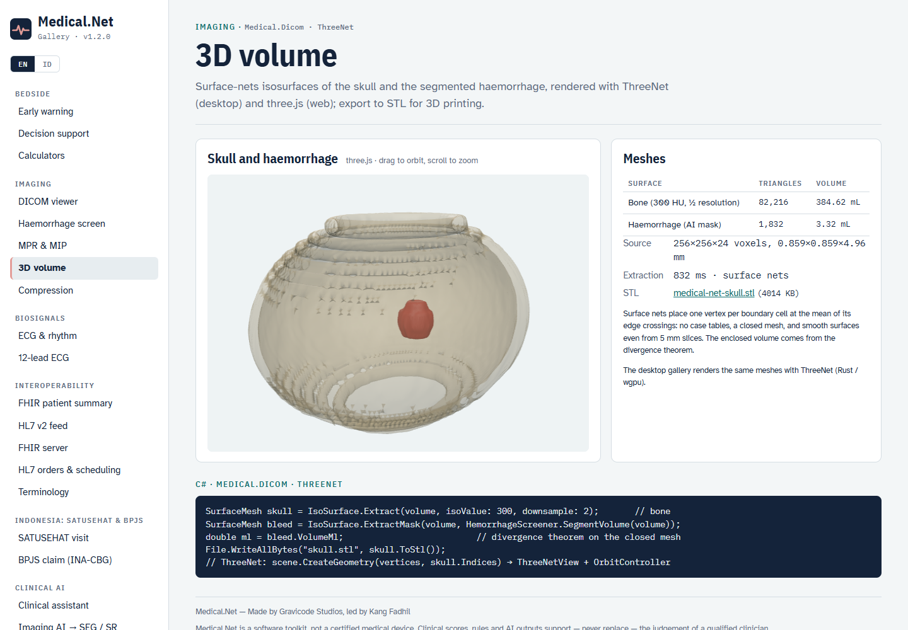
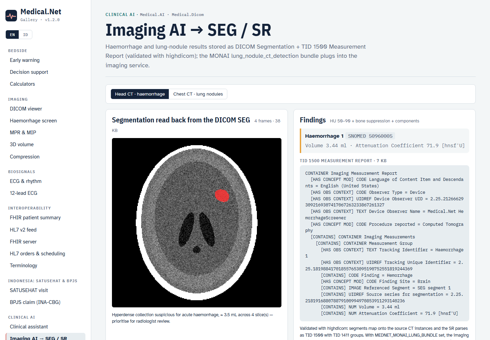
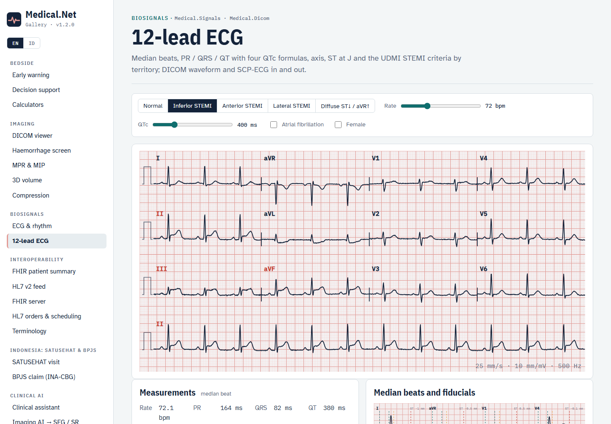

# Imaging and signals (v1.2)

Medical.Net 1.2 adds:

- compressed DICOM transfer syntaxes;
- volumes with MPR / MIP on the Rust kernel;
- isosurfaces and a 3D viewer (ThreeNet on desktop, three.js on the web);
- AI results as DICOM SEG + TID 1500 SR, with lung-nodule detection and the MONAI model-zoo bundle;
- a 12-lead ECG analyzer with DICOM waveform and SCP-ECG input/output.

## Compressed transfer syntaxes

```csharp
DicomFile jls = DicomCodecs.Transcode(file, DicomCompression.JpegLsLossless);
DicomFile j2k = DicomCodecs.Transcode(file, DicomCompression.Jpeg2000, quality: 20);   // lossy, ≈ 20:1
DicomFile raw = DicomCodecs.Decompress(j2k);                                           // Explicit VR Little Endian
short[] px = DicomImaging.FrameI16(jls.Dataset);    // compressed frames are decoded on demand everywhere
```

| `DicomCompression` | Transfer syntax | Verified |
|---|---|---|
| `Rle` | RLE Lossless (1.2.840.10008.1.2.5) | bit-exact round trip |
| `JpegLossless` | JPEG Lossless SV1 (…4.70) | bit-exact |
| `JpegLsLossless` / `JpegLsNearLossless` | JPEG-LS (…4.80 / …4.81) | bit-exact / \|error\| ≤ NEAR |
| `Jpeg2000Lossless` / `Jpeg2000` | JPEG 2000 (…4.90 / …4.91) | bit-exact / bounded RMSE |
| `HtJpeg2000Lossless` | High-Throughput JPEG 2000 (…4.201) | bit-exact |

The native codecs come from `fo-dicom.Codecs` (MS-PL): libijg, CharLS, OpenJPEG and OpenJPH, for Windows, Linux and macOS on x64 and Arm64. Windows also needs the Visual C++ 14 runtime. `DicomCodecs.EnsureRegistered()` installs them on first use. If your host already registered `NativeTranscoderManager`, that setup is left as it is.

## Volumes, MPR and slab projections

```csharp
DicomVolume v = DicomVolume.FromSeries(files);       // any order; sorted along the slice normal (Image Position Patient)
VolumeImage axial   = VolumeRendering.Mpr(v, VolumePlane.Axial, position: 0.5);
VolumeImage coronal = VolumeRendering.Mpr(v, VolumePlane.Coronal);
VolumeImage mip     = VolumeRendering.Project(v, VolumePlane.Axial, SlabMode.Max, 0.5, thicknessMm: 30);
VolumeImage minip   = VolumeRendering.Project(v, VolumePlane.Coronal, SlabMode.Min);           // whole volume
VolumeImage oblique = VolumeRendering.Oblique(v, u: new(1, 0.3, 0), v: new(0, 0, -1), thicknessMm: 10, mode: SlabMode.Max);
byte[] png = mip.ToPng(WindowPreset.Bone);
```

- **Geometry.** `DicomVolume` keeps the DICOM patient geometry (LPS, mm). `ToPatient` and `ToVoxel` convert between voxel and patient coordinates, including non-orthogonal stacks.
- **Kernel.** All planes and slabs run on one Rust kernel, `mdn_slab_i16`: trilinear sampling plus max / min / mean reduction, with a bit-identical managed twin enforced by a parity test.
- **Proportions.** Output pixels are square at the finest in-plane spacing, so coronal and sagittal reformats of 5 mm series keep correct proportions.
- **Projection sampling.** Projections along an acquisition axis take one sample per voxel layer, so interpolation cannot hide a maximum or minimum.

## Isosurfaces and 3D

```csharp
SurfaceMesh skull = IsoSurface.Extract(v, isoValue: 300, downsample: 2);            // bone
SurfaceMesh bleed = IsoSurface.ExtractMask(v, HemorrhageScreener.SegmentVolume(v));  // any binary mask
double ml = bleed.VolumeMl;                    // divergence theorem on the closed mesh
File.WriteAllBytes("skull.stl", skull.ToStl());
string obj = skull.Smooth(10).ToObj();         // Taubin λ|μ smoothing for display (topology and volume kept)
```

Extraction uses naive surface nets: one vertex per boundary cell, placed at the mean of its edge crossings, and no case tables. Tests verify that meshes are watertight and consistently wound. The phantom lesion's mesh volume agrees with its analytic volume (3.45 mL).

The desktop gallery renders the meshes with **ThreeNet** (Rust / wgpu, `ThreeNetView` with an orbit controller). The web gallery uses three.js, with meshes served as binary buffers.



## Imaging AI → DICOM SEG + SR

```csharp
// Head CT: haemorrhage mask (same rule as HemorrhageScreener.Analyze)
ImagingAiOutput h = ImagingAiReports.Hemorrhage(v, HemorrhageScreener.SegmentVolume(v))!;
// Chest CT: lung nodules, ACR Lung-RADS v2022 category (baseline, solid)
LungNoduleReport r = LungNoduleDetector.Detect(v);
ImagingAiOutput n = ImagingAiReports.LungNodules(v, r)!;
await n.Segmentation!.SaveAsync("seg.dcm");   // Segmentation IOD: BINARY, per-frame source references, SNOMED segment codes
await n.Report.SaveAsync("sr.dcm");           // Comprehensive 3D SR, TID 1500 with TID 1411 groups → SEG segments

SegmentationResult back = DicomSegmentation.Read(DicomFile.Open("seg.dcm"), v);
MeasurementReportContent sr = MeasurementReport.Read(DicomFile.Open("sr.dcm"));
```

highdicom validates both objects independently. The SEG frames map onto the source CT instances. The SR parses as TID 1500, and each measurement group carries a finding, a finding site, a referenced segment and UCUM-coded measurements.

**Lung nodules.** The classical `LungNoduleDetector` works in four steps:

1. Builds the lung field (air below −400 HU that is not connected to the outside, with holes filled).
2. Takes soft-tissue candidates above −300 HU.
3. Applies a 3D shape filter that rejects vessels.
4. Measures long and short axes from in-plane moments.

It misses juxtapleural and ground-glass nodules; it is a triage aid.

**MONAI.** Set `MEDNET_MONAI_LUNG_BUNDLE` to make the imaging service run the MONAI Model Zoo bundle `lung_nodule_ct_detection`. The bundle is a RetinaNet trained on LUNA16 / LIDC-IDRI: code Apache-2.0, data CC-BY. Download it with:

```bash
python -m monai.bundle download lung_nodule_ct_detection --bundle_dir models
```

The service reproduces the bundle's own preprocessing and box post-processing.

- **Verification:** on the chest phantom it found the nodule at score 0.65, within 4 mm of the classical detector, with Lung-RADS 4B.
- **Hardware:** it needs `torch` + `torchvision`, and a GPU for practical speed (about 35 min per study on CPU).
- **Limitation:** no public trained weights exist for intracranial haemorrhage. `MEDNET_MONAI_WEIGHTS` takes your own UNet state_dict.



## 12-lead ECG

```csharp
var (ecg, truth) = Ecg12Simulator.Generate(new Ecg12Options { StPattern = StPattern.InferiorStemi, HeartRate = 72, QtcMs = 400 });
Ecg12Analysis a = Ecg12Analyzer.Analyze(ecg, new EcgPatient(Gender.Male, 58));
// a.PrMs, a.QrsMs, a.QtMs, a.QtcBazettMs / QtcFridericiaMs / QtcFraminghamMs / QtcHodgesMs, a.QrsAxisDeg, a.Qtc
// a[EcgLead.III].StJMv, a.StemiTerritories = ["Inferior"], a.StDepressionLeads = [I, aVL], a.Interpretation["id"]
EcgIntervals x = Ecg12Analyzer.MeasureIntervals([lead1, lead2], 250);   // any lead set (Holter, monitors)
```

**Simulator.** The simulator projects a vectorcardiographic dipole model onto the lead axes, so Einthoven's and Goldberger's laws hold exactly. QT follows Fridericia across rates. ST injury currents produce the right territories and their reciprocal changes.

**Analyzer.** The analysis runs in these steps:

1. **R peaks:** found on the spatial QRS magnitude by the Rust Pan-Tompkins kernel, with the signal clipped against artefacts.
2. **Median beats:** two passes; the second removes each beat's own PR level, which cancels baseline wander.
3. **QRS onset/offset:** from the spatial velocity.
4. **T end:** the **area-curve method** (Zhang et al., IEEE TBME 2006, 96 ms window) by default; `TEndMethod.Tangent` is the alternative. The global T end is the consensus of leads with a strong T wave.

**Criteria.**

- STEMI voltage criteria follow the Fourth Universal Definition of MI (2018), in two contiguous leads: ≥ 1 mm at J, but V2–V3 ≥ 2 mm for men ≥ 40 years, ≥ 2.5 mm for men under 40, and ≥ 1.5 mm for women.
- QTc categories use Fridericia with the AHA/ACCF/HRS 2009 limits. Short QT is ≤ 340 ms (ESC 2015).

**Accuracy against cardiologists** (PhysioNet QT Database, q1c annotations, 101 records).

- **Method:** the window length was chosen on one half of the records; the figures below are for the other half (51 records).
- **QT error:** mean −4.9 ms, median |error| **18 ms**, **70 % within 30 ms**.
- **Spread:** SD 65 ms, driven by a few records where QRS or T detection fails. Always over-read the measurements.

**File formats.**

- `DicomEcg.Create(ecg, patient, analysis)` / `DicomEcg.Read`: 12-lead ECG Waveform Storage with SCPECG lead codes (CID 3001), µV sensitivity, and LOINC-coded measurement annotations. Verified with pydicom.
- `ScpEcg.Write` / `ScpEcg.Read`: SCP-ECG (EN 1064), Sections 0, 1, 2, 3 and 6. Data is either raw or default-Huffman second differences. The reader also accepts first differences and derives III / aVR / aVL / aVF when a device stores only 8 leads. Bimodal compression and reference-beat subtraction are rejected with a clear error. An independent SCP-ECG reader decodes the files.
- `Charts.Ecg12Grid(ecg, highlight: …)`: the standard 3 × 4 printout plus a rhythm strip. `Charts.MedianBeats(analysis)` shows the median beats with the fiducial lines used for the measurements.



## CLI

```bash
medical dicom transcode in.dcm out.dcm --ts jpegls|jpegls-near|j2k|j2k-lossy|htj2k|jpeg-lossless|rle|none
medical dicom mpr ct/ --plane coronal --window brain --out coronal.png
medical dicom mip ct/ --plane axial --slab 30 --mode max --out mip.png
medical dicom mesh ct/ --iso 300 --out skull.stl
medical dicom ai ct/ --out-dir results          # haemorrhage (head) or lung nodules (chest) → seg.dcm + sr.dcm
medical ecg12 --pattern inferior --out ecg.svg|ecg.dcm|ecg.scp
medical ecg12 analyze ecg.scp --sex f --age 50
```

## QT validation script

`tools.md` → *QT validation* explains how to repeat the QT Database comparison. In short: export the annotated segments with `wfdb`, then run `dotnet test --filter QtDatabaseAgreement`.
