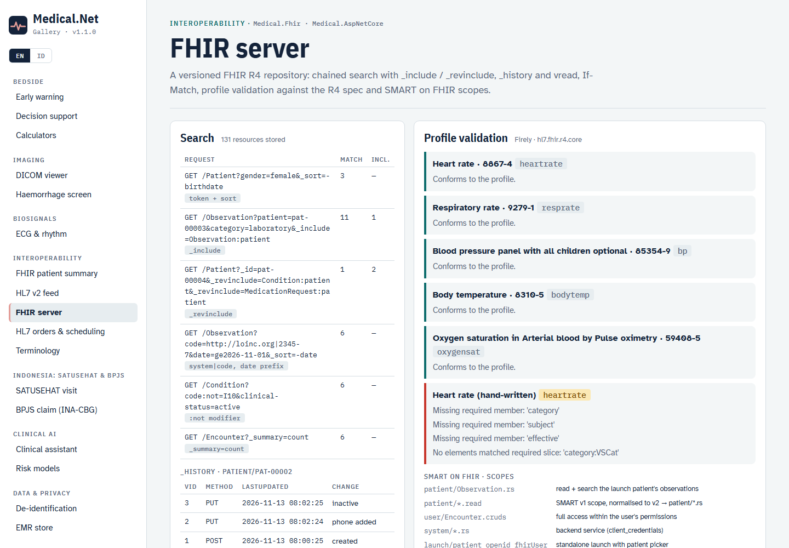
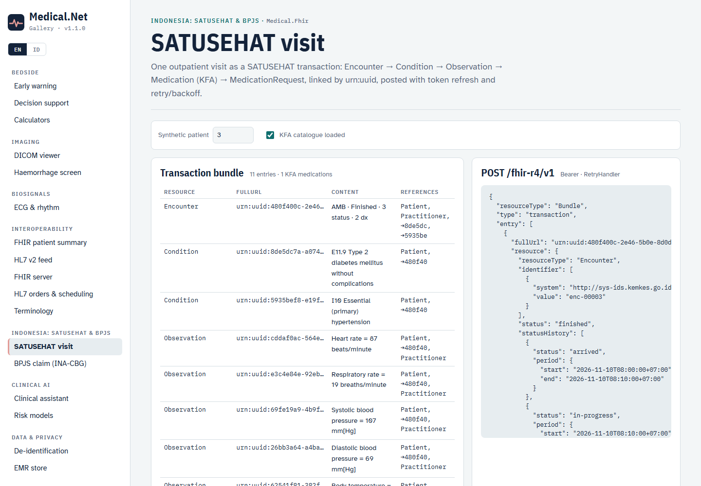
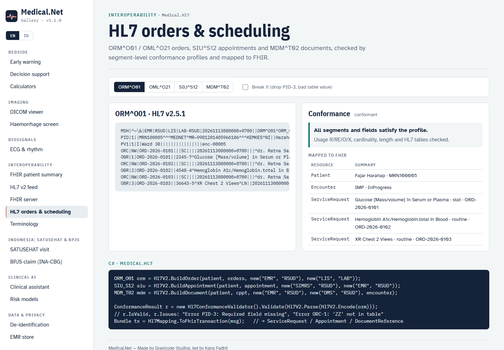
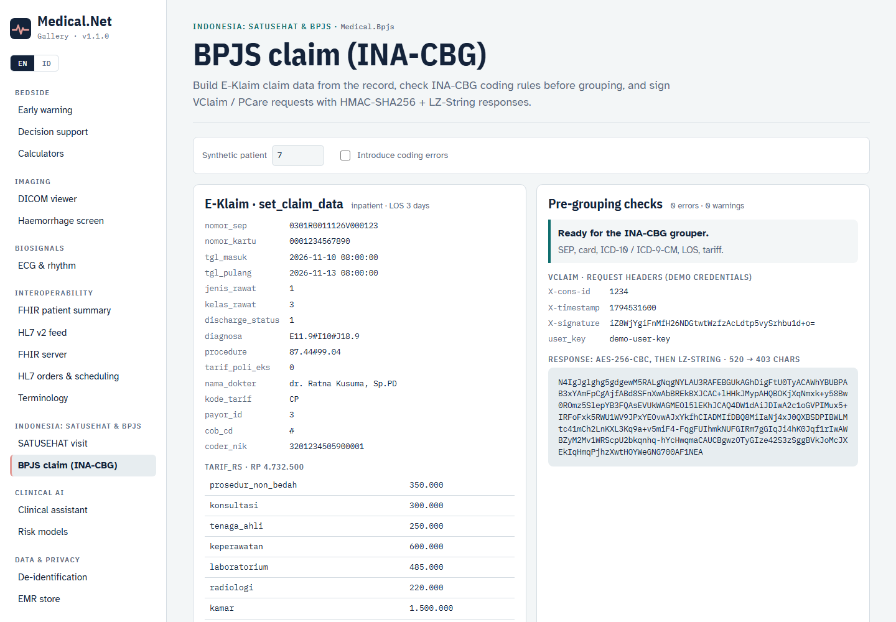

# Interoperability (v1.1)

Medical.Net 1.1 adds depth to the interop stack: a persistent FHIR server with real search semantics, profile validation, SMART on FHIR, the complete SATUSEHAT visit workflow, HL7 v2 orders / scheduling / documents with conformance profiles, and the BPJS Kesehatan APIs (VClaim, PCare, E-Klaim / INA-CBG).

## FHIR server

`IFhirRepository` is the storage contract behind `MapMedicalFhir()`, the MLLP listener and your own code. There are two implementations:

| Implementation | Use |
|---|---|
| `InMemoryFhirStore` | development, tests, edge gateways (registered by `AddFhir()`) |
| `EfFhirRepository` (`Medical.Emr`) | durable storage on SQL Server / SQLite / in-memory EF Core. Every version is stored as JSON, and the current version is indexed in `FhirSearchIndex`. Registered automatically by `AddEmr()` (`EmrOptions.PersistFhir = true`) |

```csharp
builder.Services.AddMedical(m => m
    .AddMedicalApi()
    .AddEmr(o => { o.Provider = EmrProvider.SqlServer; o.ConnectionString = cs; }));   // IFhirRepository → EfFhirRepository
var app = builder.Build();
await app.Services.EnsureEmrDatabaseAsync();   // creates EMR + FHIR tables (use EF migrations in production)
app.MapMedicalFhir();
```

### Search

| Feature | Example |
|---|---|
| Token (`system|code`, `code`, `system|`) | `Observation?code=http://loinc.org|2345-7` |
| Reference (`Type/id`, bare id, `:Type` modifier) | `Observation?patient=pat-00003`, `?subject:Patient=pat-00003` |
| String (starts-with, `:exact`, `:contains`) | `Patient?family:exact=Santoso&given=Bu` |
| Date with prefixes `eq ne gt lt ge le sa eb` | `Observation?date=ge2026-11-01`, `Patient?birthdate=lt1960` |
| OR within a parameter, AND across parameters | `Observation?code=2345-7,2160-0&patient=pat-00001` |
| `:not`, `:missing` | `Condition?code:not=I10`, `Observation?encounter:missing=true` |
| `_id`, `_lastUpdated` | `Patient?_id=pat-00001,pat-00002` |
| `_include`, `_revinclude` (`Type:param[:Target]`, `*`) | `Observation?…&_include=Observation:patient`, `Patient?_id=…&_revinclude=Condition:patient` |
| `_sort` (multiple keys, `-` for descending), `_count`, `_offset` (with `next`/`previous` links), `_summary=count` | `Patient?_sort=-birthdate&_count=20` |

Indexed parameters: `Patient` (identifier, name, family, given, gender, birthdate); `Appointment` (identifier, patient, actor, status, date, service-type); `Condition` and `AllergyIntolerance` (the common set plus clinical-status, verification-status); every other resource type (identifier, patient, subject, encounter, code, category, status, date, requester, performer, author, type). Unknown parameters are ignored and reported as an `OperationOutcome` entry with `search.mode = outcome`.

### Versioning, history and conditional operations

```http
PUT  /fhir/Patient/pat-1           If-Match: W/"2"     → 200 / 201, 412 when the version moved on
GET  /fhir/Patient/pat-1/_history                       → history bundle (newest first, DELETE entries included)
GET  /fhir/Patient/pat-1/_history/1                     → vread
GET  /fhir/Patient/_history?_since=2026-11-01           → type history; /fhir/_history for the whole server
GET  /fhir/Patient/pat-1           (after DELETE)       → 410 Gone
```

Transactions are processed in FHIR order (DELETE → POST → PUT → GET) and are atomic, using a database transaction on relational providers. `urn:uuid:` references are rewritten to the assigned ids everywhere in the bundle, and `ifNoneExist` turns a POST into a match.

### Profile validation

```csharp
var validator = new FhirProfileValidator(new FhirValidationOptions
{
    Packages = ["hl7.fhir.uv.ips@1.1.0"],          // optional IG packages (downloaded once into ~/.fhir/packages)
    ProfileDirectory = "profiles",                  // optional local / national StructureDefinitions
});
OperationOutcome oo = validator.Validate(observation, "http://hl7.org/fhir/StructureDefinition/heartrate");
bool ok = FhirProfileValidator.IsSuccess(oo);      // meta.profile is used when no profile is passed
```

The R4 core `specification.zip` comes from the `Hl7.Fhir.Specification.Data.R4` package and is copied into the output of every app that references `Medical.Fhir`. Over HTTP, use `POST /fhir/{type}/$validate[?profile=…]`. `POST`/`PUT` of a resource that declares `meta.profile` is validated, and invalid resources get **422** with the `OperationOutcome`.

### SMART on FHIR

```csharp
builder.Services.AddMedical(m => m.AddMedicalApi().AddSmartOnFhir(o =>
{
    o.SigningKey = builder.Configuration["Smart:SigningKey"]!;        // ≥ 32 bytes; random per process when empty
    o.Clients.Add(new SmartClientRegistration("ward-app", ["https://ward.example/callback"], "launch/patient openid fhirUser patient/*.rs"));
    o.Clients.Add(new SmartClientRegistration("etl", [], "system/*.rs", Secret: builder.Configuration["Smart:EtlSecret"]));
}));
app.MapMedicalFhir();
app.MapSmartAuthorization();   // /fhir/.well-known/smart-configuration, /auth/authorize, /auth/token, /auth/launch
```

- Authorization code with **PKCE (S256)** for public apps; `client_credentials` for backend services, restricted to `system/` scopes.
- SMART v1 (`patient/*.read`) and v2 (`patient/Observation.rs`) scopes. Every FHIR interaction is checked (c/r/u/d/s), including each entry of a transaction.
- Patient-bound tokens (`patient/` scopes plus a launch patient) only see that patient's compartment. Searches are narrowed automatically, and other patients return 403.
- The built-in authorization server auto-approves (development). In production, put your identity provider in front of `/auth/authorize` or use your organisation's SMART server.

Client side: `SmartClient.DiscoverAsync`, `SmartClient.CreateAuthorizationRequest` (PKCE), `ExchangeCodeAsync`, `ClientCredentialsAsync`, and `BearerTokenHandler` for `HttpClient`.



## SATUSEHAT workflow

```csharp
var kfa = new KfaCatalog();                                           // KFA (Kamus Farmasi dan Alat Kesehatan) codes
await new KfaClient(http, satuSehat).ResolveIntoAsync(kfa, record.Medications.Select(m => m.Generic));
// or: KfaCatalog.LoadCsv("kfa.csv") from your formulary mapping

SatuSehatSubmission s = SatuSehatWorkflow.BuildOutpatientVisit(record, new SatuSehatContext
{
    PatientIhs = "P02478375538", PatientName = "Budi Santoso",
    PractitionerIhs = "N10000001", PractitionerName = "dr. Ratna",
    LocationId = "b017aa54-…", LocationName = "Poli Penyakit Dalam", OrganizationId = "10000004",
}, kfa);
foreach (var w in s.Warnings) logger.LogWarning("{Warning}", w);      // e.g. medications without a KFA code are skipped
Bundle result = await satuSehat.PostTransactionAsync(s.Bundle);
```

The bundle contains:

- **Encounter**: `statusHistory` arrived → in-progress → finished, the discharge diagnoses with rank, and the attending practitioner.
- **Condition**: ICD-10 encounter diagnoses.
- **Observation**: six vital signs.
- **Medication**: the KFA code with the `MedicationType` extension.
- **MedicationRequest**.

Every entry is linked with deterministic `urn:uuid`s. `SatuSehatClient` caches the OAuth2 token and refreshes it once on 401. `AddFhir(satuSehat: …)` registers the named `"satusehat"` `HttpClient` with `RetryHandler`, which uses exponential backoff with full jitter and honours `Retry-After`. It always retries 429 and 503; it retries 408, 500, 502 and 504 for idempotent requests only.



## HL7 v2: orders, scheduling, documents, conformance

| Message | Builder | Back to the domain / FHIR |
|---|---|---|
| ORM^O01 general order | `Hl7V2.BuildOrder(patient, orders, from, to, encounter)` | `Hl7WorkflowMapping.ToOrders` → `ServiceRequest` |
| OML^O21 lab order with specimen | `Hl7V2.BuildLabOrder(...)` | `ToOrders` (SPM-4 → `Specimen`) |
| SIU^S12 appointment | `Hl7V2.BuildAppointment(patient, appointment, from, to)` | `ToAppointment` → `Appointment` |
| MDM^T02 document | `Hl7V2.BuildDocument(patient, document, from, to, encounter)` | `ToDocument` → `DocumentReference` (text attachment) |

`Hl7Mapping.ToFhirTransaction(msg)` picks the right resources for each message type, and the MLLP listener stores them all.

```csharp
var conformance = new Hl7ConformanceValidator();          // built-in profiles: ADT^A01, ORU^R01, ORM^O01, OML^O21, SIU^S12, MDM^T02
ConformanceResult r = conformance.Validate(er7);
// r.IsValid, r.Profile, r.Issues: "Error PID-3: Required field missing", "Error ORC-1: 'ZZ' is not in the table"
conformance.Add(Hl7ConformanceValidator.ParseProfiles(File.ReadAllText("my-profiles.json"))[0]);   // local profiles
```

Profiles describe segment usage (R/RE/O/X) and cardinality, field usage, maximum length and table values. Set `MllpListenerOptions.EnforceConformance = true` to answer `AE` to non-conformant messages. `POST /api/hl7/conformance` validates over HTTP.



## BPJS Kesehatan (`Medical.Bpjs`)

```csharp
builder.Services.AddMedical(m => m.AddBpjs(o =>
{
    o.Credentials = BpjsCredentials.FromEnvironment();       // BPJS_CONS_ID, BPJS_SECRET_KEY, BPJS_USER_KEY
    o.Environment = BpjsEnvironment.Development;             // apijkn-dev → Production: apijkn
    o.EKlaimUrl = "http://eklaim.rs.local/E-Klaim/ws.php";
    o.EKlaimKey = builder.Configuration["EKlaim:Key"];       // 64 hex characters from E-Klaim setup
}));
```

| Client | Calls |
|---|---|
| `VClaimClient` | `PesertaByKartuAsync`, `PesertaByNikAsync`, `DiagnosaAsync`, `RujukanAsync`, `SepAsync`, `InsertSepAsync` (SEP 2.0), `DeleteSepAsync` |
| `PCareClient` | `PesertaAsync`, `DiagnosaAsync`, `PendaftaranAsync` |
| `EKlaimClient` | `NewClaimAsync`, `SetClaimDataAsync`, `GrouperAsync(stage)`, `ClaimFinalAsync`, `SendClaimAsync`, `GetClaimDataAsync` |

The request and response cryptography is implemented and covered by tests:

- **VClaim / PCare requests:** `X-signature = Base64(HMAC-SHA256(secret, consId & timestamp))`.
- **VClaim / PCare responses:** AES-256-CBC with key `SHA-256(consId + secret + timestamp)`, then LZ-String decompression. The decompression is verified against the reference lz-string 1.5.0.
- **E-Klaim payloads:** AES-256-CBC, wrapped as `base64(signature10 ‖ iv16 ‖ cipher)`.

**INA-CBG claims.** `InaCbgClaimBuilder.FromRecord(record, nomorSep, nomorKartu, tariff, coderNik, procedures)` builds `new_claim` / `set_claim_data` payloads, including the 18 hospital tariff components. Before grouping, `InaCbgClaimBuilder.Validate(claim)` checks:

- SEP (19 characters), card (13 digits) and NIK (16 digits);
- ICD-10 format and existence, and ICD-9-CM format;
- external-cause codes (V–Y) are never primary; R-codes as primary get a warning; P-codes require a birth weight;
- ICU length of stay, the date order, and a non-zero tariff.



## CLI

```bash
medical fhir validate obs.json --profile http://hl7.org/fhir/StructureDefinition/heartrate
medical hl7 sample --type orm|oml|siu|mdm|adt|oru --out msg.hl7 && medical hl7 conform msg.hl7
medical satusehat bundle --index 3 --out visit.json
medical bpjs claim --index 7 [--sep 0301R0011126V000123]
```
