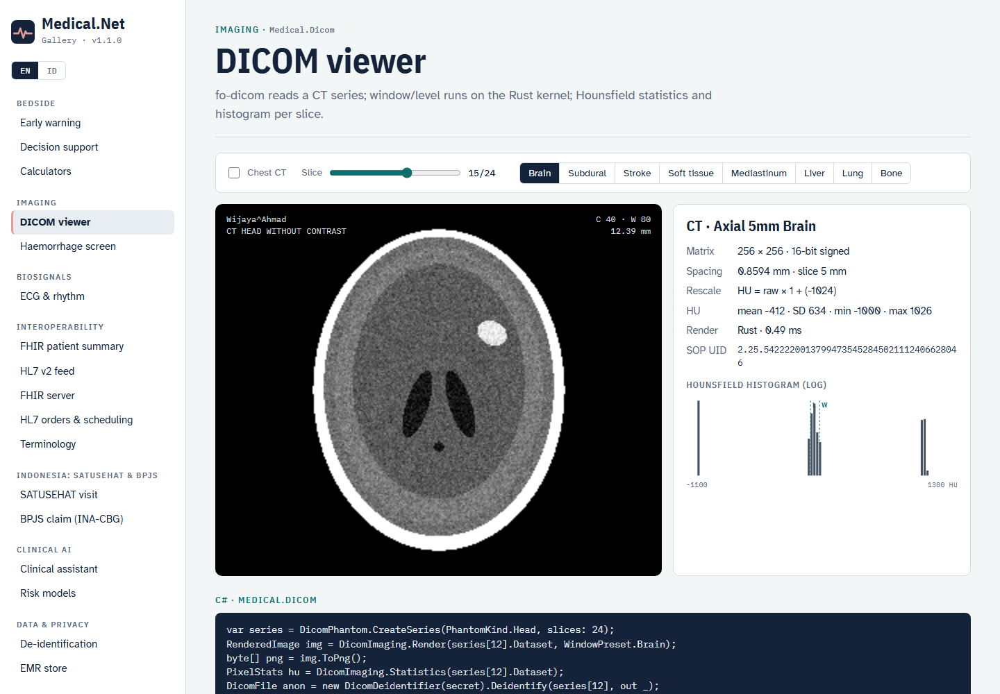
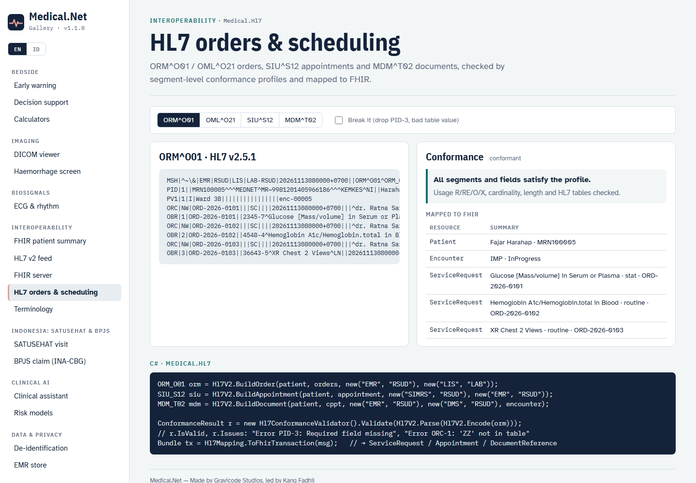
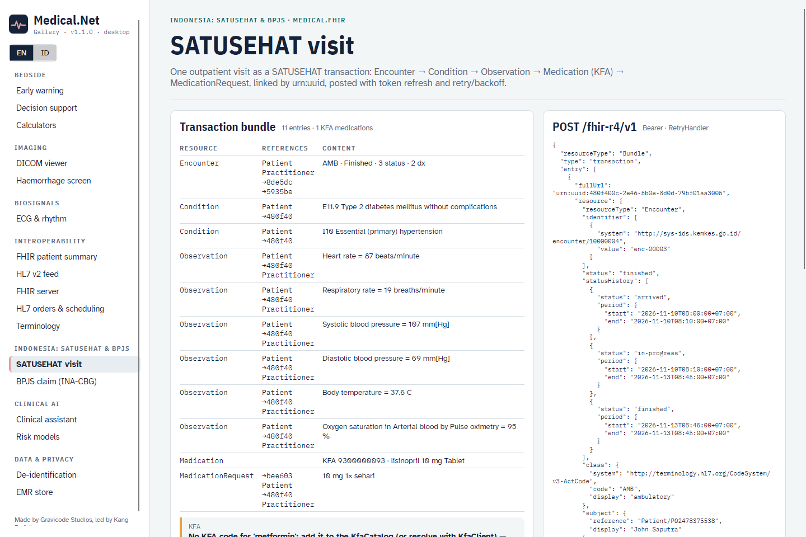
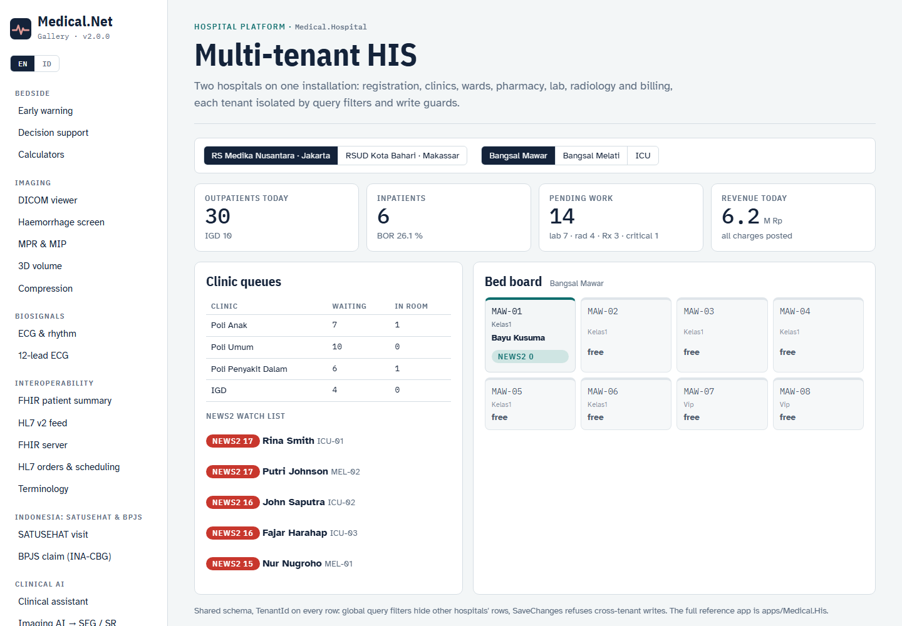
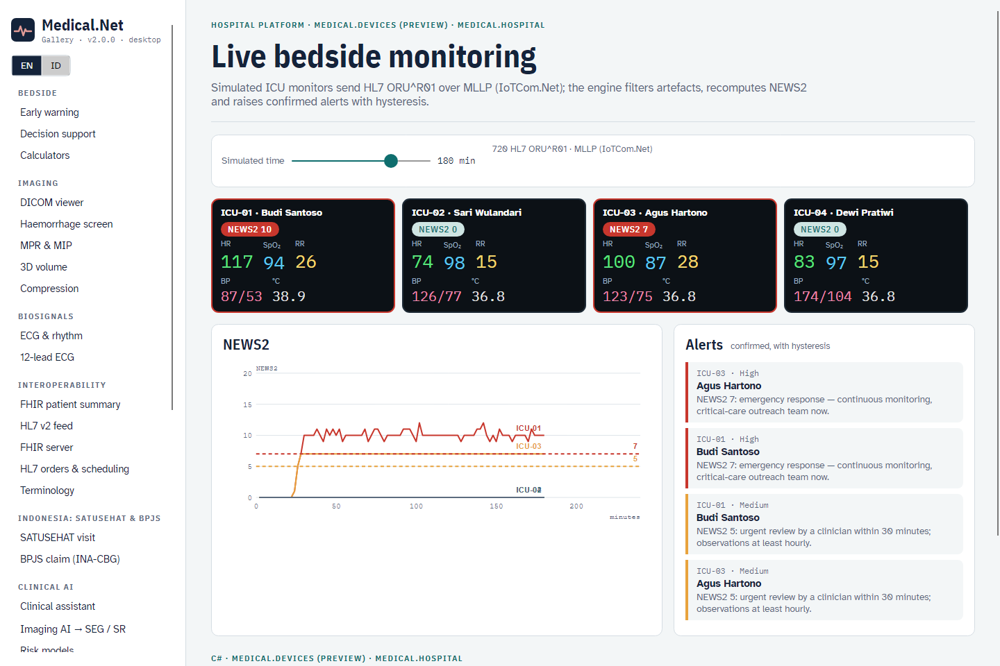

# Tools: CLI, templates and Gallery

## `medical` CLI

```bash
dotnet tool install -g Medical.Cli
medical help
```

| Command | Example |
|---|---|
| Scores | `medical news2 --rr 24 --spo2 93 --o2 --sbp 105 --hr 115 --temp 38.5 [--avpu C] [--scale2] [--json]` · `medical qsofa --rr 22 --sbp 98 --altered` |
| Calculators | `medical egfr --cr 1.2 --age 60 --sex f [--weight 60]` · `medical bmi --weight 70 --height 172` · `medical dose amoxicillin --weight 25 [--crcl 40]` |
| Terminology | `medical code search gagal jantung [--system icd10]` · `medical code validate loinc 2345-7` · `medical code map 44054006` |
| Drug safety | `medical interactions warfarin ibuprofen metronidazole --allergy penicillin` |
| FHIR | `medical fhir patient|record|ips --index 3 --out ips.json` · `medical fhir validate ips.json [--profile <url>]` |
| HL7 | `medical hl7 sample [--type oru|adt|orm|oml|siu|mdm] --out msg.hl7` · `medical hl7 conform msg.hl7` · `medical hl7 parse|to-fhir oru.hl7` · `medical hl7 send localhost:2575 oru.hl7` · `medical hl7 listen --port 2575` |
| SATUSEHAT | `medical satusehat bundle --index 3 --out visit.json` (Encounter → Condition → Observation → MedicationRequest) |
| BPJS | `medical bpjs claim --index 7 [--sep 0301R0011126V000123]` (INA-CBG claim data + coding checks; exit code 2 on errors) |
| Imaging (v1.2) | `medical dicom transcode in.dcm out.dcm --ts jpegls|j2k|j2k-lossy|htj2k|rle|none` · `medical dicom mpr ct --plane coronal` · `medical dicom mip ct --slab 30 --mode max|min|mean` · `medical dicom mesh ct --iso 300 --out skull.stl` · `medical dicom ai ct --out-dir results` (SEG + SR) |
| DICOM | `medical dicom phantom --kind head --out ct` · `medical dicom info|render ct/IM015.dcm --window brain` · `medical dicom anonymize in.dcm out.dcm --secret …` · `medical dicom hemorrhage ct` · `medical dicom echo pacs 104` |
| Signals | `medical ecg --rhythm af --hr 90` · `medical ecg12 [--pattern inferior|anterior|lateral|diffuse] [--qtc 480] [--rhythm af] [--sex f --age 50] --out ecg.svg|.dcm|.scp` · `medical ecg12 analyze ecg.scp` |
| Privacy | `medical deid "Ny. Siti, HP 0812…"` · `--file note.txt --pseudonyms --secret …` |
| Decision support / AI | `medical cds --index 3` · `medical risk --index 7` · `medical ask "…" --patient 7` |
| Scores (v1.3) | `medical score sofa|apache2|pews|meows|wells-pe|wells-dvt|perc|child-pugh …` · `medical cvrisk --age 55 --sex m --tc 213 --hdl 50 --sbp 140 [--race aa]` |
| Growth (v1.3) | `medical growth --sex f --age-months 24 --weight 9.0 --height 77.5 [--standing] [--hc 46]` (WHO tables downloaded once) |
| Dosing & sources (v1.3) | `medical renal rivaroxaban --crcl 28 [--child-pugh B]` · `medical interactions … --sources [--csv f.csv] [--drugbank db.xml]` |
| NLP & guidelines (v1.3) | `medical nlp "<note>" [--hf]` · `medical guideline ask "<question>" [--corpus dir] [--hf-embed] [--offline]` |
| Learning (v1.3) | `medical federated [--noise 1.0 --clip 0.5] [--card card.md]` · `medical drift --shift 0.8` |
| EMR | `medical emr seed --db medical.db --count 50` · `medical emr show pat-00007` |
| HIS (v2.0) | `medical his seed [--db his.db] [--patients 40]` · `medical his dashboard [--db his.db] [--tenant rs-nusantara]` · `medical his patient <mrn> [--db his.db] [--tenant rs-nusantara] [--fhir summary.json]` |
| Monitoring (v2.0) | `medical monitor [--minutes 120] [--step 5]` (simulated ICU monitors → HL7 / MLLP → NEWS2 alerts; exit code 3 on a high alert) |
| Sync (v2.0) | `medical sync demo` (offline ward rounds: two tablets, conflicts, convergence) |
| Worklist (v2.1) | `medical worklist serve [--port 11112] [--date 20261116]` (demo DICOM Modality Worklist SCP) · `medical worklist query <host> <port> [--modality CT] [--date 20261116[-20261120]] [--aet MEDICALNET-MWL] [--name "RAHAYU*"]` (C-FIND) |

Add `--lang id` for Bahasa Indonesia output.

## `dotnet new` templates

```bash
dotnet new install Medical.Templates
```

| Template | Creates |
|---|---|
| `medical-console` | Console app: NEWS2, decision support, bilingual problem list, IPS export |
| `medical-fhir-api` | ASP.NET Core FHIR server (search, `_history`, `$validate`) + clinical API + MLLP listener, seeded with synthetic patients. `--smart` adds SMART on FHIR authorization; `--persist` stores FHIR in EF Core (SQLite) |
| `medical-hl7-gateway` | Worker service: MLLP → FHIR, CDS alerts in logs, optional forwarding to a FHIR server |
| `medical-blazor` | Blazor ward board ranked by NEWS2 with observation charts and alerts |
| `medical-avalonia` | Avalonia DICOM viewer with window presets, HU statistics and haemorrhage screening |

All templates accept `--MedicalNetVersion` (default `2.0.0`).

## Gallery

Thirty-two use cases — early warning, decision support, calculators, DICOM viewer, haemorrhage screen, **MPR & MIP**, **3D volume**, **compression**, ECG, **12-lead ECG**, **imaging AI → SEG / SR**, FHIR patient summary, HL7 feed, **FHIR server**, **HL7 orders & scheduling**, terminology, **SATUSEHAT visit**, **BPJS claim (INA-CBG)**, clinical assistant, risk models, de-identification, EMR, and (v1.3) **ICU & obstetric scores**, **cardiovascular risk**, **WHO growth**, **drug safety & dosing**, **clinical NLP & coding**, **guideline answers**, **federated learning**, and (v2.0, group *Hospital platform*) **multi-tenant HIS**, **live bedside monitoring** and **offline ward rounds** — in two apps that share `gallery/Medical.Gallery.Shared`:

```bash
dotnet run --project gallery/Medical.Gallery.Web --urls http://localhost:5290      # /?lang=id for Indonesian
dotnet run --project gallery/Medical.Gallery.Desktop
dotnet run --project gallery/Medical.Gallery.Desktop -- --screenshot docs/images id  # headless screenshots
```

| | |
|---|---|
|  |  |
|  |  |
|  |  |
|  |  |
|  |  |

Web screenshots are produced with headless Chrome (`--screenshot`, `--blink-settings=preferredColorScheme=1` for light mode, `--force-prefers-reduced-motion` so the ECG draw-on animation is complete). The 3D page needs WebGL (`--use-angle=swiftshader --enable-unsafe-swiftshader`) and is captured at `/demo/volume3d?still=1`: virtual time would drop the Blazor circuit, so still mode builds the scene from the prerendered markup and swaps the canvas for an image. The desktop 3D view renders offscreen with ThreeNet in `--screenshot` mode.

## Hospital apps (v2.0 – 2.1)

```bash
ASPNETCORE_ENVIRONMENT=Development dotnet run --project apps/Medical.His --urls http://localhost:5300
dotnet build Medical.Rounds.slnx                                          # MAUI; needs the maui-windows workload
dotnet run --project apps/Medical.Rounds -f net10.0-windows10.0.19041.0
```

Run the HIS in Development, or publish it. Static web assets don't resolve when the `bin` executable runs in Production.
See [Hospital platform](platform.md) for configuration, roles and APIs.

**HIS screenshots.** With the HIS running, sign in through `/account/demo` in the screenshot URL. Use a fresh
`--user-data-dir` for every shot so that no cookie from an earlier user, hospital or language is reused:

```bash
chrome --headless=new --user-data-dir="$(mktemp -d)" --blink-settings=preferredColorScheme=1 --window-size=1440,1000 \
  --screenshot=docs/images/his-dashboard-en.png \
  "http://localhost:5300/account/demo?tenant=rs-nusantara&user=admin&lang=en&returnUrl=/rs-nusantara"
```

Use `lang=id` and no suffix for the Indonesian shots (`his-dashboard.png`), and `returnUrl=/rs-nusantara/monitoring`,
`/registration`, `/pharmacy` and so on for the other pages.

**Rounds screenshots.** With the HIS running on `http://localhost:5300`, the MAUI app captures itself and exits:

```bash
apps/Medical.Rounds/bin/Debug/net10.0-windows10.0.19041.0/win-x64/Medical.Rounds.exe --capture docs/images en   # rounds-ward.png, rounds-patient.png, …
apps/Medical.Rounds/bin/Debug/net10.0-windows10.0.19041.0/win-x64/Medical.Rounds.exe --capture docs/images id   # rounds-ward-id.png, …
```

The capture records vitals and a note on the sickest patient (they stay on the device's in-memory store) and writes
`rounds-capture[-id].log` with the sync result.

## QT validation

The 12-lead analyzer is checked against the PhysioNet QT Database: `tools/validation/qtdb_export.py` exports the cardiologist-annotated segments, then `dotnet test --filter QtDatabaseAgreement` reports the agreement (`MEDNET_QTDB_SPLIT=a|b` restricts it to the tuning or the held-out half). See `tools/validation/README.md` for the highdicom (SEG / SR) and pydicom / SCP-ECG checks.
