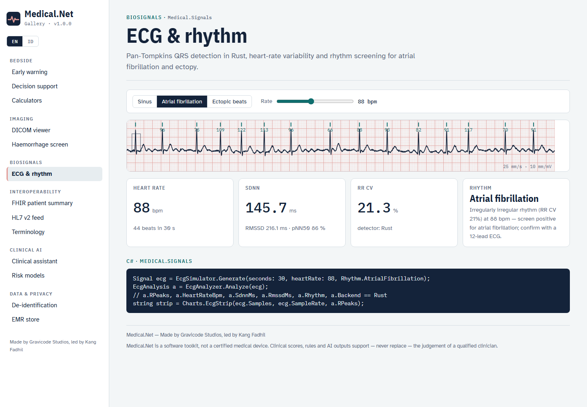
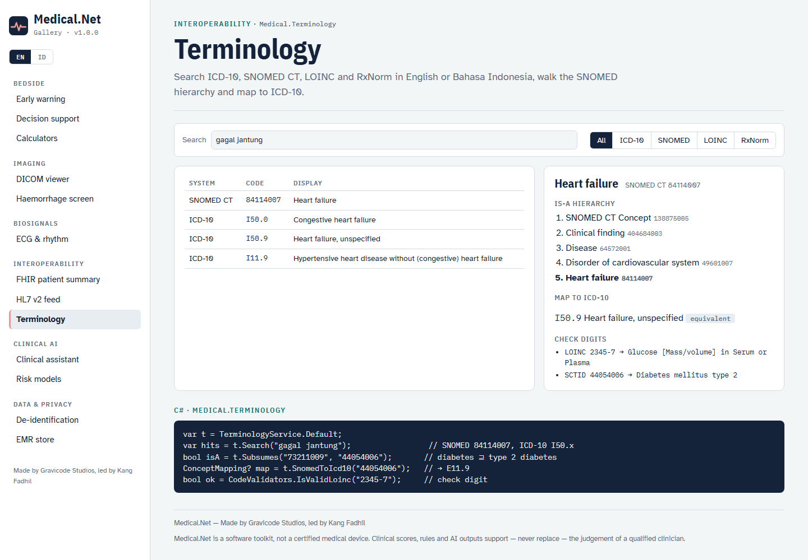
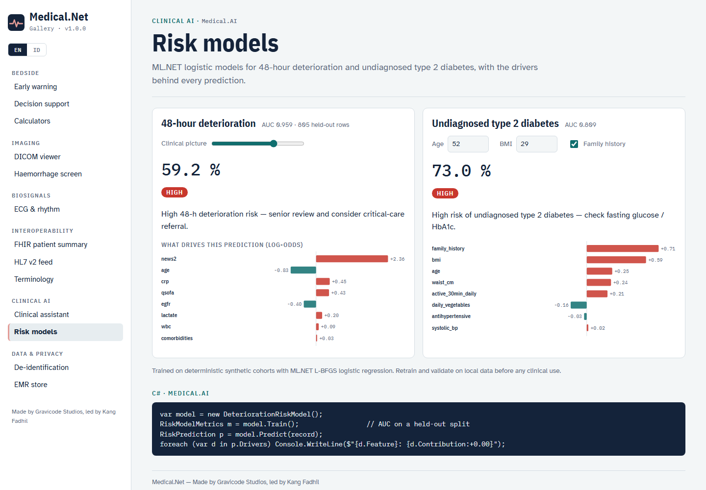
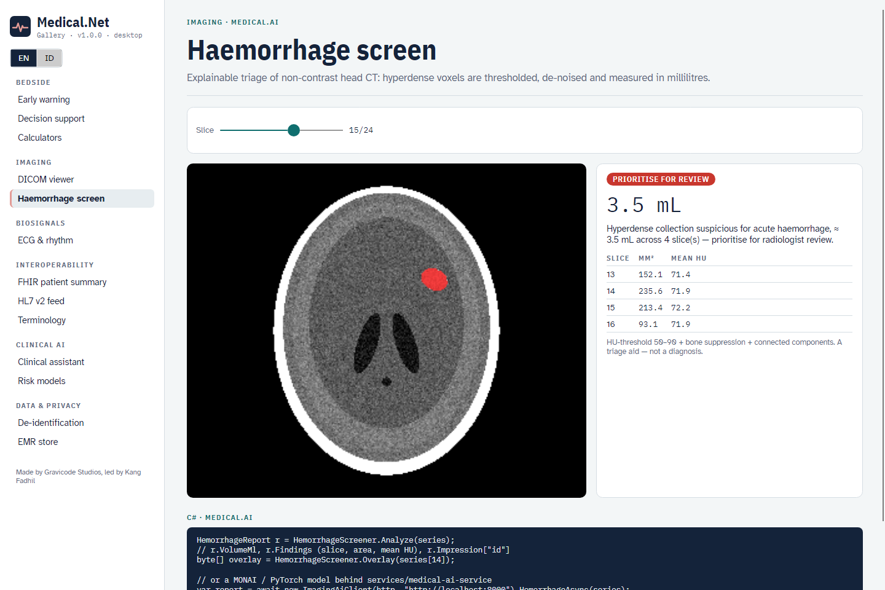
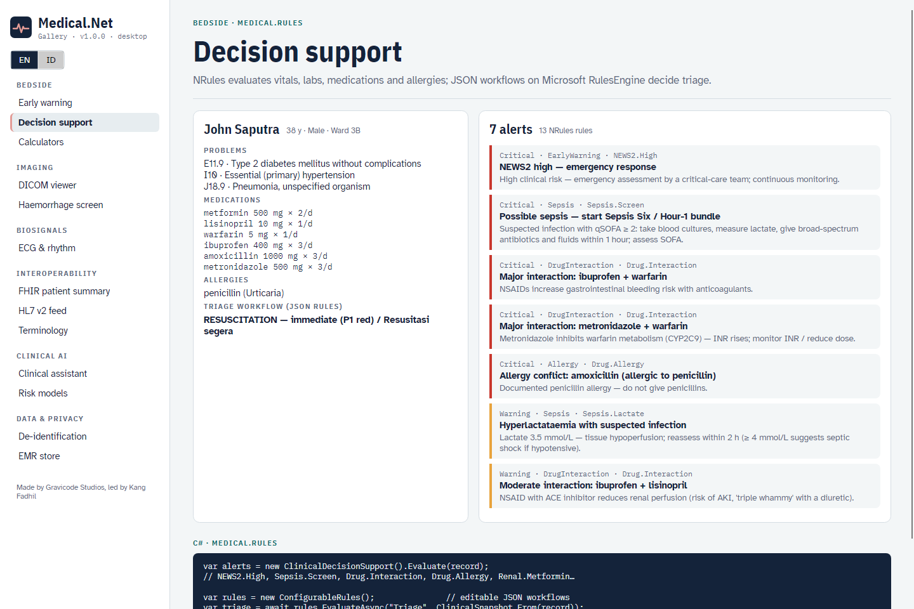

# Tools: CLI, templates and Gallery

## `medical` CLI

```bash
dotnet tool install -g Medical.Cli
medical help
```

| Command | Example |
|---|---|
| Scores | `medical news2 --rr 24 --spo2 93 --o2 --sbp 105 --hr 115 --temp 38.5 [--avpu C] [--scale2] [--json]` · `medical qsofa --rr 22 --sbp 98 --altered` |
| Calculators | `medical egfr --cr 1.2 --age 60 --sex f [--weight 60]` · `medical bmi --weight 70 --height 172` · `medical dose amoxicillin --weight 25 [--crcl 40]` |
| Terminology | `medical code search gagal jantung [--system icd10]` · `medical code validate loinc 2345-7` · `medical code map 44054006` |
| Drug safety | `medical interactions warfarin ibuprofen metronidazole --allergy penicillin` |
| FHIR | `medical fhir patient|record|ips --index 3 --out ips.json` · `medical fhir validate ips.json` |
| HL7 | `medical hl7 sample --out oru.hl7` · `medical hl7 parse|to-fhir oru.hl7` · `medical hl7 send localhost:2575 oru.hl7` · `medical hl7 listen --port 2575` |
| DICOM | `medical dicom phantom --kind head --out ct` · `medical dicom info|render ct/IM015.dcm --window brain` · `medical dicom anonymize in.dcm out.dcm --secret …` · `medical dicom hemorrhage ct` · `medical dicom echo pacs 104` |
| Signals | `medical ecg --rhythm af --hr 90` |
| Privacy | `medical deid "Ny. Siti, HP 0812…"` · `--file note.txt --pseudonyms --secret …` |
| Decision support / AI | `medical cds --index 3` · `medical risk --index 7` · `medical ask "…" --patient 7` |
| EMR | `medical emr seed --db medical.db --count 50` · `medical emr show pat-00007` |

Add `--lang id` for Bahasa Indonesia output.

## `dotnet new` templates

```bash
dotnet new install Medical.Templates
```

| Template | Creates |
|---|---|
| `medical-console` | Console app: NEWS2, decision support, bilingual problem list, IPS export |
| `medical-fhir-api` | ASP.NET Core FHIR server + clinical API + MLLP listener, seeded with synthetic patients |
| `medical-hl7-gateway` | Worker service: MLLP → FHIR, CDS alerts in logs, optional forwarding to a FHIR server |
| `medical-blazor` | Blazor ward board ranked by NEWS2 with observation charts and alerts |
| `medical-avalonia` | Avalonia DICOM viewer with window presets, HU statistics and haemorrhage screening |

All templates accept `--MedicalNetVersion` (default `1.0.0`).

## Gallery

Thirteen use cases — early warning, decision support, calculators, DICOM viewer, haemorrhage screen, ECG, FHIR patient summary, HL7 feed, terminology, clinical assistant, risk models, de-identification, EMR — in two apps that share `gallery/Medical.Gallery.Shared`:

```bash
dotnet run --project gallery/Medical.Gallery.Web --urls http://localhost:5290      # /?lang=id for Indonesian
dotnet run --project gallery/Medical.Gallery.Desktop
dotnet run --project gallery/Medical.Gallery.Desktop -- --screenshot docs/images id  # headless screenshots
```

| | |
|---|---|
|  |  |
|  |  |
|  |  |

Web screenshots are produced with headless Chrome (`--screenshot`, `--blink-settings=preferredColorScheme=1` for light mode).
