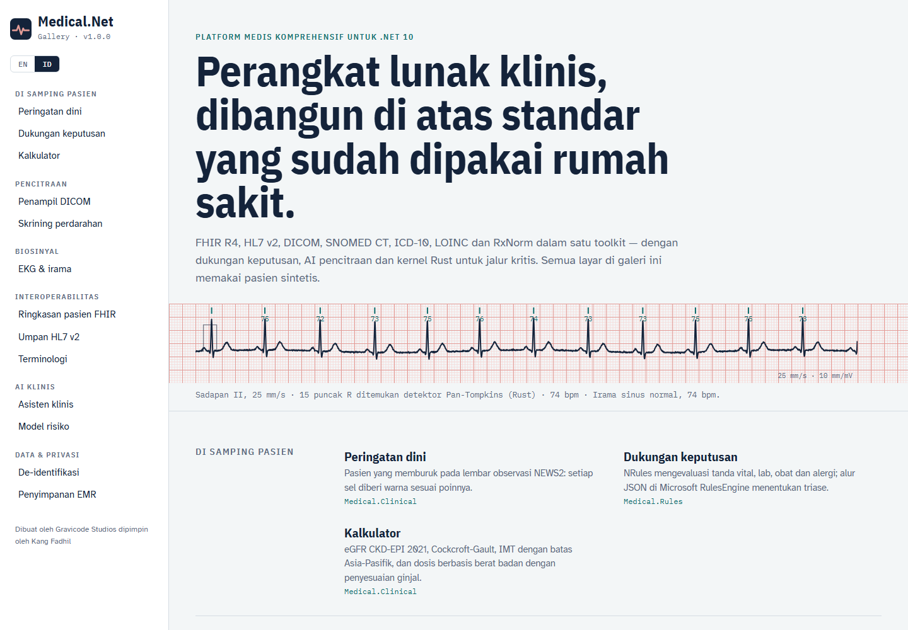

# Dokumentasi Medical.Net

Medical.Net — Platform Medis Komprehensif untuk .NET 10. Dibuat oleh Gravicode Studios dipimpin oleh Kang Fadhil. · [English](../en/README.md)

| Panduan | Isi |
|---|---|
| [Memulai](getting-started.md) | Instalasi, rekam pasien pertama, NEWS2, dukungan keputusan, ekspor FHIR |
| [Arsitektur](architecture.md) | Lapisan paket, model domain, DI, event, audit, aturan desain |
| [Modul](modules.md) | Semua paket beserta contoh: FHIR, HL7, DICOM, terminologi, klinis, aturan, sinyal, privasi, EMR, visualisasi |
| [AI klinis](ai.md) | Model risiko, asisten klinis (Claude / kompatibel OpenAI / offline), AI pencitraan dan layanan MONAI |
| [Deployment](deployment.md) | Server FHIR, listener MLLP, SATUSEHAT, database & cache EMR, layanan pencitraan, keamanan & kepatuhan |
| [Perkakas](tools.md) | CLI `medical`, templat `dotnet new`, aplikasi Galeri dan tangkapan layar |
| [Kernel native](native.md) | Crate Rust, fallback managed, build untuk platform lain |

> Medical.Net adalah perangkat lunak pengembang, bukan alat kesehatan bersertifikat. Skor klinis, aturan, dan keluaran AI membantu — bukan menggantikan — penilaian tenaga medis yang berwenang.
