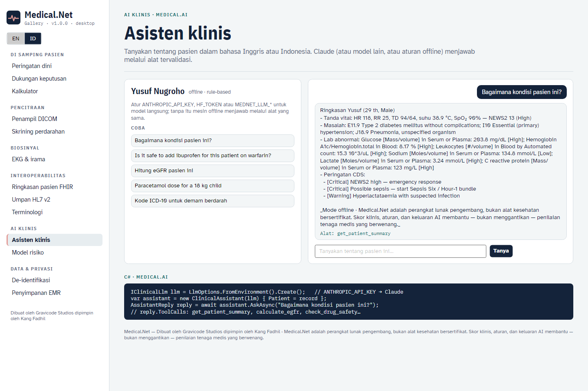

# AI klinis



## Asisten klinis

`ClinicalAssistant` menjawab pertanyaan tentang pasien dalam konteks (bahasa Indonesia atau Inggris). Model tidak pernah menghitung angka klinis sendiri: ia memanggil `ClinicalTools` — `get_patient_summary`, `calculate_news2`, `calculate_qsofa`, `calculate_egfr`, `calculate_bmi`, `weight_based_dose`, `check_drug_safety`, `lookup_terminology` — dan setiap pemanggilan dikembalikan di `AssistantReply.ToolCalls` serta dicatat di log audit.

```csharp
IClinicalLlm llm = LlmOptions.FromEnvironment().Create();
var asisten = new ClinicalAssistant(llm, audit: auditLog) { Patient = record };
AssistantReply r = await asisten.AskAsync("Pasien ini kenapa? Hitung juga eGFR-nya.");
```

| Penyedia | Cara mengaktifkan | Catatan |
|---|---|---|
| **Claude** (bawaan bila ada kunci) | `ANTHROPIC_API_KEY` (+ `ANTHROPIC_WORKSPACE_ID` untuk kunci yang tidak terikat workspace) | SDK resmi Anthropic C#, model `claude-opus-5-5`, adaptive thinking, effort tinggi, fallback penolakan di sisi server |
| Hugging Face | `HF_TOKEN` atau `MEDNET_LLM_PROVIDER=huggingface` | `https://router.huggingface.co/v1`, bawaan `Qwen/Qwen2.5-72B-Instruct` |
| Azure OpenAI / DeepSeek / Ollama / vLLM | `MEDNET_LLM_PROVIDER=openai`, `MEDNET_LLM_ENDPOINT`, `MEDNET_LLM_API_KEY`, `MEDNET_LLM_MODEL` | Chat completions kompatibel OpenAI dengan function calling |
| Offline | tanpa kunci, atau `MEDNET_LLM_PROVIDER=offline` | Router kata kunci dua bahasa yang deterministik, memakai alat yang sama |

## Model risiko (ML.NET)

```csharp
var model = new DeteriorationRiskModel();      // usia, NEWS2, qSOFA, laktat, leukosit, CRP, eGFR, komorbiditas
RiskModelMetrics m = model.Train();             // AUC ≈ 0,96 pada data uji sintetis
RiskPrediction p = model.Predict(record);
foreach (var d in p.Drivers) Console.WriteLine($"{d.Feature} {d.Contribution:+0.00}");
var dm = new DiabetesRiskModel();               // DM tipe 2 belum terdiagnosis (terinspirasi FINDRISC)
```

Regresi logistik L-BFGS pada fitur terstandardisasi sehingga setiap faktor = bobot × skor-z pada skala log-odds. Kohort bawaan bersifat sintetis — latih ulang dan validasi dengan data lokal sebelum dipakai klinis.

## AI pencitraan

`HemorrhageScreener.Analyze(series)` — triase CT kepala tanpa kontras yang dapat dijelaskan (penghalusan 3×3, 50–90 HU, penekanan tepi tulang/udara, komponen terhubung, volume dalam mL); menolak seri selain kepala. `Overlay(slice)` menghasilkan PNG dengan voksel terdeteksi berwarna merah.

### Layanan MONAI / PyTorch

```bash
cd services/medical-ai-service
pip install -r requirements.txt            # tambahkan torch + monai dan atur MEDNET_MONAI_WEIGHTS untuk UNet terlatih
uvicorn app:app --port 8000
```

```csharp
var laporan = await new ImagingAiClient(http, "http://localhost:8000").HemorrhageAsync(series);
```

Tanpa `MEDNET_MONAI_WEIGHTS` layanan menjalankan pipeline klasik (hasilnya sama persis dengan versi C#); dengan bobot ia menjalankan UNet 3D MONAI. Bila layanan tidak dapat dihubungi, klien beralih ke skrining lokal.
