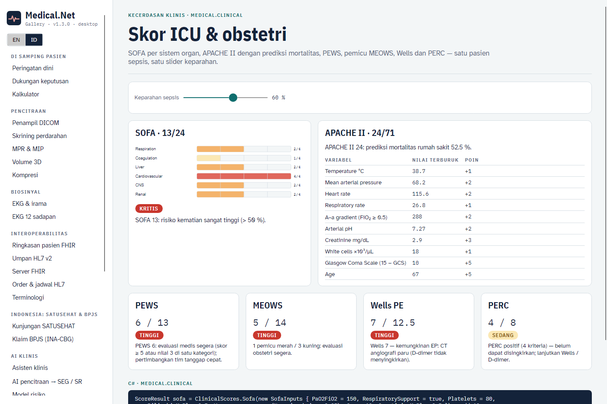
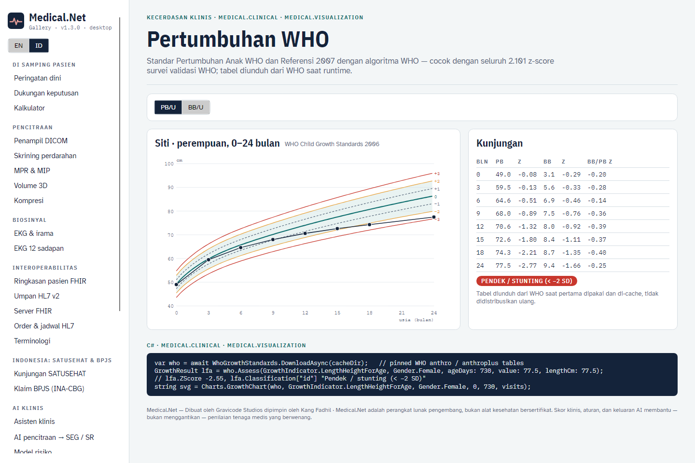
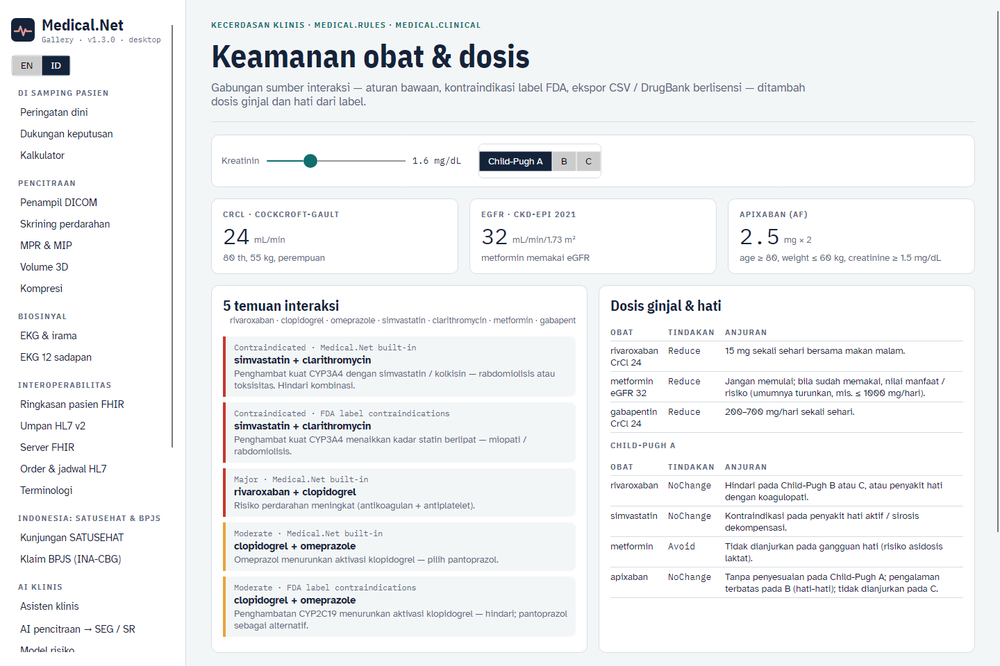
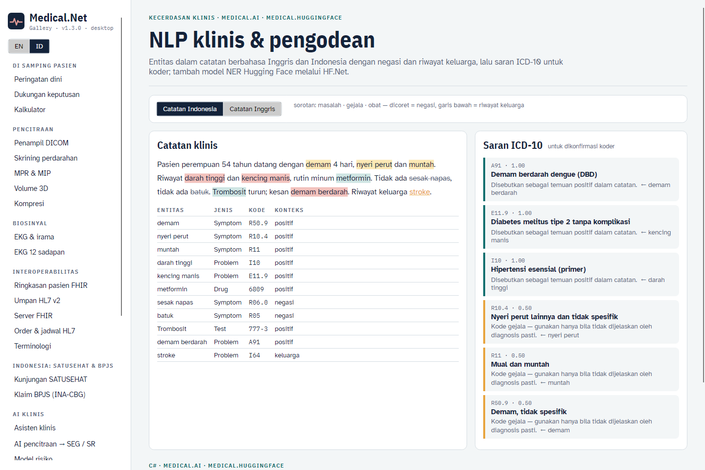
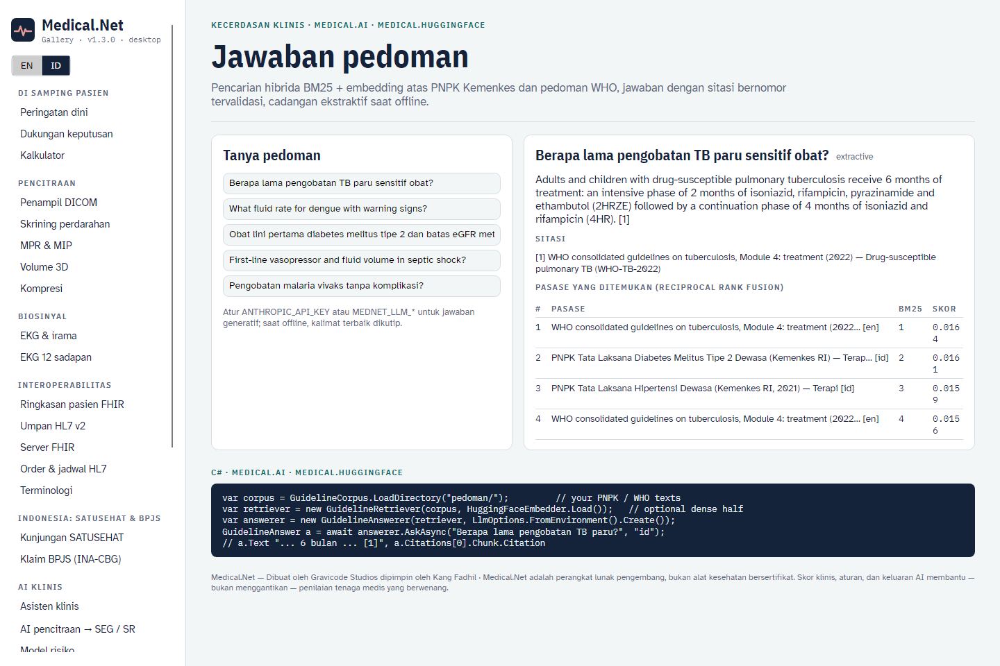
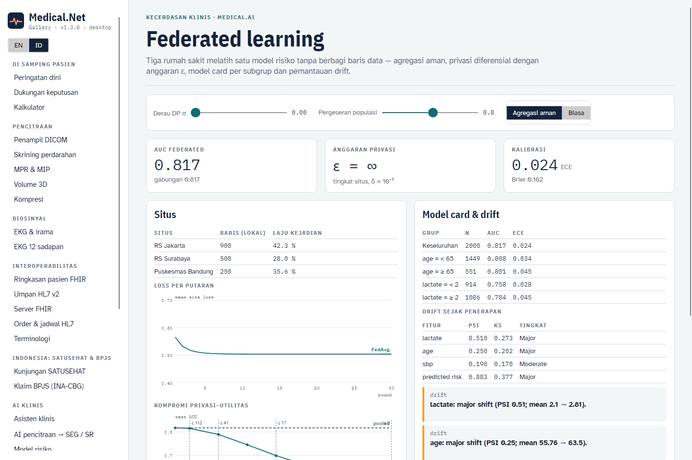

# Kecerdasan klinis (v1.3)

Medical.Net 1.3 menambahkan skor perawatan intensif dan kardiovaskular, penilaian pertumbuhan WHO, sumber interaksi obat
yang dapat dipasang beserta dosis ginjal / hati, NLP klinis dengan saran ICD-10, jawaban pedoman bersitasi, serta
pelatihan model yang menjaga privasi lengkap dengan model card dan pemantauan drift. · [English](../en/clinical-intelligence.md)

> Semua keluaran di sini membantu — bukan menggantikan — penilaian klinisi. Konfirmasi dosis dengan label terkini dan
> formularium setempat, dan kode dengan koder bersertifikat.

## Skor perawatan intensif, obstetri dan TEV (`Medical.Clinical`)

```csharp
ScoreResult sofa = ClinicalScores.Sofa(new SofaInputs
{
    PaO2FiO2 = 150, RespiratorySupport = true, Platelets = 80, BilirubinMgDl = 2.5,
    Vasopressors = new Vasopressors(Norepinephrine: 0.05), Gcs = 13, CreatinineMgDl = 2.5,
});                                                    // 13/24 — komponen 3·2·2·3·1·2; organ yang tidak diukur dicantumkan
ScoreResult apache = ClinicalScores.ApacheII(inputs, diagnosticWeight: 0.113);   // + prediksi mortalitas rumah sakit
ScoreResult pews = ClinicalScores.Pews(new PewsInputs(Behaviour: 1, Cardiovascular: 2, Respiratory: 1));
ScoreResult meows = ClinicalScores.Meows(rr, spo2, suhu, sistolik, diastolik, nadi, Avpu.Alert);   // pemicu merah / kuning
ScoreResult wells = ClinicalScores.WellsPe(...);       // ExactScore 4,5 (setengah poin); Score dalam satuan setengah poin
ScoreResult cp = ClinicalScores.ChildPugh(bilirubinMgDl: 2.5, albuminGDl: 3.0, inr: 1.5, ascites: 1, encephalopathy: 0);   // 8 → B
```

| Skor | Sumber | Catatan |
|---|---|---|
| SOFA | Vincent 1996; Sepsis-3 | PaO₂/FiO₂ < 200 bernilai 3–4 hanya dengan bantuan napas; ginjal = yang terburuk dari kreatinin dan produksi urine |
| APACHE II | Knaus 1985 | 12 variabel fisiologi + usia + kesehatan kronik; logit −3,517 + 0,146·skor (+0,603 bedah darurat) + bobot diagnosis |
| PEWS | Monaghan 2005 (Brighton) | ≥ 5 atau nilai 3 di satu kategori → evaluasi segera |
| MEOWS | Singh 2012 | skor = 2 per pemicu merah + 1 per kuning; 1 merah atau 2 kuning → segera |
| Wells EP / TVD, PERC | Wells 2000 / 2003, Kline 2004 | Wells dua tingkat; PERC hanya bila probabilitas klinis rendah |
| Child-Pugh | Pugh 1973 | kelas A 5–6, B 7–9, C 10–15; dipakai untuk dosis hati |

## Risiko kardiovaskular

```csharp
var x = new CvRiskInputs(Age: 55, Gender.Male, TotalCholesterol: 213, Hdl: 50, SystolicBp: 140,
                         TreatedForHypertension: false, Smoker: false, Diabetes: false);
CardiovascularRisk.Ascvd(x, PceRace.AfricanAmerican);   // 7,9 % — Pooled Cohort Equations
CardiovascularRisk.Framingham(x);                       // 13,5 % — CVD umum (D'Agostino 2008)
```

Koefisien diperiksa terhadap implementasi independen (paket R CVrisk) dan contoh dari pedomannya sendiri: perempuan kulit
putih / Afrika-Amerika 2,1 % / 3,0 % dan laki-laki Afrika-Amerika 6,1 %. Untuk laki-laki kulit putih, tabel pedoman
mencetak 5,3 % padahal persamaannya menghasilkan 5,38 %, dan tes memakai 5,38. Hasil memberi peringatan di luar rentang
derivasi, dan PCE menyarankan kalibrasi ulang lokal untuk pasien Indonesia / Asia.

## Standar pertumbuhan WHO

```csharp
var who = await WhoGrowthStandards.DownloadAsync(cacheDir);      // diunduh sekali dari GitHub WHO (commit terkunci)
GrowthResult r = who.Assess(GrowthIndicator.LengthHeightForAge, Gender.Female, ageDays: 730, value: 77.5, lengthCm: 77.5);
// r.ZScore −2,55, r.Classification["id"] "Pendek / stunting (< −2 SD)"
string svg = Charts.GrowthChart(who, GrowthIndicator.LengthHeightForAge, Gender.Female, 0, 731, kunjungan, "id");
```

- Menerapkan aturan WHO Anthro / AnthroPlus:
  - z-score LMS;
  - perhitungan terbatas di luar ±3 SD untuk indikator berbasis berat;
  - konversi 0,7 cm berbaring ↔ berdiri pada 731 hari (pengukuran berdiri di bawah 9 bulan diabaikan);
  - interpolasi 0,1 cm untuk BB/PB;
  - interpolasi bulanan untuk 5–19 tahun;
  - penanda nilai tidak masuk akal.
- **Divalidasi terhadap keluaran WHO sendiri:** seluruh 2.101 z-score dalam `survey_who2007_z.csv` WHO (TB/U, BB/U, IMT/U) cocok persis, demikian pula nilai harapan dari tes paket anthro.
- **Lisensi data:** tabel WHO tidak didistribusikan ulang dalam paket MIT. `DownloadAsync` mengunduhnya dari GitHub WHO, atau `Load` dapat diarahkan ke sebuah folder.

## Sumber interaksi obat dan dosis organ

```csharp
IDrugInteractionSource source = new CompositeInteractionSource(
    new BuiltInInteractionSource(),                       // aturan kelas terkurasi
    LabelContraindications.Source,                        // pasangan kontraindikasi label FDA, dengan bagian label
    CsvInteractionSource.Load("formularium.csv"),         // drug_a, drug_b, severity, effect_en[, effect_id, reference]
    DrugBankInteractionSource.Load("full_database.xml", obatFormularium));   // XML DrugBank berlisensi milik Anda
var temuan = await source.CheckAsync(["simvastatin", "clarithromycin", "rivaroxaban", "clopidogrel"]);

OrganDosing.Default.Renal("rivaroxaban", crClMlMin: 28, regimen: "AF stroke prevention");   // 15 mg sekali sehari
OrganDosing.ApixabanAf(age: 82, weightKg: 58, creatinineMgDl: 1.0);   // 2,5 mg dua kali sehari (≥ 2 kriteria)
OrganDosing.Default.Hepatic("rivaroxaban", "B");           // Hindari
```

- **Basis data berlisensi:** implementasikan `IDrugInteractionSource` untuk First Databank, Medi-Span, Lexicomp atau layanan formularium nasional. Sumber yang gagal dicatat di `Errors` tanpa menghentikan pemeriksaan.
- **Tabel ginjal:** metformin (eGFR), gabapentin, rivaroxaban, dabigatran, enoxaparin, levofloksasin dan siprofloksasin (CrCl), lengkap dengan catatan dialisis, semuanya dari label obat AS.

## NLP klinis dan pengodean ICD-10

```csharp
var rec = new CompositeEntityRecognizer(
    new TerminologyEntityRecognizer(),                                  // terminologi EN / ID + sinonim sehari-hari
    HuggingFaceEntityRecognizer.Load("d4data/biomedical-ner-all"));     // HF.Net, dalam proses, tanpa Python
var codes = new Icd10Coder(rec).Suggest("Pasien dengan demam berdarah dan darah tinggi, tidak ada sesak napas. Riwayat keluarga diabetes.");
// A91, I10 — R06.0 dinegasikan dan E11.9 riwayat keluarga: keduanya dikecualikan
```

- **Negasi dan riwayat keluarga:** dideteksi dengan pemicu gaya NegEx dalam bahasa Inggris dan Indonesia ("tidak ada", "menyangkal", "tanpa", "riwayat keluarga"); "tetapi" / "namun" mengakhiri cakupan.
- **Kode gejala:** kode bab R diurutkan di bawah diagnosis pasti.
- **NER Hugging Face:** sub-kata digabung menjadi kata utuh, lalu setiap entitas dikodekan lewat terminologi.

## Jawaban pedoman dengan sitasi

```csharp
var corpus = GuidelineCorpus.LoadDirectory("pedoman/");   // .md / .txt, header opsional title: / source: / language: / url:
var retriever = new GuidelineRetriever(corpus, HuggingFaceEmbedder.Load());   // BM25 + embedding multibahasa, RRF
GuidelineAnswer a = await new GuidelineAnswerer(retriever, LlmOptions.FromEnvironment().Create()).AskAsync("Berapa lama pengobatan TB paru?", "id");
```

- **Pencarian:** BM25 dengan glosarium EN↔ID; istilah terjemahan berbobot setengah sehingga pasase berbahasa sama dengan pertanyaan diutamakan. Opsional digabung dengan pencarian dense (reciprocal rank fusion).
- **Pemeriksaan sitasi:** LLM hanya boleh menjawab dari sumber bernomor. Sitasi ke sumber yang tidak diberikan dihapus, dan jawaban tanpa sitasi valid diganti jawaban ekstraktif.
- **Korpus contoh:** `GuidelineCorpus.Sample()` berisi ringkasan singkat yang ditulis untuk Medical.Net, merujuk WHO dan PNPK Kemenkes (hipertensi, malaria, DBD, diabetes). Muat dokumen resmi untuk pemakaian nyata.

## Federated learning, model card dan drift

```csharp
FederatedResult fed = FederatedLogisticRegression.Train(fitur, situs,
    new FederatedOptions { SecureAggregation = true, ClipNorm = 0.5, NoiseMultiplier = 1.0 });
double eps = fed.Epsilon(delta: 1e-5);                   // (ε, δ) tingkat situs dari komposisi Rényi DP
ModelCard card = ModelCard.Create("Perburukan", tujuan, prediksi, label, subgrup);   // AUC / Brier / ECE per subgrup
DriftReport drift = new DriftMonitor(fitur, referensi, prediksiRef, labelRef).Check(kini, prediksi, label);   // PSI, KS, peringatan AUC / ECE
```

- **Agregasi aman:** dengan topeng aditif berpasangan, koordinator hanya melihat jumlah pembaruan; tes menunjukkan bobotnya identik dengan pelatihan tanpa topeng.
- **Privasi diferensial:** DP-FedAvg memotong pembaruan setiap situs dan menambahkan derau Gaussian.
- **Hasil pada situs sintetis:** AUC federated berada dalam 0,01 dari pelatihan gabungan.

## CLI

```bash
medical score sofa --pf 150 --ventilated --plt 80 --bili 2.5 --norepinephrine 0.05 --gcs 13 --cr 2.5
medical cvrisk --age 55 --sex m --tc 213 --hdl 50 --sbp 140
medical growth --sex f --age-months 24 --weight 9.0 --height 77.5 --hc 46 --lang id
medical renal rivaroxaban --cr 1.6 --age 80 --weight 55 --sex f --child-pugh B --lang id
medical interactions simvastatin clarithromycin warfarin --sources [--csv formularium.csv]
medical nlp "Pasien dengan demam berdarah, tidak ada sesak napas." --lang id [--hf]
medical guideline ask "Berapa lama pengobatan TB paru?" --lang id [--corpus pedoman/] [--offline]
medical federated --noise 1.0 --clip 0.5 --card MODEL_CARD.md      medical drift --shift 0.8
```

## Galeri

| | |
|---|---|
|  |  |
|  |  |
|  |  |
