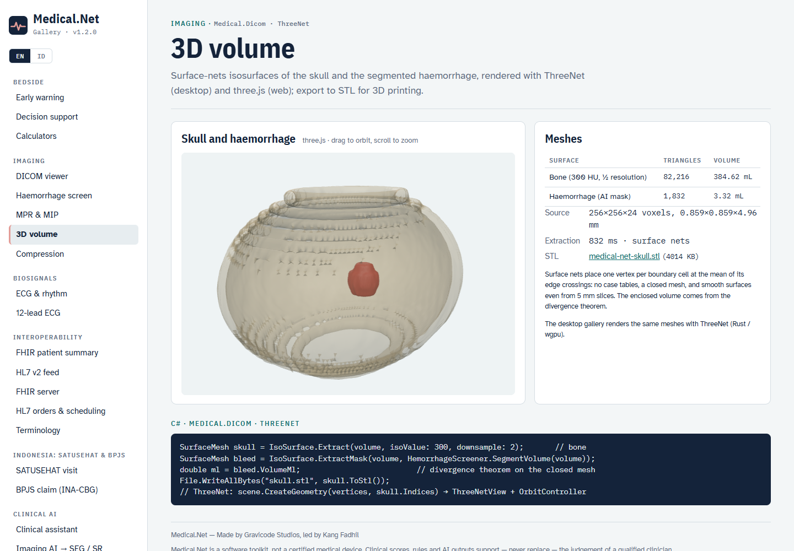
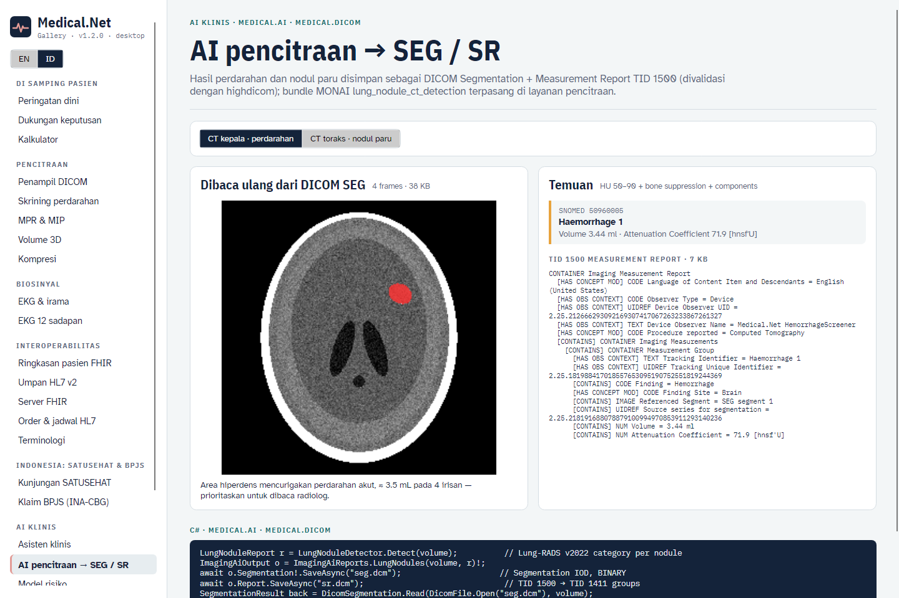
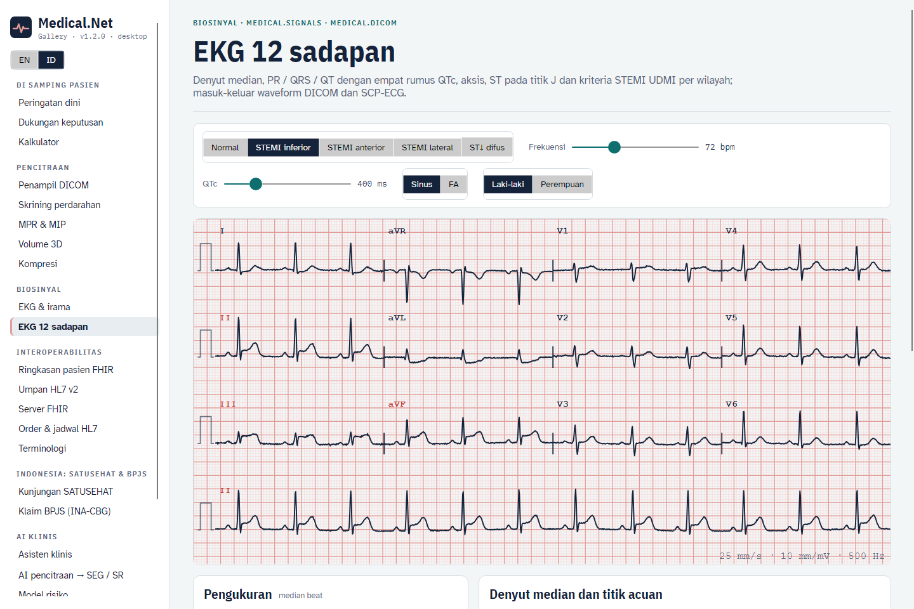

# Pencitraan dan sinyal (v1.2)

Medical.Net 1.2 menambahkan:

- sintaks transfer DICOM terkompresi;
- volume dengan MPR / MIP di kernel Rust;
- isosurface dan penampil 3D (ThreeNet di desktop, three.js di web);
- hasil AI sebagai DICOM SEG + SR TID 1500, dengan deteksi nodul paru dan bundle model-zoo MONAI;
- penganalisis EKG 12 sadapan dengan masukan/keluaran waveform DICOM dan SCP-ECG.

## Sintaks transfer terkompresi

```csharp
DicomFile jls = DicomCodecs.Transcode(file, DicomCompression.JpegLsLossless);
DicomFile j2k = DicomCodecs.Transcode(file, DicomCompression.Jpeg2000, quality: 20);   // lossy, ≈ 20:1
DicomFile raw = DicomCodecs.Decompress(j2k);                                           // Explicit VR Little Endian
short[] px = DicomImaging.FrameI16(jls.Dataset);    // frame terkompresi didekode sesuai kebutuhan di semua tempat
```

| `DicomCompression` | Sintaks transfer | Terverifikasi |
|---|---|---|
| `Rle` | RLE Lossless (1.2.840.10008.1.2.5) | bolak-balik identik bit |
| `JpegLossless` | JPEG Lossless SV1 (…4.70) | identik bit |
| `JpegLsLossless` / `JpegLsNearLossless` | JPEG-LS (…4.80 / …4.81) | identik bit / \|galat\| ≤ NEAR |
| `Jpeg2000Lossless` / `Jpeg2000` | JPEG 2000 (…4.90 / …4.91) | identik bit / RMSE terbatas |
| `HtJpeg2000Lossless` | High-Throughput JPEG 2000 (…4.201) | identik bit |

Codec native berasal dari `fo-dicom.Codecs` (MS-PL): libijg, CharLS, OpenJPEG dan OpenJPH, untuk Windows, Linux dan macOS di x64 dan Arm64. Windows juga memerlukan runtime Visual C++ 14. `DicomCodecs.EnsureRegistered()` memasangnya saat pertama dipakai. Bila host Anda sudah mendaftarkan `NativeTranscoderManager`, pengaturan itu dibiarkan apa adanya.

## Volume, MPR dan proyeksi slab

```csharp
DicomVolume v = DicomVolume.FromSeries(files);       // urutan bebas; diurutkan menurut normal irisan (Image Position Patient)
VolumeImage aksial  = VolumeRendering.Mpr(v, VolumePlane.Axial, position: 0.5);
VolumeImage koronal = VolumeRendering.Mpr(v, VolumePlane.Coronal);
VolumeImage mip     = VolumeRendering.Project(v, VolumePlane.Axial, SlabMode.Max, 0.5, thicknessMm: 30);
VolumeImage minip   = VolumeRendering.Project(v, VolumePlane.Coronal, SlabMode.Min);           // seluruh volume
VolumeImage miring  = VolumeRendering.Oblique(v, u: new(1, 0.3, 0), v: new(0, 0, -1), thicknessMm: 10, mode: SlabMode.Max);
byte[] png = mip.ToPng(WindowPreset.Bone);
```

- **Geometri.** `DicomVolume` menyimpan geometri pasien DICOM (LPS, mm). `ToPatient` dan `ToVoxel` mengonversi antara koordinat voksel dan pasien, termasuk tumpukan yang tidak ortogonal.
- **Kernel.** Semua bidang dan slab berjalan di satu kernel Rust, `mdn_slab_i16`: sampling trilinier ditambah reduksi max / min / mean, dengan kembaran managed identik bit yang dijaga uji paritas.
- **Proporsi.** Piksel keluaran persegi pada spasi bidang terhalus, sehingga rekonstruksi koronal dan sagital dari seri 5 mm tetap proporsional.
- **Sampling proyeksi.** Proyeksi sepanjang sumbu akuisisi mengambil satu sampel per lapis voksel, sehingga interpolasi tidak dapat menyembunyikan nilai maksimum atau minimum.

## Isosurface dan 3D

```csharp
SurfaceMesh tengkorak = IsoSurface.Extract(v, isoValue: 300, downsample: 2);             // tulang
SurfaceMesh darah = IsoSurface.ExtractMask(v, HemorrhageScreener.SegmentVolume(v));       // mask biner apa pun
double ml = darah.VolumeMl;                     // teorema divergensi pada mesh tertutup
File.WriteAllBytes("tengkorak.stl", tengkorak.ToStl());
string obj = tengkorak.Smooth(10).ToObj();      // penghalusan Taubin λ|μ untuk tampilan (topologi dan volume terjaga)
```

Ekstraksi memakai surface nets naif: satu verteks per sel batas, ditempatkan di rerata titik potong rusuknya, tanpa tabel kasus. Pengujian memastikan mesh kedap air dan berorientasi konsisten. Volume mesh lesi phantom sesuai dengan volume analitiknya (3,45 mL).

Galeri desktop merender mesh dengan **ThreeNet** (Rust / wgpu, `ThreeNetView` dengan orbit controller). Galeri web memakai three.js, dengan mesh dikirim sebagai buffer biner.



## AI pencitraan → DICOM SEG + SR

```csharp
// CT kepala: mask perdarahan (aturan yang sama dengan HemorrhageScreener.Analyze)
ImagingAiOutput h = ImagingAiReports.Hemorrhage(v, HemorrhageScreener.SegmentVolume(v))!;
// CT toraks: nodul paru, kategori ACR Lung-RADS v2022 (baseline, solid)
LungNoduleReport r = LungNoduleDetector.Detect(v);
ImagingAiOutput n = ImagingAiReports.LungNodules(v, r)!;
await n.Segmentation!.SaveAsync("seg.dcm");   // Segmentation IOD: BINARY, rujukan sumber per frame, kode segmen SNOMED
await n.Report.SaveAsync("sr.dcm");           // Comprehensive 3D SR, TID 1500 dengan grup TID 1411 → segmen SEG
```

highdicom memvalidasi kedua objek secara independen. Frame SEG terpetakan ke instance CT sumber. SR terbaca sebagai TID 1500, dan setiap grup pengukuran membawa temuan, lokasi temuan, segmen rujukan dan pengukuran berkode UCUM.

**Nodul paru.** `LungNoduleDetector` klasik bekerja dalam empat langkah:

1. Membentuk lapang paru (udara di bawah −400 HU yang tidak terhubung ke luar, dengan lubang diisi).
2. Mengambil kandidat jaringan lunak di atas −300 HU.
3. Menerapkan filter bentuk 3D yang menolak pembuluh darah.
4. Mengukur sumbu panjang dan pendek dari momen bidang.

Nodul juxtapleural dan ground-glass tidak terdeteksi; ini alat bantu triase.

**MONAI.** Setel `MEDNET_MONAI_LUNG_BUNDLE` agar layanan pencitraan menjalankan bundle MONAI Model Zoo `lung_nodule_ct_detection`. Bundle ini adalah RetinaNet yang dilatih pada LUNA16 / LIDC-IDRI: kode Apache-2.0, data CC-BY. Unduh dengan:

```bash
python -m monai.bundle download lung_nodule_ct_detection --bundle_dir models
```

Layanan mereproduksi praproses dan pascaproses kotak milik bundle itu sendiri.

- **Verifikasi:** pada phantom toraks, bundle menemukan nodul dengan skor 0,65, dalam 4 mm dari detektor klasik, dengan Lung-RADS 4B.
- **Perangkat keras:** memerlukan `torch` + `torchvision`, serta GPU agar cukup cepat (sekitar 35 menit per studi di CPU).
- **Keterbatasan:** belum ada bobot publik untuk perdarahan intrakranial. `MEDNET_MONAI_WEIGHTS` menerima state_dict UNet Anda sendiri.



## EKG 12 sadapan

```csharp
var (ekg, kebenaran) = Ecg12Simulator.Generate(new Ecg12Options { StPattern = StPattern.InferiorStemi, HeartRate = 72, QtcMs = 400 });
Ecg12Analysis a = Ecg12Analyzer.Analyze(ekg, new EcgPatient(Gender.Male, 58));
// a.PrMs, a.QrsMs, a.QtMs, a.QtcBazettMs / QtcFridericiaMs / QtcFraminghamMs / QtcHodgesMs, a.QrsAxisDeg, a.Qtc
// a[EcgLead.III].StJMv, a.StemiTerritories = ["Inferior"], a.StDepressionLeads = [I, aVL], a.Interpretation["id"]
EcgIntervals x = Ecg12Analyzer.MeasureIntervals([sadapan1, sadapan2], 250);   // set sadapan apa pun (Holter, monitor)
```

**Simulator.** Simulator memproyeksikan model dipol vektorkardiografik ke sumbu sadapan, sehingga hukum Einthoven dan Goldberger berlaku persis. QT mengikuti Fridericia pada berbagai frekuensi. Arus cedera ST menghasilkan wilayah yang benar beserta perubahan resiproknya.

**Penganalisis.** Analisis berjalan dalam langkah berikut:

1. **Puncak R:** dicari pada magnitudo spasial QRS oleh kernel Rust Pan-Tompkins, dengan sinyal dipotong terhadap artefak.
2. **Denyut median:** dua tahap; tahap kedua menghapus level PR tiap denyut, sehingga simpangan baseline hilang.
3. **Awal/akhir QRS:** dari kecepatan spasial.
4. **Akhir T:** **metode kurva area** (Zhang dkk., IEEE TBME 2006, jendela 96 md) sebagai bawaan; `TEndMethod.Tangent` adalah alternatifnya. Akhir T global adalah konsensus sadapan dengan gelombang T yang kuat.

**Kriteria.**

- Kriteria voltase STEMI mengikuti Definisi Universal IM ke-4 (2018), pada dua sadapan berdekatan: ≥ 1 mm di J, namun V2–V3 ≥ 2 mm untuk laki-laki ≥ 40 tahun, ≥ 2,5 mm untuk laki-laki di bawah 40 tahun, dan ≥ 1,5 mm untuk perempuan.
- Kategori QTc memakai Fridericia dengan batas AHA/ACCF/HRS 2009. QT pendek adalah ≤ 340 md (ESC 2015).

**Akurasi terhadap kardiolog** (PhysioNet QT Database, anotasi q1c, 101 rekaman).

- **Metode:** panjang jendela dipilih pada separuh rekaman; angka di bawah adalah untuk separuh lainnya (51 rekaman).
- **Galat QT:** rerata −4,9 md, median |galat| **18 md**, **70 % dalam 30 md**.
- **Sebaran:** SD 65 md, akibat beberapa rekaman dengan deteksi QRS atau T yang gagal. Pengukuran harus selalu dibaca ulang.

**Format berkas.**

- `DicomEcg.Create(ekg, pasien, analisis)` / `DicomEcg.Read`: 12-lead ECG Waveform Storage dengan kode sadapan SCPECG (CID 3001), sensitivitas µV, dan anotasi pengukuran berkode LOINC. Terverifikasi dengan pydicom.
- `ScpEcg.Write` / `ScpEcg.Read`: SCP-ECG (EN 1064), Section 0, 1, 2, 3 dan 6. Data berupa mentah atau selisih kedua dengan Huffman bawaan. Pembaca juga menerima selisih pertama dan menurunkan III / aVR / aVL / aVF bila perangkat hanya menyimpan 8 sadapan. Kompresi bimodal dan pengurangan denyut referensi ditolak dengan pesan galat yang jelas. Pembaca SCP-ECG independen mendekode berkas tersebut.
- `Charts.Ecg12Grid(ekg, highlight: …)`: cetakan standar 3 × 4 ditambah strip irama. `Charts.MedianBeats(analisis)` menampilkan denyut median dengan garis titik acuan yang dipakai untuk pengukuran.



## CLI

```bash
medical dicom transcode in.dcm out.dcm --ts jpegls|jpegls-near|j2k|j2k-lossy|htj2k|jpeg-lossless|rle|none
medical dicom mpr ct/ --plane coronal --window brain --out koronal.png
medical dicom mip ct/ --plane axial --slab 30 --mode max --out mip.png
medical dicom mesh ct/ --iso 300 --out tengkorak.stl
medical dicom ai ct/ --out-dir hasil          # perdarahan (kepala) atau nodul paru (toraks) → seg.dcm + sr.dcm
medical ecg12 --pattern inferior --out ekg.svg|ekg.dcm|ekg.scp --lang id
medical ecg12 analyze ekg.scp --sex f --age 50
```

Skrip validasi (highdicom, pydicom, QT Database) ada di `tools/validation`.
