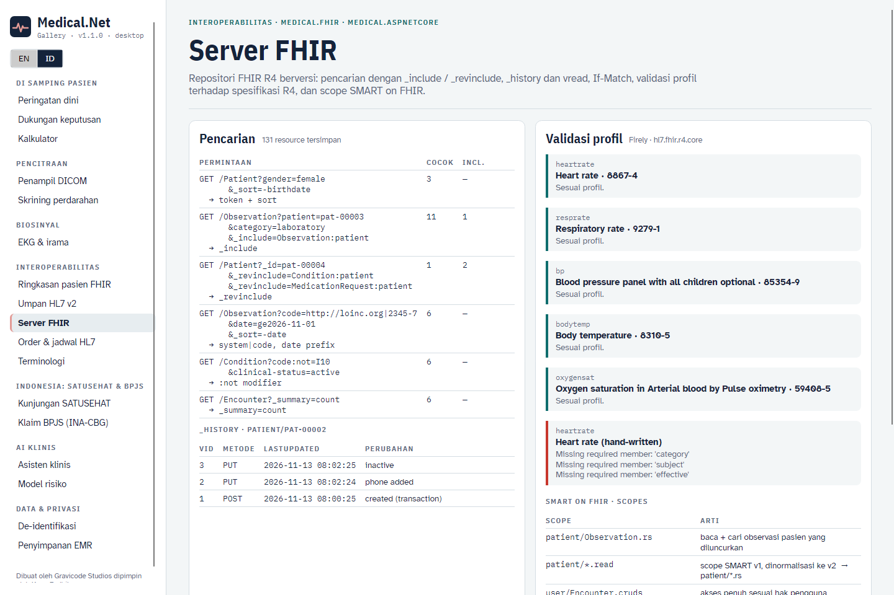
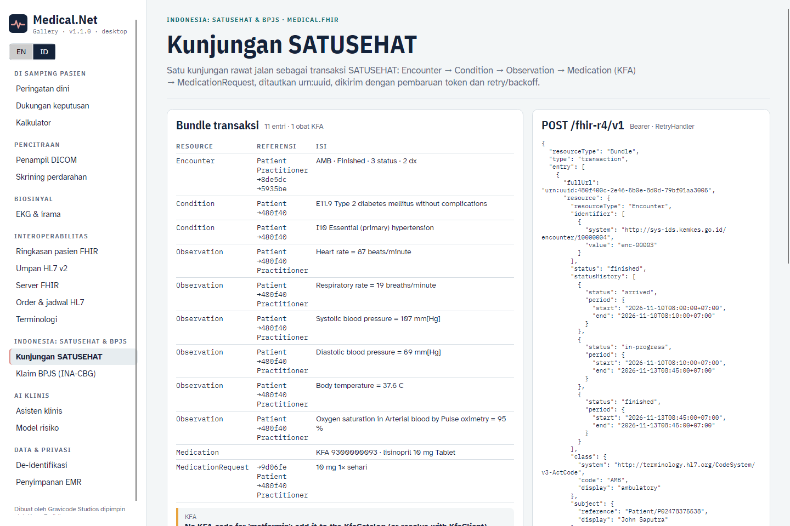
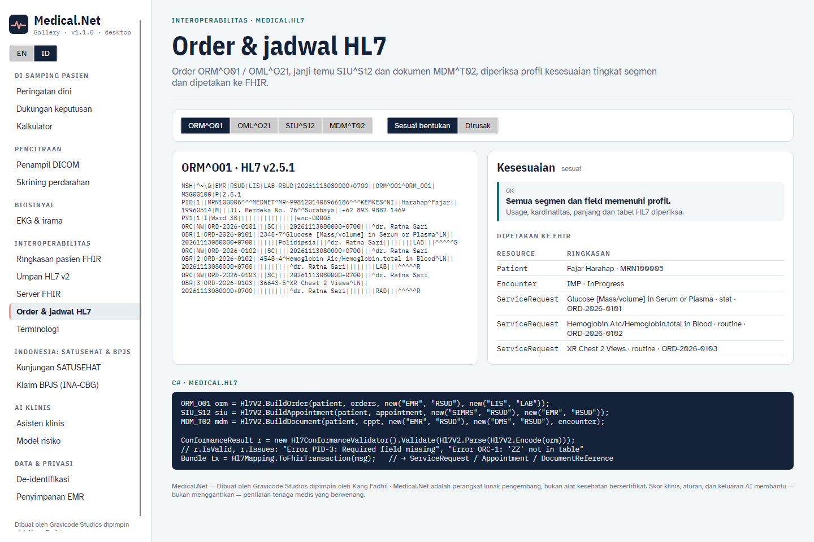
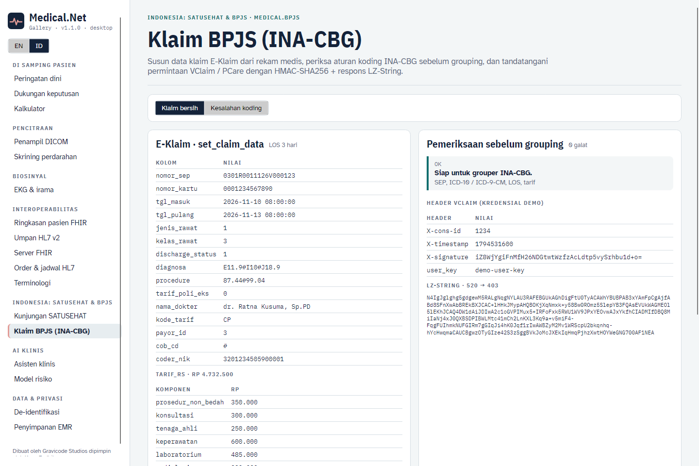

# Interoperabilitas (v1.1)

Medical.Net 1.1 memperdalam lapisan interoperabilitas. Tambahannya meliputi:

- server FHIR persisten dengan semantik pencarian yang sesungguhnya,
- validasi profil dan SMART on FHIR,
- alur kunjungan SATUSEHAT yang lengkap,
- order, penjadwalan dan dokumen HL7 v2 beserta profil kesesuaian,
- API BPJS Kesehatan (VClaim, PCare, E-Klaim / INA-CBG).

## Server FHIR

`IFhirRepository` adalah kontrak penyimpanan yang dipakai `MapMedicalFhir()`, listener MLLP, dan kode Anda sendiri. Tersedia dua implementasi:

| Implementasi | Kegunaan |
|---|---|
| `InMemoryFhirStore` | pengembangan, pengujian, gateway edge (didaftarkan oleh `AddFhir()`) |
| `EfFhirRepository` (`Medical.Emr`) | penyimpanan tahan lama di EF Core (SQL Server / SQLite / in-memory). Setiap versi disimpan sebagai JSON, dan versi terkini diindeks di `FhirSearchIndex`. Didaftarkan otomatis oleh `AddEmr()` (`EmrOptions.PersistFhir = true`) |

```csharp
builder.Services.AddMedical(m => m
    .AddMedicalApi()
    .AddEmr(o => { o.Provider = EmrProvider.SqlServer; o.ConnectionString = cs; }));   // IFhirRepository → EfFhirRepository
var app = builder.Build();
await app.Services.EnsureEmrDatabaseAsync();   // membuat tabel EMR + FHIR (gunakan migrasi EF di produksi)
app.MapMedicalFhir();
```

### Pencarian

| Fitur | Contoh |
|---|---|
| Token (`system|code`, `code`, `system|`) | `Observation?code=http://loinc.org|2345-7` |
| Referensi (`Type/id`, id saja, modifier `:Type`) | `Observation?patient=pat-00003`, `?subject:Patient=pat-00003` |
| String (awalan, `:exact`, `:contains`) | `Patient?family:exact=Santoso&given=Bu` |
| Tanggal dengan prefiks `eq ne gt lt ge le sa eb` | `Observation?date=ge2026-11-01`, `Patient?birthdate=lt1960` |
| OR dalam satu parameter, AND antar-parameter | `Observation?code=2345-7,2160-0&patient=pat-00001` |
| `:not`, `:missing` | `Condition?code:not=I10`, `Observation?encounter:missing=true` |
| `_id`, `_lastUpdated` | `Patient?_id=pat-00001,pat-00002` |
| `_include`, `_revinclude` (`Type:param[:Target]`, `*`) | `Observation?…&_include=Observation:patient`, `Patient?_id=…&_revinclude=Condition:patient` |
| `_sort` (banyak kunci, `-` untuk menurun), `_count`, `_offset` (dengan tautan `next`/`previous`), `_summary=count` | `Patient?_sort=-birthdate&_count=20` |

Parameter yang diindeks:

- `Patient`: identifier, name, family, given, gender, birthdate.
- `Appointment`: identifier, patient, actor, status, date, service-type.
- `Condition` dan `AllergyIntolerance`: set umum di bawah, ditambah clinical-status dan verification-status.
- Semua tipe lain (set umum): identifier, patient, subject, encounter, code, category, status, date, requester, performer, author, type.

Parameter yang tidak dikenal diabaikan dan dilaporkan sebagai entri `OperationOutcome` dengan `search.mode = outcome`.

### Versi, riwayat dan operasi bersyarat

```http
PUT  /fhir/Patient/pat-1           If-Match: W/"2"     → 200 / 201, 412 bila versinya sudah berubah
GET  /fhir/Patient/pat-1/_history                       → bundle riwayat (terbaru dulu, termasuk DELETE)
GET  /fhir/Patient/pat-1/_history/1                     → vread
GET  /fhir/Patient/_history?_since=2026-11-01           → riwayat per tipe; /fhir/_history untuk seluruh server
GET  /fhir/Patient/pat-1           (setelah DELETE)     → 410 Gone
```

Transaksi diproses dalam urutan FHIR (DELETE → POST → PUT → GET) dan bersifat atomik. Pada provider relasional, transaksi berjalan di dalam transaksi basis data. Referensi `urn:uuid:` di seluruh bundle diganti dengan id yang diberikan, dan `ifNoneExist` mengubah POST menjadi pencocokan.

### Validasi profil

```csharp
var validator = new FhirProfileValidator(new FhirValidationOptions
{
    Packages = ["hl7.fhir.uv.ips@1.1.0"],          // paket IG opsional (diunduh sekali ke ~/.fhir/packages)
    ProfileDirectory = "profiles",                  // StructureDefinition lokal / nasional (opsional)
});
OperationOutcome oo = validator.Validate(observation, "http://hl7.org/fhir/StructureDefinition/heartrate");
bool ok = FhirProfileValidator.IsSuccess(oo);      // meta.profile dipakai bila profil tidak diberikan
```

`specification.zip` inti R4 berasal dari paket `Hl7.Fhir.Specification.Data.R4` dan disalin ke output setiap aplikasi yang mereferensikan `Medical.Fhir`. Lewat HTTP, gunakan `POST /fhir/{type}/$validate[?profile=…]`. `POST`/`PUT` resource yang mencantumkan `meta.profile` divalidasi, dan resource yang tidak valid dijawab **422** beserta `OperationOutcome`.

### SMART on FHIR

```csharp
builder.Services.AddMedical(m => m.AddMedicalApi().AddSmartOnFhir(o =>
{
    o.SigningKey = builder.Configuration["Smart:SigningKey"]!;        // ≥ 32 byte; acak per proses bila kosong
    o.Clients.Add(new SmartClientRegistration("ward-app", ["https://ward.example/callback"], "launch/patient openid fhirUser patient/*.rs"));
    o.Clients.Add(new SmartClientRegistration("etl", [], "system/*.rs", Secret: builder.Configuration["Smart:EtlSecret"]));
}));
app.MapMedicalFhir();
app.MapSmartAuthorization();   // /fhir/.well-known/smart-configuration, /auth/authorize, /auth/token, /auth/launch
```

- Authorization code dengan **PKCE (S256)** untuk aplikasi publik; `client_credentials` untuk layanan backend, terbatas pada scope `system/`.
- Scope SMART v1 (`patient/*.read`) dan v2 (`patient/Observation.rs`). Setiap interaksi FHIR diperiksa (c/r/u/d/s), termasuk tiap entri transaksi.
- Token yang terikat pasien (scope `patient/` ditambah pasien peluncuran) hanya melihat kompartemen pasien tersebut. Pencarian dipersempit otomatis, dan pasien lain dijawab 403.
- Server otorisasi bawaan menyetujui otomatis (mode pengembangan). Di produksi, pasang penyedia identitas Anda di depan `/auth/authorize` atau gunakan server SMART organisasi Anda.

Sisi klien: `SmartClient.DiscoverAsync`, `SmartClient.CreateAuthorizationRequest` (PKCE), `ExchangeCodeAsync`, `ClientCredentialsAsync`, dan `BearerTokenHandler` untuk `HttpClient`.



## Alur SATUSEHAT

```csharp
var kfa = new KfaCatalog();                                           // kode KFA (Kamus Farmasi dan Alat Kesehatan)
await new KfaClient(http, satuSehat).ResolveIntoAsync(kfa, record.Medications.Select(m => m.Generic));
// atau: KfaCatalog.LoadCsv("kfa.csv") dari pemetaan formularium Anda

SatuSehatSubmission s = SatuSehatWorkflow.BuildOutpatientVisit(record, new SatuSehatContext
{
    PatientIhs = "P02478375538", PatientName = "Budi Santoso",
    PractitionerIhs = "N10000001", PractitionerName = "dr. Ratna",
    LocationId = "b017aa54-…", LocationName = "Poli Penyakit Dalam", OrganizationId = "10000004",
}, kfa);
foreach (var w in s.Warnings) logger.LogWarning("{Warning}", w);      // mis. obat tanpa kode KFA dilewati
Bundle result = await satuSehat.PostTransactionAsync(s.Bundle);
```

Isi bundle:

- **Encounter**: `statusHistory` arrived → in-progress → finished, diagnosis pulang beserta peringkatnya, dan dokter penanggung jawab.
- **Condition**: diagnosis kunjungan ICD-10.
- **Observation**: enam tanda vital.
- **Medication**: kode KFA dengan ekstensi `MedicationType`.
- **MedicationRequest**.

Setiap entri ditautkan dengan `urn:uuid` deterministik. `SatuSehatClient` menyimpan token OAuth2 dan memperbaruinya sekali bila mendapat 401. `AddFhir(satuSehat: …)` mendaftarkan `HttpClient` bernama `"satusehat"` dengan `RetryHandler`, yang memakai backoff eksponensial dengan full jitter dan menghormati `Retry-After`. 429 dan 503 selalu diulang; 408, 500, 502 dan 504 hanya untuk permintaan idempoten.



## HL7 v2: order, penjadwalan, dokumen, kesesuaian

| Pesan | Builder | Kembali ke domain / FHIR |
|---|---|---|
| ORM^O01 order umum | `Hl7V2.BuildOrder(patient, orders, from, to, encounter)` | `Hl7WorkflowMapping.ToOrders` → `ServiceRequest` |
| OML^O21 order lab dengan spesimen | `Hl7V2.BuildLabOrder(...)` | `ToOrders` (SPM-4 → `Specimen`) |
| SIU^S12 janji temu | `Hl7V2.BuildAppointment(patient, appointment, from, to)` | `ToAppointment` → `Appointment` |
| MDM^T02 dokumen | `Hl7V2.BuildDocument(patient, document, from, to, encounter)` | `ToDocument` → `DocumentReference` (lampiran teks) |

`Hl7Mapping.ToFhirTransaction(msg)` memilih resource yang sesuai dengan tipe pesan, dan listener MLLP menyimpan semuanya.

```csharp
var conformance = new Hl7ConformanceValidator();          // profil bawaan: ADT^A01, ORU^R01, ORM^O01, OML^O21, SIU^S12, MDM^T02
ConformanceResult r = conformance.Validate(er7);
// r.IsValid, r.Profile, r.Issues: "Error PID-3: Required field missing", "Error ORC-1: 'ZZ' is not in the table"
conformance.Add(Hl7ConformanceValidator.ParseProfiles(File.ReadAllText("profil-saya.json"))[0]);   // profil lokal
```

Profil mendefinisikan usage segmen (R/RE/O/X) dan kardinalitasnya, usage field, panjang maksimum, serta nilai tabel. Setel `MllpListenerOptions.EnforceConformance = true` agar pesan yang tidak sesuai dijawab `AE`. `POST /api/hl7/conformance` memvalidasi lewat HTTP.



## BPJS Kesehatan (`Medical.Bpjs`)

```csharp
builder.Services.AddMedical(m => m.AddBpjs(o =>
{
    o.Credentials = BpjsCredentials.FromEnvironment();       // BPJS_CONS_ID, BPJS_SECRET_KEY, BPJS_USER_KEY
    o.Environment = BpjsEnvironment.Development;             // apijkn-dev → Production: apijkn
    o.EKlaimUrl = "http://eklaim.rs.local/E-Klaim/ws.php";
    o.EKlaimKey = builder.Configuration["EKlaim:Key"];       // 64 karakter hex dari setup E-Klaim
}));
```

| Klien | Panggilan |
|---|---|
| `VClaimClient` | `PesertaByKartuAsync`, `PesertaByNikAsync`, `DiagnosaAsync`, `RujukanAsync`, `SepAsync`, `InsertSepAsync` (SEP 2.0), `DeleteSepAsync` |
| `PCareClient` | `PesertaAsync`, `DiagnosaAsync`, `PendaftaranAsync` |
| `EKlaimClient` | `NewClaimAsync`, `SetClaimDataAsync`, `GrouperAsync(stage)`, `ClaimFinalAsync`, `SendClaimAsync`, `GetClaimDataAsync` |

Kriptografi permintaan dan respons sudah diimplementasikan dan diuji:

- **Permintaan VClaim / PCare:** `X-signature = Base64(HMAC-SHA256(secret, consId & timestamp))`.
- **Respons VClaim / PCare:** AES-256-CBC dengan kunci `SHA-256(consId + secret + timestamp)`, lalu dekompresi LZ-String. Dekompresi diverifikasi terhadap lz-string 1.5.0 referensi.
- **Payload E-Klaim:** AES-256-CBC, dibungkus sebagai `base64(signature10 ‖ iv16 ‖ cipher)`.

**Klaim INA-CBG.** `InaCbgClaimBuilder.FromRecord(record, nomorSep, nomorKartu, tariff, coderNik, procedures)` menyusun payload `new_claim` / `set_claim_data`, termasuk 18 komponen tarif rumah sakit. Sebelum grouping, `InaCbgClaimBuilder.Validate(claim)` memeriksa:

- SEP (19 karakter), kartu (13 digit) dan NIK (16 digit);
- format dan keberadaan ICD-10, serta format ICD-9-CM;
- kode sebab luar (V–Y) tidak boleh jadi diagnosis utama; kode R sebagai utama mendapat peringatan; kode P wajib disertai berat lahir;
- lama rawat ICU, urutan tanggal, dan tarif yang tidak nol.



## CLI

```bash
medical fhir validate obs.json --profile http://hl7.org/fhir/StructureDefinition/heartrate
medical hl7 sample --type orm|oml|siu|mdm|adt|oru --out msg.hl7 && medical hl7 conform msg.hl7
medical satusehat bundle --index 3 --out kunjungan.json
medical bpjs claim --index 7 [--sep 0301R0011126V000123] --lang id
```
