# Perkakas: CLI, templat, dan Galeri

## CLI `medical`

```bash
dotnet tool install -g Medical.Cli
medical help
```

| Perintah | Contoh |
|---|---|
| Skor | `medical news2 --rr 24 --spo2 93 --o2 --sbp 105 --hr 115 --temp 38.5 --lang id` · `medical qsofa --rr 22 --sbp 98 --altered` |
| Kalkulator | `medical egfr --cr 1.2 --age 60 --sex f` · `medical bmi --weight 70 --height 172` · `medical dose amoxicillin --weight 25` |
| Terminologi | `medical code search demam berdarah --lang id` · `medical code validate loinc 2345-7` · `medical code map 44054006` |
| Keamanan obat | `medical interactions warfarin ibuprofen --allergy penicillin --lang id` |
| FHIR / HL7 | `medical fhir ips --index 3 --out ips.json` · `medical hl7 sample --out oru.hl7` · `medical hl7 listen --port 2575` |
| DICOM | `medical dicom phantom --out ct` · `medical dicom render ct/IM015.dcm --window brain` · `medical dicom hemorrhage ct --lang id` |
| Lainnya | `medical ecg --rhythm af` · `medical deid "Ny. Siti, HP 0812…"` · `medical cds --lang id` · `medical risk` · `medical ask "…" --patient 7` · `medical emr seed` |

## Templat `dotnet new`

```bash
dotnet new install Medical.Templates
dotnet new medical-fhir-api -n RumahSakit.Api
```

| Templat | Hasil |
|---|---|
| `medical-console` | Aplikasi konsol: NEWS2, dukungan keputusan, daftar masalah dua bahasa, ekspor IPS |
| `medical-fhir-api` | Server FHIR ASP.NET Core + API klinis + listener MLLP, berisi pasien sintetis |
| `medical-hl7-gateway` | Worker service: MLLP → FHIR, peringatan CDS di log, opsi meneruskan ke server FHIR |
| `medical-blazor` | Papan bangsal Blazor diurutkan berdasarkan NEWS2 |
| `medical-avalonia` | Penampil DICOM Avalonia dengan preset jendela, statistik HU, skrining perdarahan |

## Galeri

Tiga belas kasus penggunaan di dua aplikasi yang berbagi `gallery/Medical.Gallery.Shared`:

```bash
dotnet run --project gallery/Medical.Gallery.Web --urls http://localhost:5290      # buka /?lang=id
dotnet run --project gallery/Medical.Gallery.Desktop
dotnet run --project gallery/Medical.Gallery.Desktop -- --screenshot docs/images id
```

| | |
|---|---|
| 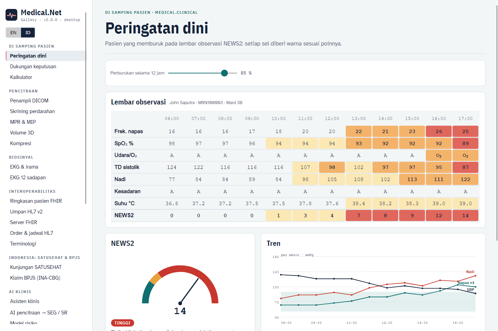 |  |
|  |  |

## Baru di 1.1

| Perintah | Contoh |
|---|---|
| Validasi profil FHIR | `medical fhir validate obs.json --profile http://hl7.org/fhir/StructureDefinition/heartrate` |
| Order / jadwal / dokumen HL7 | `medical hl7 sample --type orm|oml|siu|mdm --out msg.hl7` · `medical hl7 conform msg.hl7` |
| SATUSEHAT | `medical satusehat bundle --index 3 --out kunjungan.json` |
| BPJS | `medical bpjs claim --index 7 --lang id` (data klaim INA-CBG + pemeriksaan koding; kode keluar 2 bila ada galat) |

Templat `medical-fhir-api` kini menerima `--smart` (otorisasi SMART on FHIR) dan `--persist` (FHIR tersimpan di EF Core/SQLite); `--MedicalNetVersion` bawaan `1.1.0`.

Galeri kini berisi tujuh belas kasus, termasuk **Server FHIR**, **Order & jadwal HL7**, **Kunjungan SATUSEHAT** dan **Klaim BPJS (INA-CBG)**:

| | |
|---|---|
| 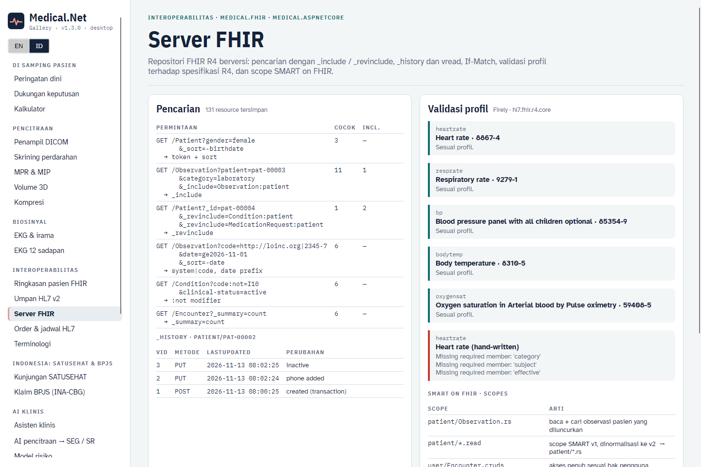 | 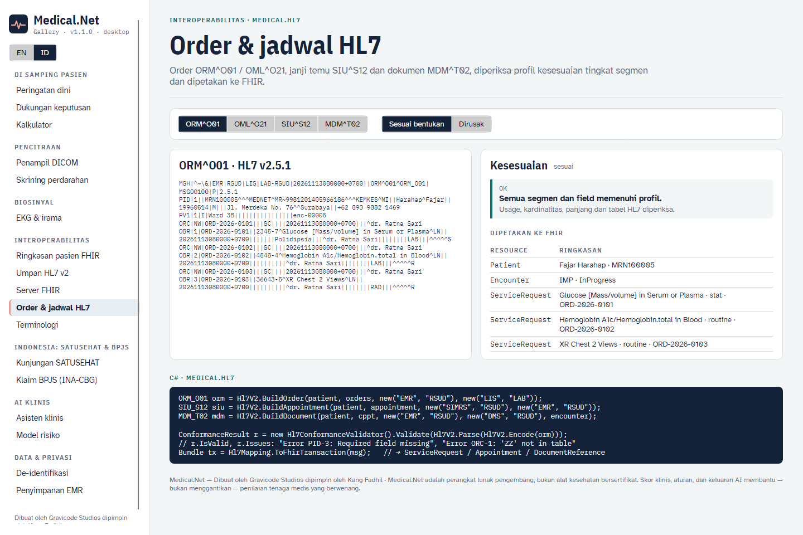 |
| 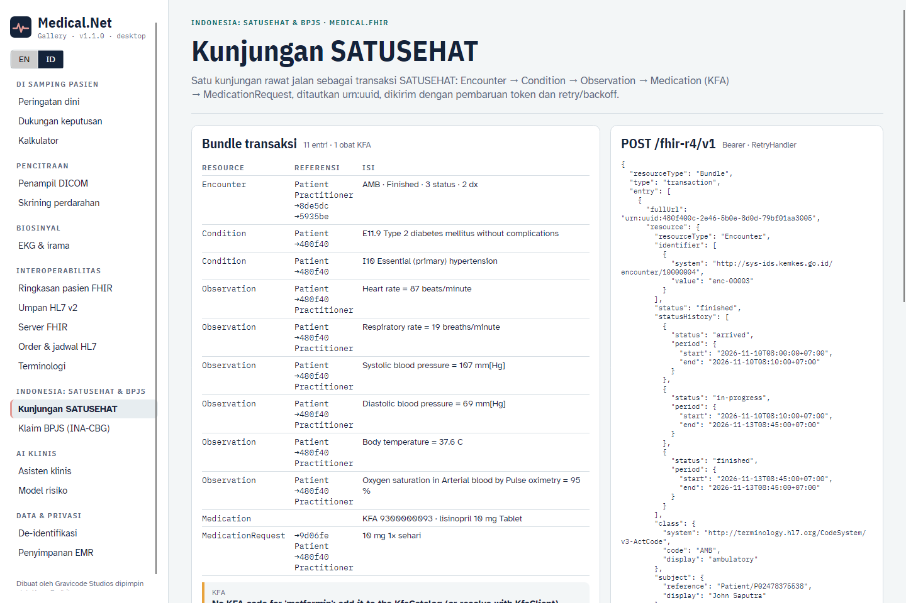 | 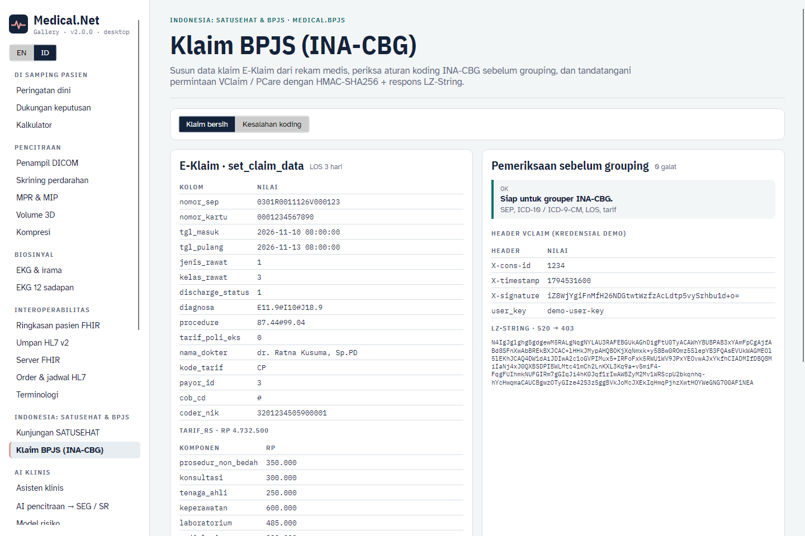 |

Tangkapan layar web dibuat dengan Chrome headless (`--screenshot`, `--blink-settings=preferredColorScheme=1` untuk mode terang, `--force-prefers-reduced-motion` agar animasi EKG sudah selesai).

## Baru di 1.2

| Perintah | Contoh |
|---|---|
| Kompresi DICOM | `medical dicom transcode in.dcm out.dcm --ts jpegls|j2k|j2k-lossy|htj2k|rle|none` |
| MPR / MIP | `medical dicom mpr ct --plane coronal` · `medical dicom mip ct --slab 30 --mode max|min|mean` |
| Mesh 3D | `medical dicom mesh ct --iso 300 --out tengkorak.stl` |
| AI → SEG + SR | `medical dicom ai ct --out-dir hasil` |
| EKG 12 sadapan | `medical ecg12 --pattern inferior --out ekg.svg|.dcm|.scp --lang id` · `medical ecg12 analyze ekg.scp --sex f --age 50` |

Galeri v1.2 menambahkan **MPR & MIP**, **Volume 3D** (ThreeNet / three.js), **Kompresi**, **EKG 12 sadapan** dan **AI pencitraan → SEG / SR**.

| | |
|---|---|
| 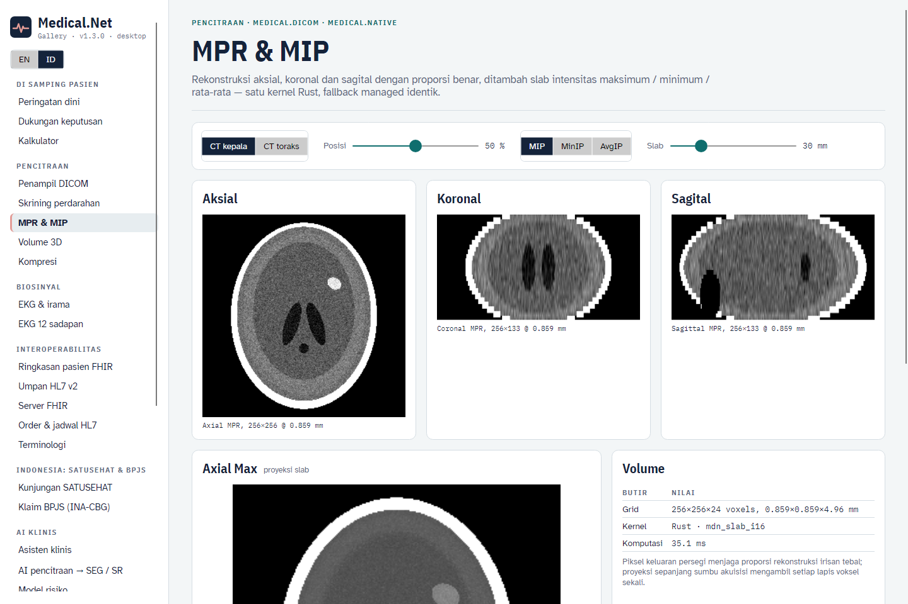 | 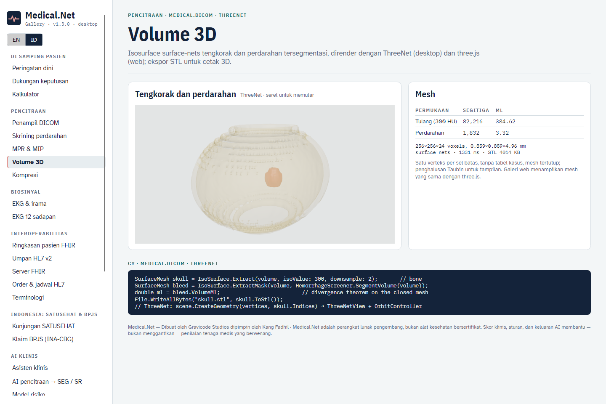 |
| 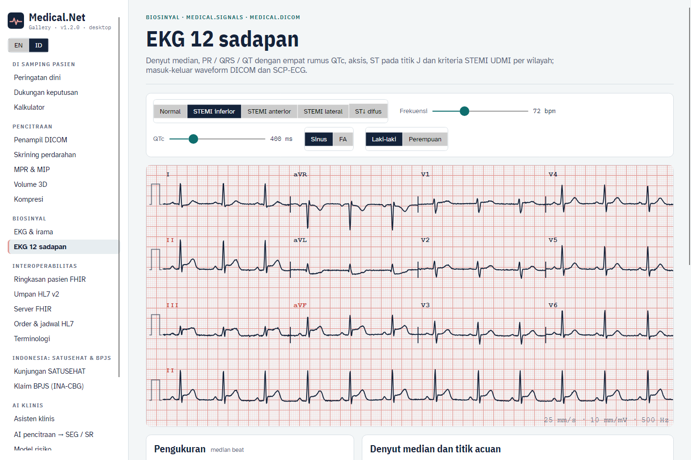 | 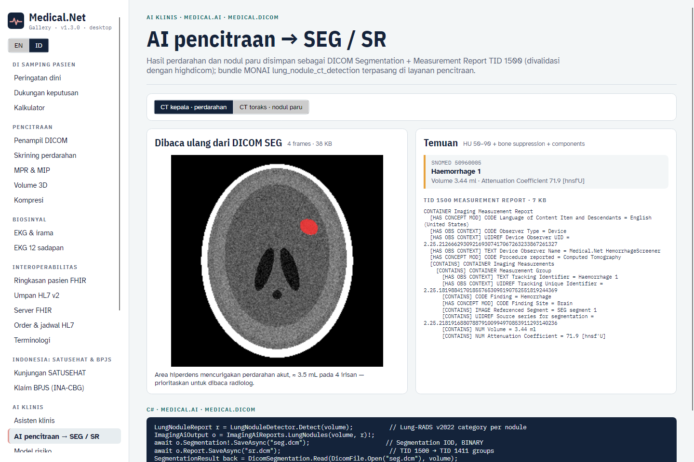 |

**Validasi QT**: `tools/validation/qtdb_export.py` mengekspor segmen beranotasi PhysioNet QT Database, lalu `dotnet test --filter QtDatabaseAgreement` melaporkan kesesuaiannya.

## Baru di 1.3

| Perintah | Contoh |
|---|---|
| Skor | `medical score sofa|apache2|pews|meows|wells-pe|wells-dvt|perc|child-pugh … --lang id` · `medical cvrisk --age 55 --sex m --tc 213 --hdl 50 --sbp 140` |
| Pertumbuhan WHO | `medical growth --sex f --age-months 24 --weight 9.0 --height 77.5 --lang id` (tabel WHO diunduh sekali) |
| Dosis & sumber obat | `medical renal rivaroxaban --crcl 28 --child-pugh B --lang id` · `medical interactions … --sources [--csv formularium.csv]` |
| NLP & pedoman | `medical nlp "<catatan>" --lang id [--hf]` · `medical guideline ask "<pertanyaan>" --lang id [--corpus pedoman/]` |
| Pembelajaran | `medical federated --noise 1.0 --clip 0.5 --card card.md` · `medical drift --shift 0.8` |

Galeri v1.3 berisi dua puluh sembilan kasus, termasuk **Skor ICU & obstetri**, **Risiko kardiovaskular**, **Pertumbuhan WHO**, **Keamanan obat & dosis**, **NLP klinis & pengodean**, **Jawaban pedoman** dan **Federated learning**. Templat memakai `--MedicalNetVersion` bawaan `1.3.0`.

| | |
|---|---|
| 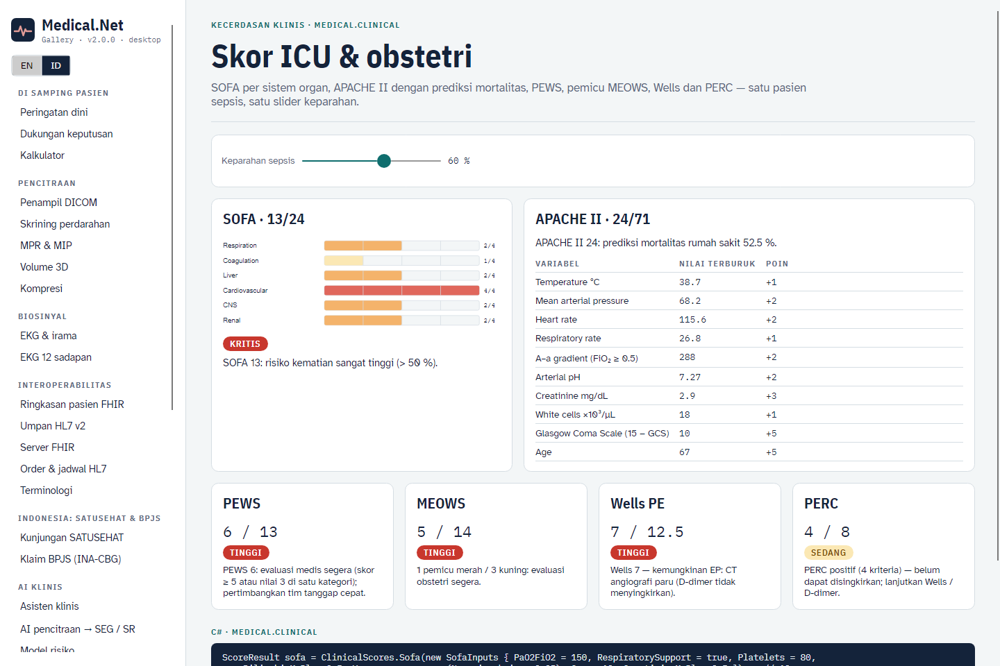 | 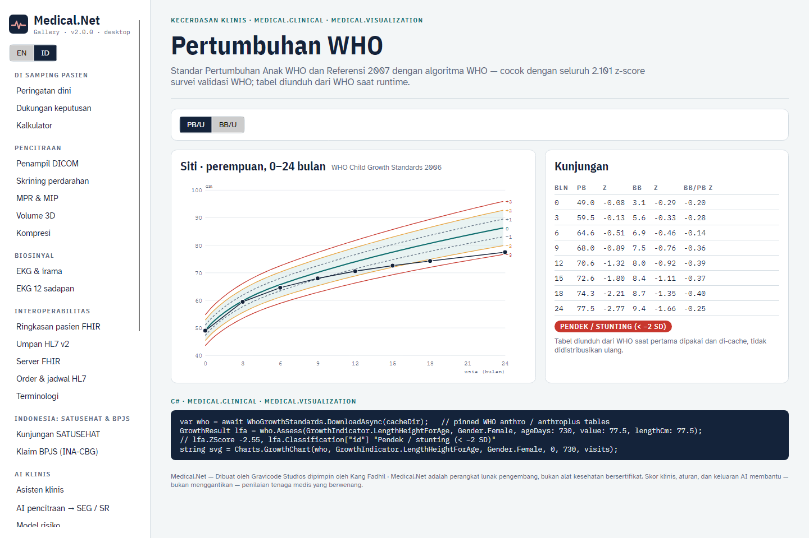 |
| 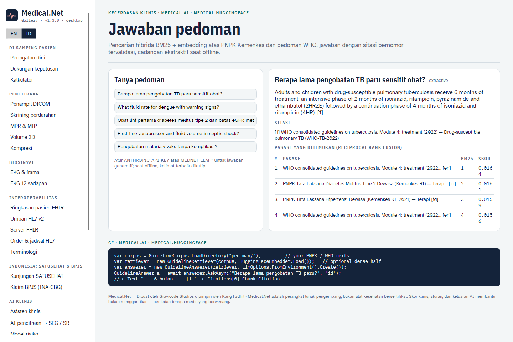 | 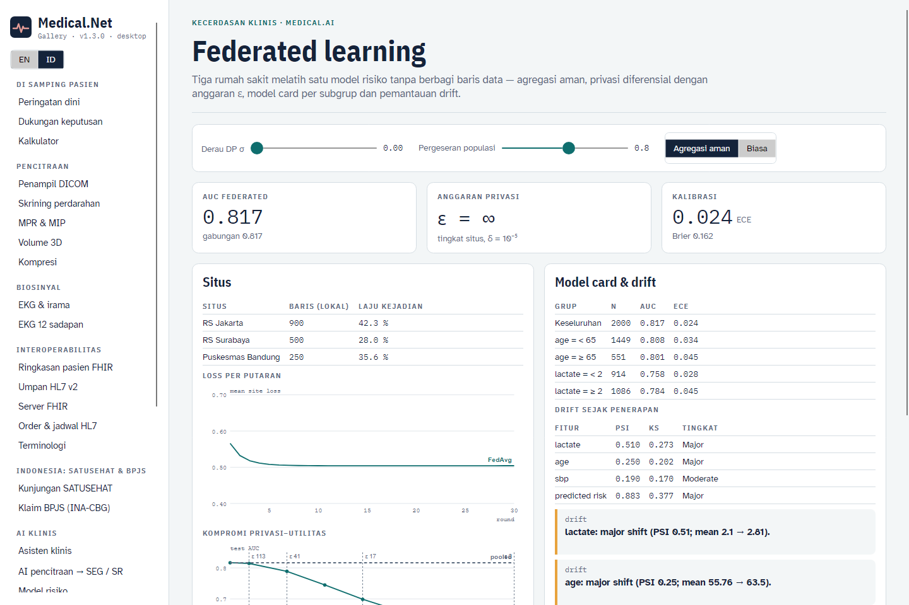 |

## Baru di 2.0

| Perintah | Contoh |
|---|---|
| SIMRS | `medical his seed [--db his.db] [--patients 40]` · `medical his dashboard [--db his.db] [--tenant rs-bahari] --lang id` · `medical his patient <no-rm> [--db his.db] [--tenant rs-nusantara] [--fhir ringkasan.json]` |
| Pemantauan | `medical monitor [--minutes 120] [--step 5] --lang id` (monitor ICU tersimulasi → HL7 / MLLP → peringatan NEWS2; kode keluar 3 bila ada peringatan High) |
| Sinkronisasi | `medical sync demo --lang id` (visite luring: dua tablet, konflik, konvergensi) |
| Worklist (v2.1) | `medical worklist serve [--port 11112] [--date 20261116]` (SCP Modality Worklist DICOM demo) · `medical worklist query <host> <port> [--modality CT] [--date 20261116[-20261120]] [--aet MEDICALNET-MWL] [--name "RAHAYU*"]` (C-FIND) |

Galeri kini berisi tiga puluh dua kasus. Kelompok baru **Platform rumah sakit** memuat **SIMRS multi-tenant**,
**Monitor pasien langsung** dan **Visite luring**. Templat memakai `--MedicalNetVersion` bawaan `2.0.0`.

| | |
|---|---|
| 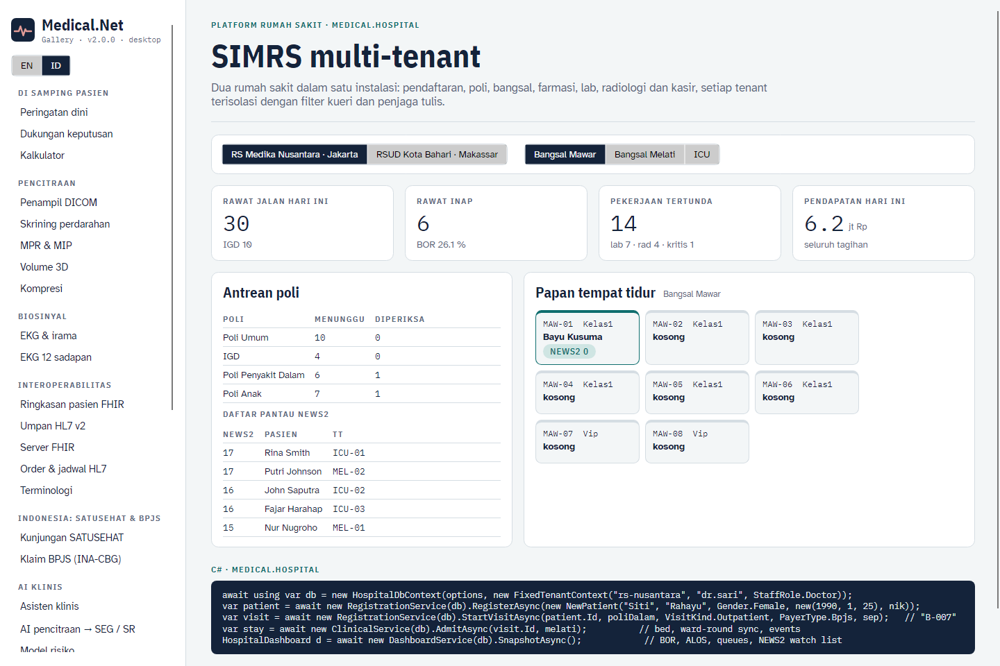 | 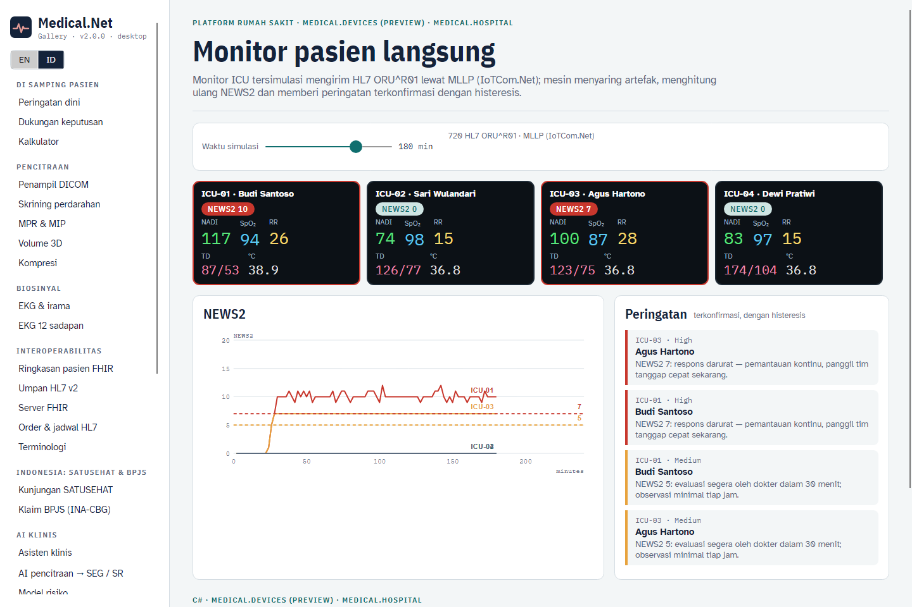 |
| 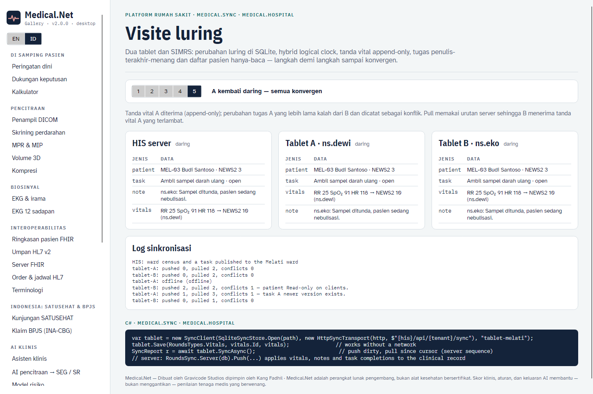 | 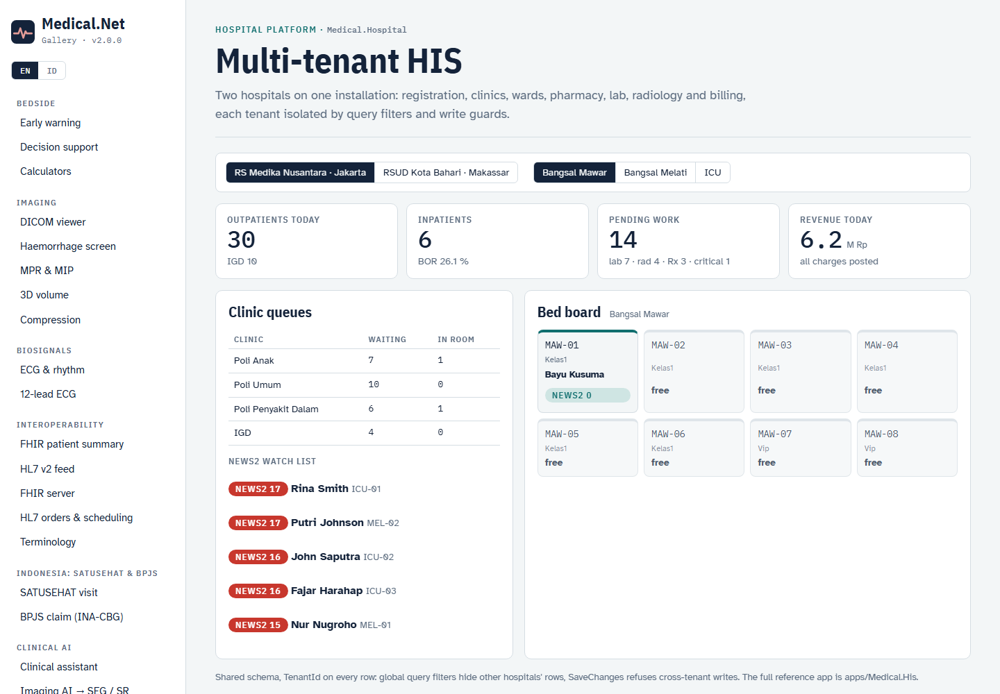 |

### Aplikasi rumah sakit

```bash
ASPNETCORE_ENVIRONMENT=Development dotnet run --project apps/Medical.His --urls http://localhost:5300
dotnet build Medical.Rounds.slnx                                          # MAUI; perlu workload maui-windows
dotnet run --project apps/Medical.Rounds -f net10.0-windows10.0.19041.0
```

Jalankan SIMRS dalam lingkungan Development, atau publish aplikasinya. Aset web statis tidak ditemukan bila file
executable di `bin` dijalankan dalam lingkungan Production. Konfigurasi, peran dan API dijelaskan di
[Platform rumah sakit](platform.md).

**Tangkapan layar SIMRS.** Dengan SIMRS berjalan, masuk melalui `/account/demo` di URL tangkapan layar. Gunakan
`--user-data-dir` baru untuk setiap tangkapan agar cookie dari pengguna, rumah sakit atau bahasa sebelumnya tidak
terpakai lagi:

```bash
chrome --headless=new --user-data-dir="$(mktemp -d)" --blink-settings=preferredColorScheme=1 --window-size=1440,1000 \
  --screenshot=docs/images/his-dashboard.png \
  "http://localhost:5300/account/demo?tenant=rs-nusantara&user=admin&lang=id&returnUrl=/rs-nusantara"
```

Gunakan `lang=en` dan akhiran `-en` untuk versi bahasa Inggris (`his-dashboard-en.png`), serta
`returnUrl=/rs-nusantara/monitoring`, `/registration`, `/pharmacy` dan seterusnya untuk halaman lain.

**Tangkapan layar visite.** Dengan SIMRS berjalan di `http://localhost:5300`, aplikasi MAUI menangkap layarnya sendiri
lalu keluar:

```bash
apps/Medical.Rounds/bin/Debug/net10.0-windows10.0.19041.0/win-x64/Medical.Rounds.exe --capture docs/images id   # rounds-ward-id.png, …
apps/Medical.Rounds/bin/Debug/net10.0-windows10.0.19041.0/win-x64/Medical.Rounds.exe --capture docs/images en   # rounds-ward.png, …
```

Saat menangkap layar, aplikasi mencatat tanda vital dan satu catatan pada pasien paling berat (hanya di penyimpanan
memori perangkat), lalu menulis `rounds-capture[-id].log` berisi hasil sinkronisasi.
