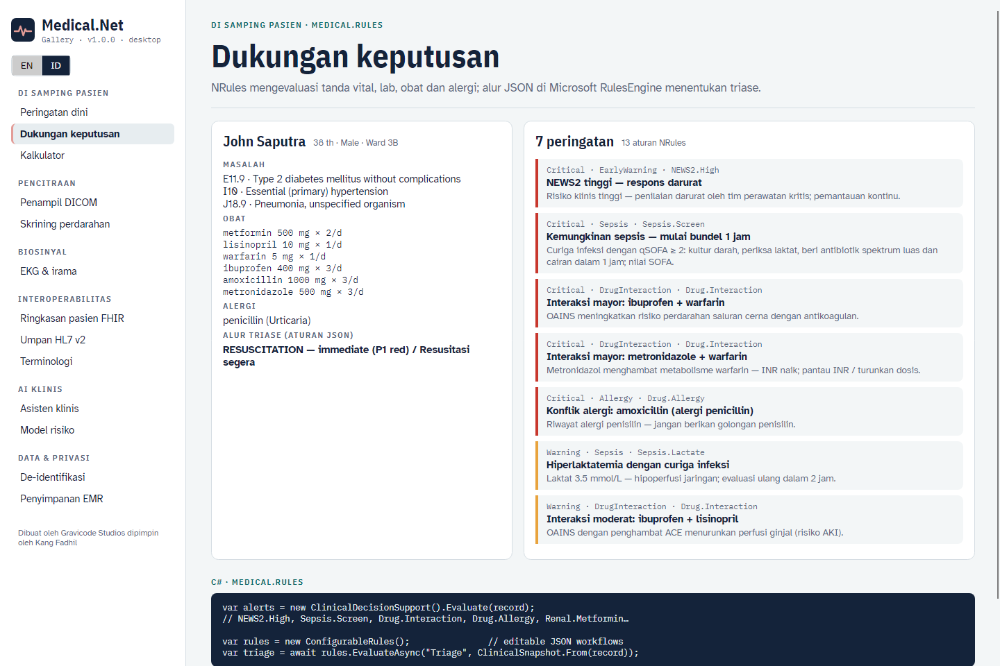
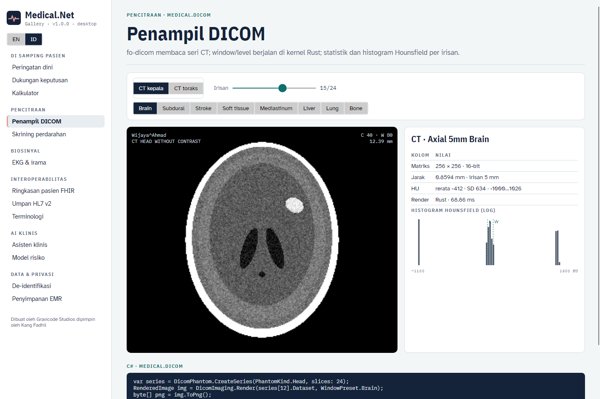
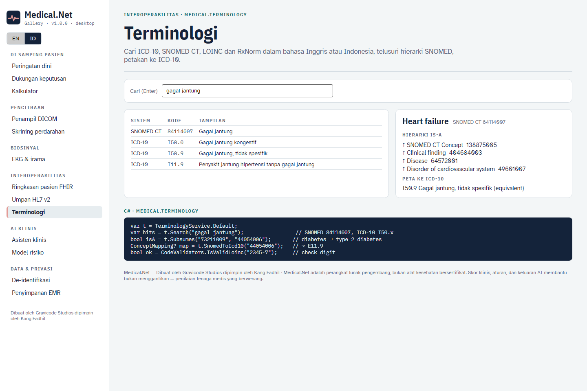

# Perkakas: CLI, templat, dan Galeri

## CLI `medical`

```bash
dotnet tool install -g Medical.Cli
medical help
```

| Perintah | Contoh |
|---|---|
| Skor | `medical news2 --rr 24 --spo2 93 --o2 --sbp 105 --hr 115 --temp 38.5 --lang id` · `medical qsofa --rr 22 --sbp 98 --altered` |
| Kalkulator | `medical egfr --cr 1.2 --age 60 --sex f` · `medical bmi --weight 70 --height 172` · `medical dose amoxicillin --weight 25` |
| Terminologi | `medical code search demam berdarah --lang id` · `medical code validate loinc 2345-7` · `medical code map 44054006` |
| Keamanan obat | `medical interactions warfarin ibuprofen --allergy penicillin --lang id` |
| FHIR / HL7 | `medical fhir ips --index 3 --out ips.json` · `medical hl7 sample --out oru.hl7` · `medical hl7 listen --port 2575` |
| DICOM | `medical dicom phantom --out ct` · `medical dicom render ct/IM015.dcm --window brain` · `medical dicom hemorrhage ct --lang id` |
| Lainnya | `medical ecg --rhythm af` · `medical deid "Ny. Siti, HP 0812…"` · `medical cds --lang id` · `medical risk` · `medical ask "…" --patient 7` · `medical emr seed` |

## Templat `dotnet new`

```bash
dotnet new install Medical.Templates
dotnet new medical-fhir-api -n RumahSakit.Api
```

| Templat | Hasil |
|---|---|
| `medical-console` | Aplikasi konsol: NEWS2, dukungan keputusan, daftar masalah dua bahasa, ekspor IPS |
| `medical-fhir-api` | Server FHIR ASP.NET Core + API klinis + listener MLLP, berisi pasien sintetis |
| `medical-hl7-gateway` | Worker service: MLLP → FHIR, peringatan CDS di log, opsi meneruskan ke server FHIR |
| `medical-blazor` | Papan bangsal Blazor diurutkan berdasarkan NEWS2 |
| `medical-avalonia` | Penampil DICOM Avalonia dengan preset jendela, statistik HU, skrining perdarahan |

## Galeri

Tiga belas kasus penggunaan di dua aplikasi yang berbagi `gallery/Medical.Gallery.Shared`:

```bash
dotnet run --project gallery/Medical.Gallery.Web --urls http://localhost:5290      # buka /?lang=id
dotnet run --project gallery/Medical.Gallery.Desktop
dotnet run --project gallery/Medical.Gallery.Desktop -- --screenshot docs/images id
```

| | |
|---|---|
|  |  |
|  |  |
