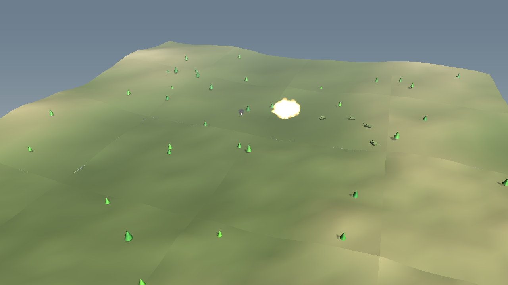
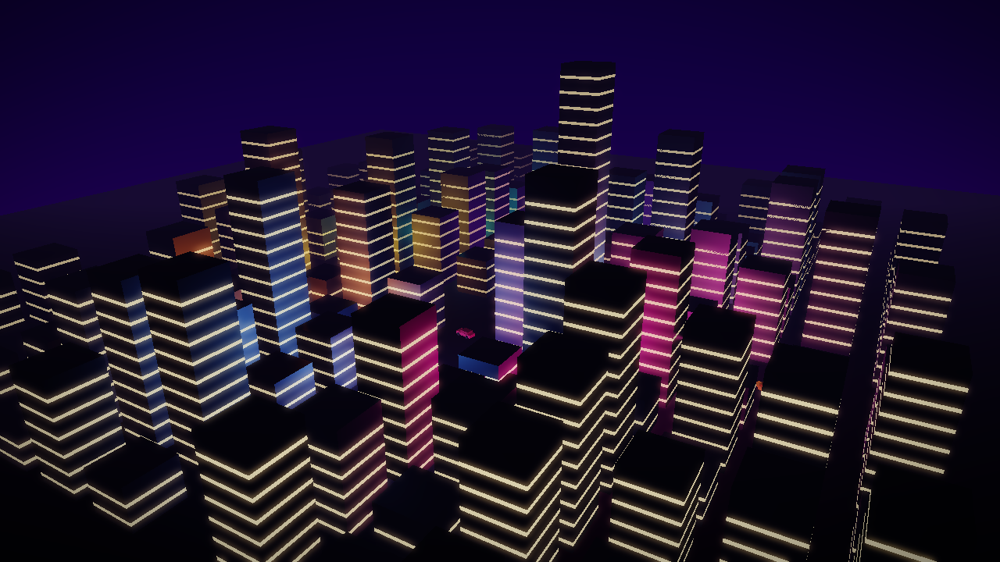
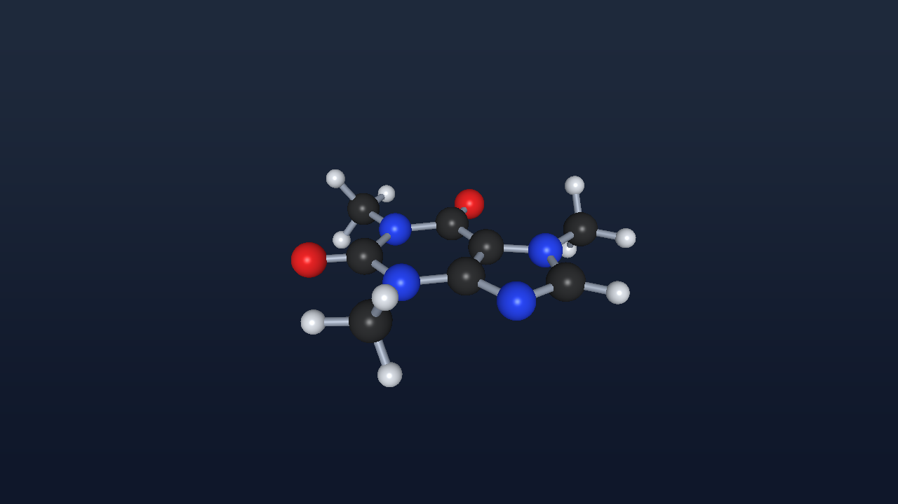
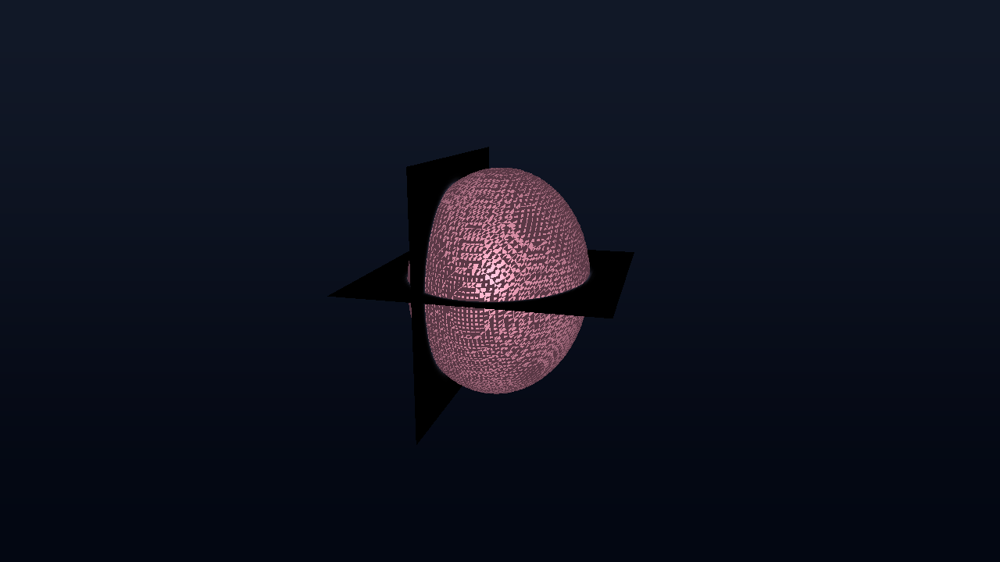
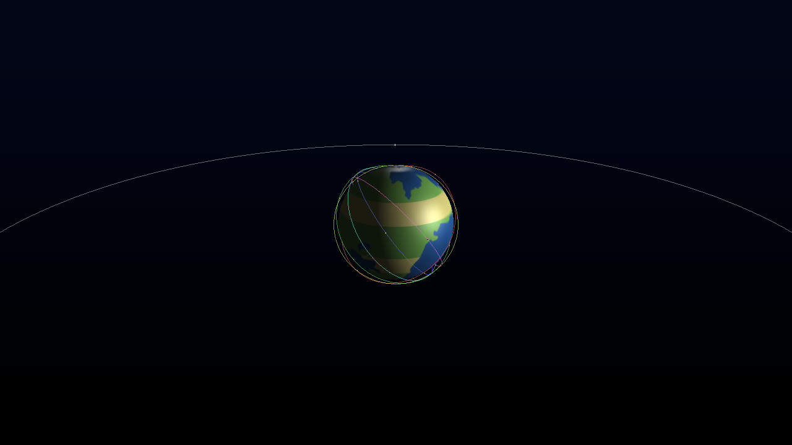
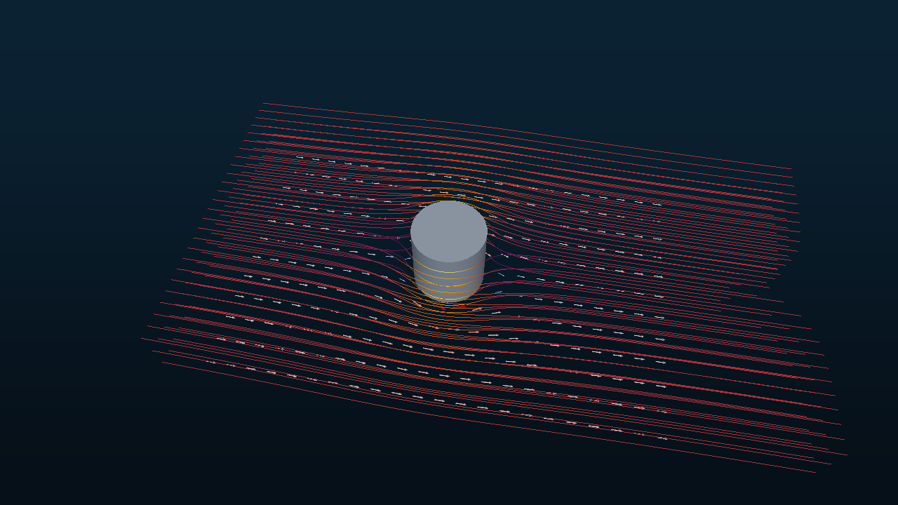
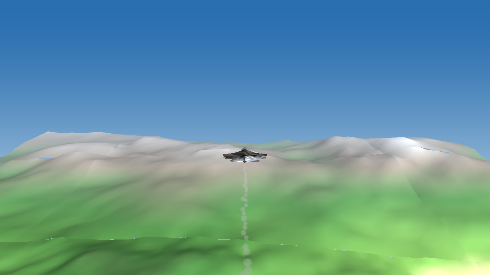
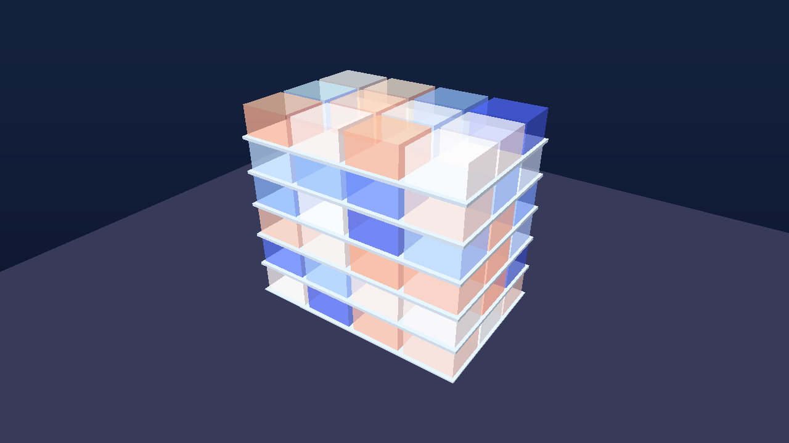

<p align="center"></p>

<h1 align="center">OpenSceneGraph.Net</h1>

<p align="center">
<b>A .NET 10 scene graph for OpenSceneGraph: managed core, native OSG 3.6.5 runtime, OpenGL / WebGL renderers, Avalonia and Blazor components.</b><br>
<i>Scene graph .NET 10 untuk OpenSceneGraph: inti managed, runtime OSG 3.6.5 native, renderer OpenGL / WebGL, komponen Avalonia dan Blazor.</i><br><br>
Created by <b>Gravicode Studios</b>, led by <b>Kang Fadhil</b> · Dibuat oleh <b>Gravicode Studios</b> dipimpin oleh <b>Kang Fadhil</b>
</p>

<p align="center"> </p>

**English** · [Bahasa Indonesia](#bahasa-indonesia) · [Documentation](docs/en/index.md) · [Dokumentasi](docs/id/index.md) · [Roadmap](PLAN.md) · [Progress](Progress.md)

## What it is

OpenSceneGraph.Net brings the [OpenSceneGraph](https://github.com/openscenegraph/OpenSceneGraph) programming model to .NET 10. It has two layers that work together:

| Layer | Package | What you get |
|---|---|---|
| **Managed scene graph** | `OpenSceneGraph.Net` | `Group`, `MatrixTransform`, `PositionAttitudeTransform`, `Switch`, `Lod`, `PagedLod`, `ProxyNode`, `StateSet` with OVERRIDE, NodeVisitors, CullVisitor (frustum, small-feature, cluster and occlusion culling), database pager, camera manipulators, animation (paths, keyframes, skeletons with skinning), particles, terrain and DEM readers, WGS84 / ECEF / UTM / map tiles, DIS (IEEE 1278.1) and vehicle models, and scientific visualisation (isosurfaces, streamlines, colormaps). It runs everywhere .NET runs, including the browser. |
| **Native OpenSceneGraph** | `OpenSceneGraph.Net.Native` | The real OSG 3.6.5 behind a C ABI shim. It reads and writes `.osg/.osgt/.osgb/.ive/.3ds/.flt/.dxf/.ac/.lwo/.x/.shp`… (53 plugins), opens `osgViewer` windows, renders offscreen, runs `osgUtil::Optimizer`, and converts between OSG and managed scenes. |

Rendering backends: `OpenSceneGraph.Net.Rendering.OpenGL` (desktop GL 3.3 / GLES 3 via ANGLE), `OpenSceneGraph.Net.Blazor` (WebGL2) and the native OSG viewer. The OpenGL and WebGL renderers share one set of GLSL shaders: Blinn-Phong with 8 lights, shadow maps, fog, point-sprite particles, render-to-texture, HUD cameras, and HDR/bloom/vignette. Custom GLSL programs and stereo are desktop-only for now.

Hot paths (normals, heightfields, batch culling, particles) have an optional **Rust** implementation (`native/osgnet-fast`, rayon-parallel) with identical managed fallbacks.

## Quick start

```bash
dotnet add package OpenSceneGraph.Net
dotnet add package OpenSceneGraph.Net.Avalonia      # desktop control  (or OpenSceneGraph.Net.Blazor for web)
dotnet add package OpenSceneGraph.Net.Native        # optional: native OSG formats + osgViewer (Windows x64)
```

```csharp
using System.Numerics;
using OpenSceneGraph.Net.Animation;
using OpenSceneGraph.Net.Meshes;
using OpenSceneGraph.Net.Scene;
using OpenSceneGraph.Net.State;

var root = new Group();
root.AddChild(Shapes.Plane(40, 40, 1, 1, Color.FromHex("#2b2d42")));
root.AddChild(new LightSource(Light.Sun(new Vector3(-0.4f, 0.5f, -0.8f))));

var spinner = new PositionAttitudeTransform { Position = new Vector3(0, 0, 2) };
spinner.AddChild(Shapes.Torus(2, 0.6f, 64, 24, Color.FromHex("#4cc9f0")));
spinner.AddUpdateCallback(new SpinCallback(Vector3.UnitZ, 45));
root.AddChild(spinner);

// Avalonia:  <osg:OsgView x:Name="View"/>   View.Scene = root;
// Blazor:    <div style="height:600px"><OsgCanvas Scene="root" /></div>
// Native:    using var v = NativeViewer.CreateWindow(); v.SetScene(root); v.Run();
```

Templates and CLI:

```bash
dotnet new install OpenSceneGraph.Net.Templates
dotnet new osgnet-avalonia -o MyDesktop3D     # also: osgnet-console, osgnet-blazor
dotnet tool install -g OpenSceneGraph.Net.Cli
osgnet info                                    # runtime, plugins, acceleration
osgnet convert tank.3ds tank.osgb              # any OSG format
osgnet render sample:molecule molecule.png     # offscreen render
osgnet terrain dem.osgn --dem srtm.tif         # DEM to tiled LOD terrain
```

## Gallery, Simulator and tools

- **OpenSceneGraph.Net Gallery**: 22 use cases (defense, academic, science, medical, office, games, simulators, GIS), each with live telemetry and source code. Ships as a Blazor WebAssembly app (`src/OpenSceneGraph.Net.Gallery.Blazor`) and an Avalonia desktop app (`src/OpenSceneGraph.Net.Gallery.Avalonia`).
- **OpenSceneGraph.Net Simulator**: an Avalonia training simulator with aircraft, UAV, ground vehicle and ship. It has a HUD, a minimap, missions and DIS output (`src/OpenSceneGraph.Net.Simulator`).
- **osgnet CLI**: inspect, convert, optimize, view, render, terrain, DIS listen/send, geo conversions.
- **Templates**: `osgnet-console`, `osgnet-avalonia`, `osgnet-blazor`.
- **3D assets**: hero models generated with Rodin, then cleaned up headlessly in Blender (`tools/blender/glb_to_obj.py`: orient, scale, decimate, bake out the base-colour texture).

| | | |
|---|---|---|
|  |  |  |
|  |  |  |

## Build from source

```powershell
dotnet build OpenSceneGraph.Net.slnx
dotnet test tests/OpenSceneGraph.Net.Tests
# native pieces (optional, Windows x64, needs Visual Studio C++ + Rust):
powershell -File native/build-osg.ps1       # builds OpenSceneGraph 3.6.5 (~20 min)
powershell -File native/build-osgnet.ps1    # builds the C shim and stages runtimes/win-x64
cargo build --release --manifest-path native/osgnet-fast/Cargo.toml
```

See [docs/en/getting-started.md](docs/en/getting-started.md) for details.

## License

MIT. OpenSceneGraph itself is under the OpenSceneGraph Public License (LGPL-based); the native package redistributes its unmodified 3.6.5 binaries.

---

## Bahasa Indonesia

OpenSceneGraph.Net membawa model pemrograman [OpenSceneGraph](https://github.com/openscenegraph/OpenSceneGraph) ke .NET 10 dalam dua lapisan yang saling melengkapi:

| Lapisan | Paket | Isi |
|---|---|---|
| **Scene graph managed** | `OpenSceneGraph.Net` | `Group`, `MatrixTransform`, `PositionAttitudeTransform`, `Switch`, `Lod`, `PagedLod`, `ProxyNode`, `StateSet` dengan OVERRIDE, NodeVisitor, CullVisitor (frustum, small-feature, cluster, occlusion culling), database pager, manipulator kamera, animasi (path, keyframe, skeleton dengan skinning), partikel, terrain dan pembaca DEM, WGS84 / ECEF / UTM / tile peta, DIS (IEEE 1278.1) dan model kendaraan, serta visualisasi ilmiah (isosurface, streamline, colormap). Berjalan di mana pun .NET berjalan, termasuk di browser. |
| **OpenSceneGraph native** | `OpenSceneGraph.Net.Native` | OSG 3.6.5 asli melalui shim C ABI. Membaca dan menulis `.osg/.osgt/.osgb/.ive/.3ds/.flt/.dxf/.ac/.lwo/.x/.shp`… (53 plugin), membuka jendela `osgViewer`, merender offscreen, menjalankan `osgUtil::Optimizer`, dan mengonversi antara scene OSG dan managed. |

Backend render: OpenGL desktop (Avalonia), WebGL2 (Blazor), dan viewer OSG native. Renderer OpenGL dan WebGL memakai satu set shader GLSL yang sama: 8 lampu, shadow map, kabut, partikel point sprite, render-to-texture, kamera HUD, dan HDR/bloom. Program GLSL kustom dan stereo saat ini hanya untuk desktop. Jalur kritis performa (normal, heightfield, culling batch, partikel) memiliki implementasi **Rust** opsional dengan fallback managed yang identik.

### Mulai cepat

```bash
dotnet add package OpenSceneGraph.Net
dotnet add package OpenSceneGraph.Net.Avalonia   # kontrol desktop (atau OpenSceneGraph.Net.Blazor untuk web)
dotnet new install OpenSceneGraph.Net.Templates
dotnet new osgnet-blazor -o Web3DSaya
```

Contoh kode sama dengan bagian bahasa Inggris di atas. Panduan lengkap ada di [docs/id/index.md](docs/id/index.md).

### Galeri, Simulator, dan alat bantu

- **OpenSceneGraph.Net Gallery**: 22 contoh penggunaan (pertahanan, akademik, sains, medis, perkantoran, game, simulator, GIS), masing-masing dengan telemetri langsung dan kode sumber, untuk web (Blazor) dan desktop (Avalonia).
- **OpenSceneGraph.Net Simulator**: simulator latihan pesawat, UAV, kendaraan darat, dan kapal, lengkap dengan HUD, minimap, misi, dan keluaran DIS.
- **CLI osgnet** dan **template `dotnet new`** untuk konsol, Avalonia, dan Blazor.
- **Aset 3D** dibuat dengan Rodin lalu dirapikan di Blender secara headless.

Lisensi MIT. Dibuat oleh **Gravicode Studios** dipimpin oleh **Kang Fadhil**.
