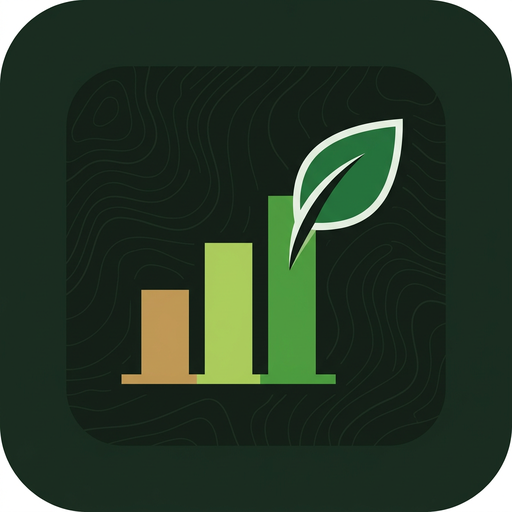
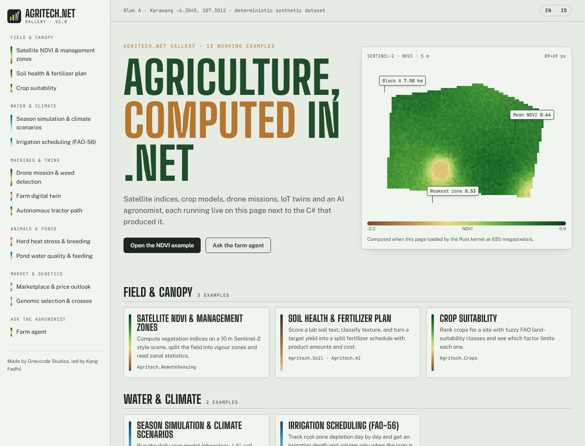
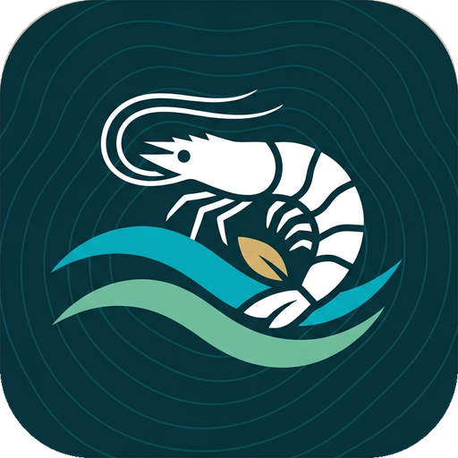
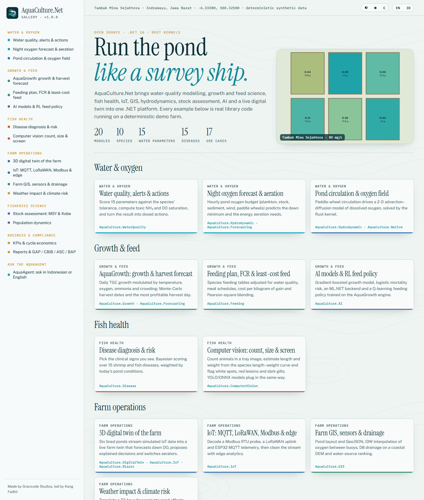
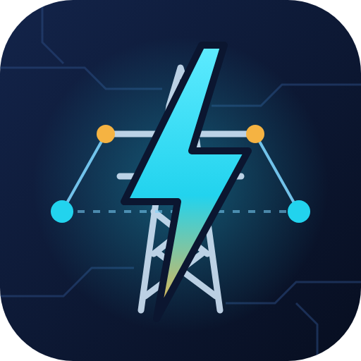
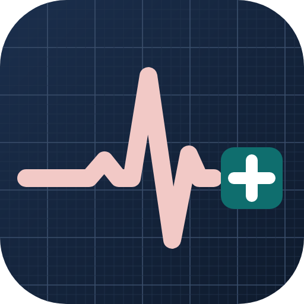
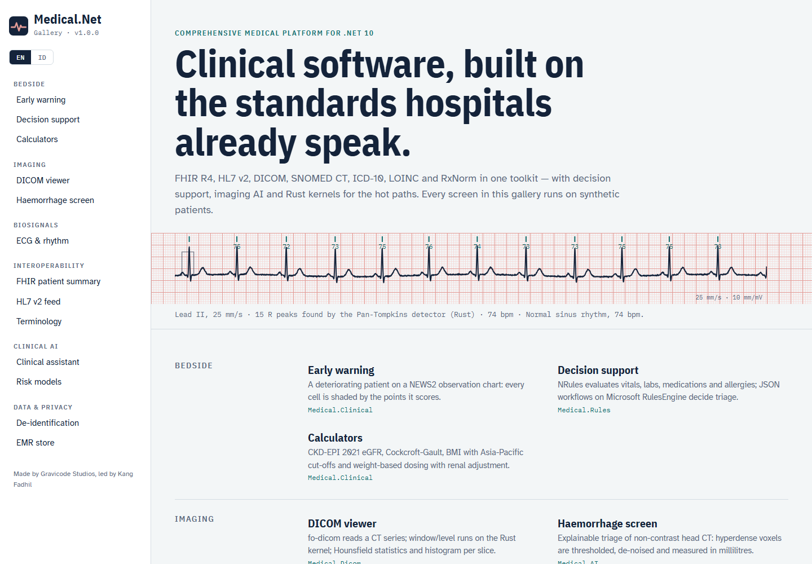

# Vibe_Components

Collection of Vibed Components: open-source .NET 10 frameworks and UI components by **Gravicode Studios**, led by **Kang Fadhil**.
Each component is a self-contained folder with its own solution, docs (English and Bahasa Indonesia), gallery apps and CI workflow.

*Kumpulan komponen .NET 10 open-source dari Gravicode Studios dipimpin oleh Kang Fadhil. Setiap komponen memiliki solusi, dokumentasi (Inggris & Indonesia), aplikasi galeri, dan workflow CI sendiri.*

## Components

| Component | Description | NuGet | CI |
|---|---|---|---|
| [**Agritech.Net**](Agritech.Net) | The ultimate open-source agriculture technology framework for .NET: crops, soil, weather, GIS, remote sensing (NDVI), drones, IoT/LoRaWAN, AI farm agent, crop simulation, genomics, livestock, fisheries, robotics, supply chain, marketplace and farm digital twin. Rust kernels, Blazor and Avalonia gallery, CLI and templates. | [`Agritech.*`](https://www.nuget.org/packages?q=Agritech) · 1.0.0 | [](https://github.com/DotNetVibeCoderz/Vibe_Components/actions/workflows/agritech-net.yml) |
| [**AquaCulture.Net**](AquaCulture.Net) | The ultimate open-source aquaculture platform for .NET: species database, water quality (WQI, NH₃, alerts, dosed actions), AquaGrowth engine, feeding and FCR, disease diagnosis, stock assessment (MSY, Kobe, YPR), population dynamics, hydrodynamics and pond oxygen budget, IoT (MQTT, LoRaWAN, Modbus), GIS, AI and LLM AquaAgent, computer vision, reporting (GAP/CBIB/ASC/BAP) and a 3D digital twin. Rust kernels, Blazor and Avalonia/ThreeNet gallery, CLI and templates. | [`AquaCulture.*`](https://www.nuget.org/packages?q=AquaCulture) · 1.0.0 | [](https://github.com/DotNetVibeCoderz/Vibe_Components/actions/workflows/aquaculture-net.yml) |
| [**Blazor.AI**](Blazor.AI) | AI components for Blazor: smart forms, copilots, cited document chat, agents, decision engines, RAG, local models, MediaPipe and 3D. | [`Blazor.AI.*`](https://www.nuget.org/packages?q=Blazor.AI) · 1.2.0 | [](https://github.com/DotNetVibeCoderz/Vibe_Components/actions/workflows/blazor-ai.yml) |
| [**Cesium.Net**](Cesium.Net) | CesiumJS for .NET: 3D globes, maps, terrain, 3D Tiles, time-dynamic data and geospatial analysis from C#, for Blazor and Avalonia. | [`Cesium.Net*`](https://www.nuget.org/packages?q=Cesium.Net) · 1.0.0 | [](https://github.com/DotNetVibeCoderz/Vibe_Components/actions/workflows/cesium-net.yml) |
| [**Electrical.Net**](Electrical.Net) | Comprehensive electrical engineering & power-system framework for .NET: sparse power flow (NR/FDLF/GS/DC/sweep), N-1, IEC 60909 short circuit, protection and arc flash, transient/small-signal/voltage stability, harmonics, renewables and hosting capacity, smart grid (reconfiguration, VVO, EV, microgrid, VPP), DC-OPF with LMPs and unit commitment, WLS state estimation, forecasting, QSTS, SCADA (Modbus, IEC 104), IEC 61850 GOOSE/SV, CIM, GIS, digital twin and an AI grid agent. Rust kernels, Blazor and Avalonia gallery, CLI and templates. | [`Electrical.*`](https://www.nuget.org/packages?q=Electrical.Core) · 1.0.0 | [](https://github.com/DotNetVibeCoderz/Vibe_Components/actions/workflows/electrical-net.yml) |
| [**GDAL.Net**](GDAL.Net) | GDAL for modern .NET: read, write, convert, reproject and analyse 200+ raster and vector formats, with Rust kernels and Blazor/Avalonia components. | [`Gravicode.GDAL.Net*`](https://www.nuget.org/packages?q=Gravicode.GDAL.Net) · 1.0.0 | [](https://github.com/DotNetVibeCoderz/Vibe_Components/actions/workflows/gdal-net.yml) |
| [**GnuRadio.Net**](GnuRadio.Net) | Software-defined radio and DSP for .NET modelled on GNU Radio: flowgraphs, filters, FFT, modulation, FEC, SDR hardware and live instruments. | [`GnuRadio.Net*`](https://www.nuget.org/packages?q=GnuRadio.Net) · 0.1.0 | [](https://github.com/DotNetVibeCoderz/Vibe_Components/actions/workflows/gnuradio-net.yml) |
| [**Medical.Net**](Medical.Net) | Comprehensive medical platform for .NET: FHIR R4 (Firely) with IPS and SATUSEHAT, HL7 v2 (NHapi) with MLLP, DICOM (fo-dicom) with DICOMweb and C-STORE, SNOMED CT / ICD-10 / LOINC / RxNorm, clinical scores, NRules decision support, EF Core EMR, de-identification, ECG/HRV, ML.NET risk models, a Claude-powered clinical assistant and CT haemorrhage screening (MONAI service). Rust kernels, Blazor and Avalonia gallery, CLI and templates. | [`Medical.*`](https://www.nuget.org/packages?q=Medical.Core) · 1.0.0 | [](https://github.com/DotNetVibeCoderz/Vibe_Components/actions/workflows/medical-net.yml) |
| [**OpenSceneGraph.Net**](OpenSceneGraph.Net) | .NET scene graph for OpenSceneGraph: managed core, native OSG 3.6.5 runtime, OpenGL/WebGL renderers, Avalonia and Blazor components. | [`OpenSceneGraph.Net*`](https://www.nuget.org/packages?q=OpenSceneGraph.Net) · 0.1.0 | [](https://github.com/DotNetVibeCoderz/Vibe_Components/actions/workflows/openscenegraph-net.yml) |

## Agritech.Net

<p align="center"></p>



```bash
dotnet add package Agritech.AI                 # crops, soil, weather and the AI farm agent
dotnet new install Agritech.Templates          # agritech-console / -blazor / -iot-edge / -avalonia
dotnet tool install -g Agritech.Cli            # agritech ask "Berapa dosis pupuk terbaik minggu ini?"
```

See the [Agritech.Net README](Agritech.Net/README.md) ([Bahasa Indonesia](Agritech.Net/README.id.md)) and its [documentation](Agritech.Net/docs/en/README.md).

## AquaCulture.Net

<p align="center"></p>



```bash
dotnet add package AquaCulture.AI              # water quality, growth, feeding, disease and the AquaAgent
dotnet new install AquaCulture.Templates       # aqua-console / -blazor / -iot-edge / -avalonia
dotnet tool install -g AquaCulture.Cli         # aqua ask "Berapa pakan udang hari ini?"
```

See the [AquaCulture.Net README](AquaCulture.Net/README.md) ([Bahasa Indonesia](AquaCulture.Net/README.id.md)) and its [documentation](AquaCulture.Net/docs/en/README.md).

## Electrical.Net

<p align="center"></p>


```bash
dotnet add package Electrical.PowerFlow        # network model, Newton–Raphson power flow, N-1, PTDF/LODF
dotnet new install Electrical.Templates        # eln-console / -blazor / -avalonia / -scada / -webapi
dotnet tool install -g Electrical.Cli          # eln ask "Berapa arus hubung singkat di bus 4?"
```

See the [Electrical.Net README](Electrical.Net/README.md) ([Bahasa Indonesia](Electrical.Net/README.id.md)) and its [documentation](Electrical.Net/docs/en/README.md).

## Medical.Net

<p align="center"></p>



```bash
dotnet add package Medical.Rules               # clinical scores, terminology and decision support
dotnet new install Medical.Templates           # medical-console / -fhir-api / -hl7-gateway / -blazor / -avalonia
dotnet tool install -g Medical.Cli             # medical news2 --rr 24 --spo2 93 --o2 --sbp 105 --hr 115 --temp 38.5 --lang id
```

See the [Medical.Net README](Medical.Net/README.md) ([Bahasa Indonesia](Medical.Net/README.id.md)) and its [documentation](Medical.Net/docs/en/README.md).

## Repository conventions

- One folder per component, with its own `.slnx`, `CLAUDE.md`, `PLAN.md` (roadmap) and `Progress.md` (tracking).
- One workflow per component in `.github/workflows/<component>.yml`. CI runs on changes under that folder.
- **Publishing to NuGet:** push a tag `<component>-vX.Y.Z` (for example `agritech-net-v1.0.1`) or run the workflow manually with *publish* ticked.
  It uses the `NUGET_API_KEY` repository secret.

## License

[MIT](LICENSE)
